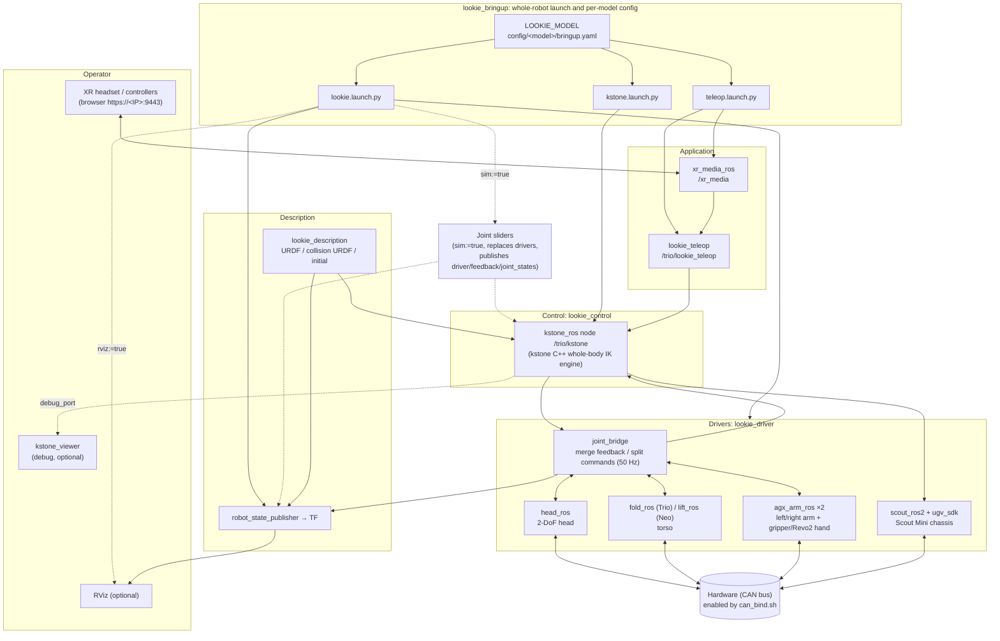
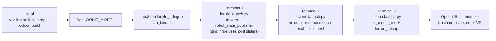
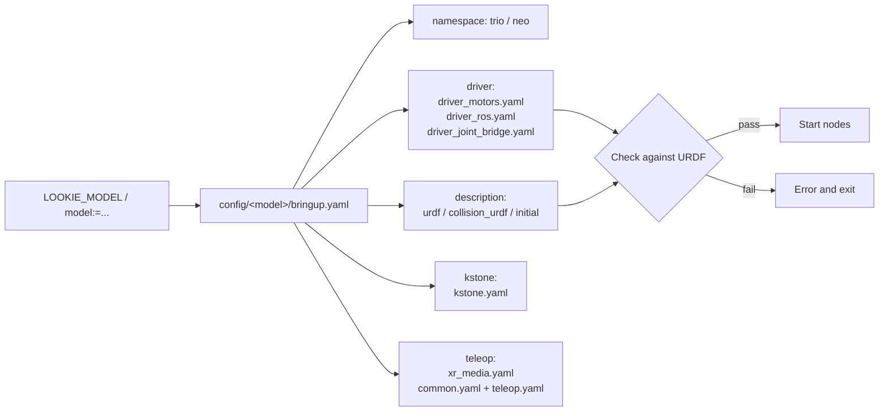
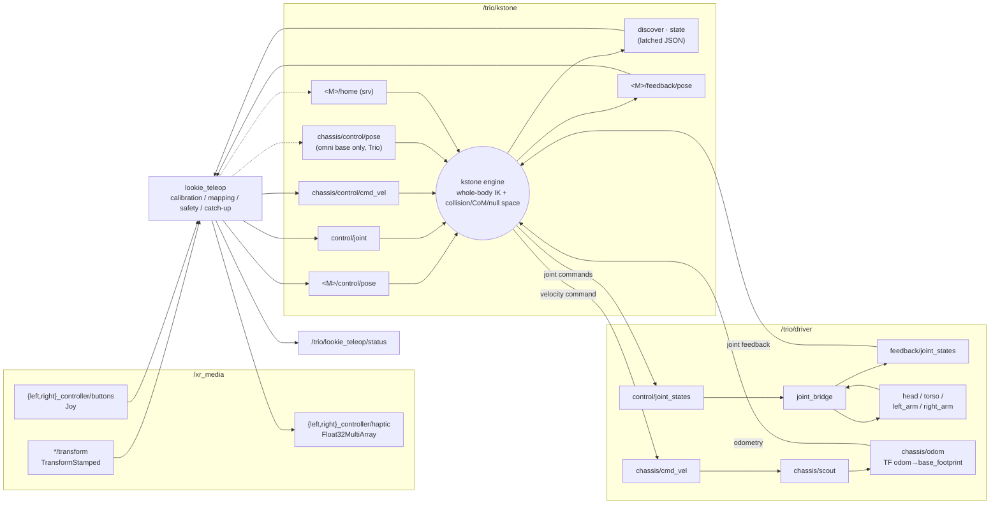
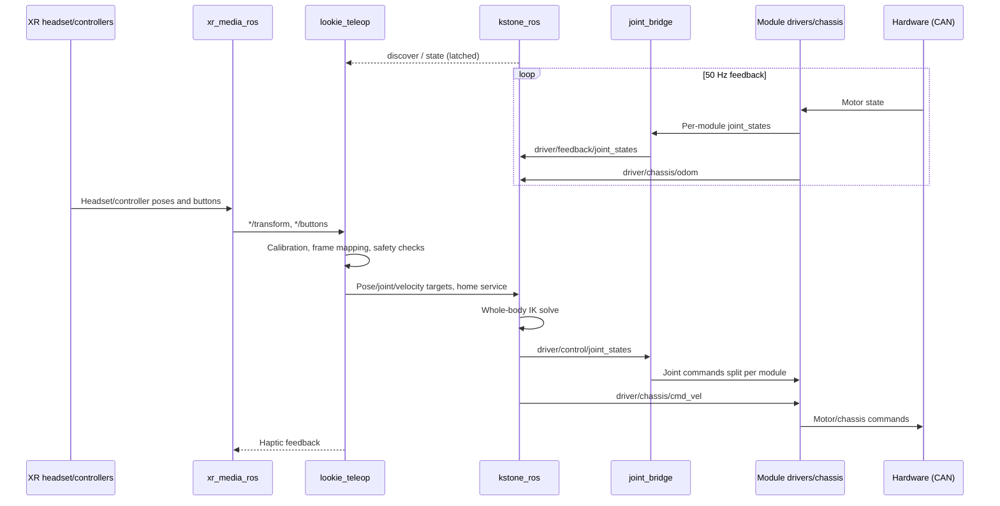
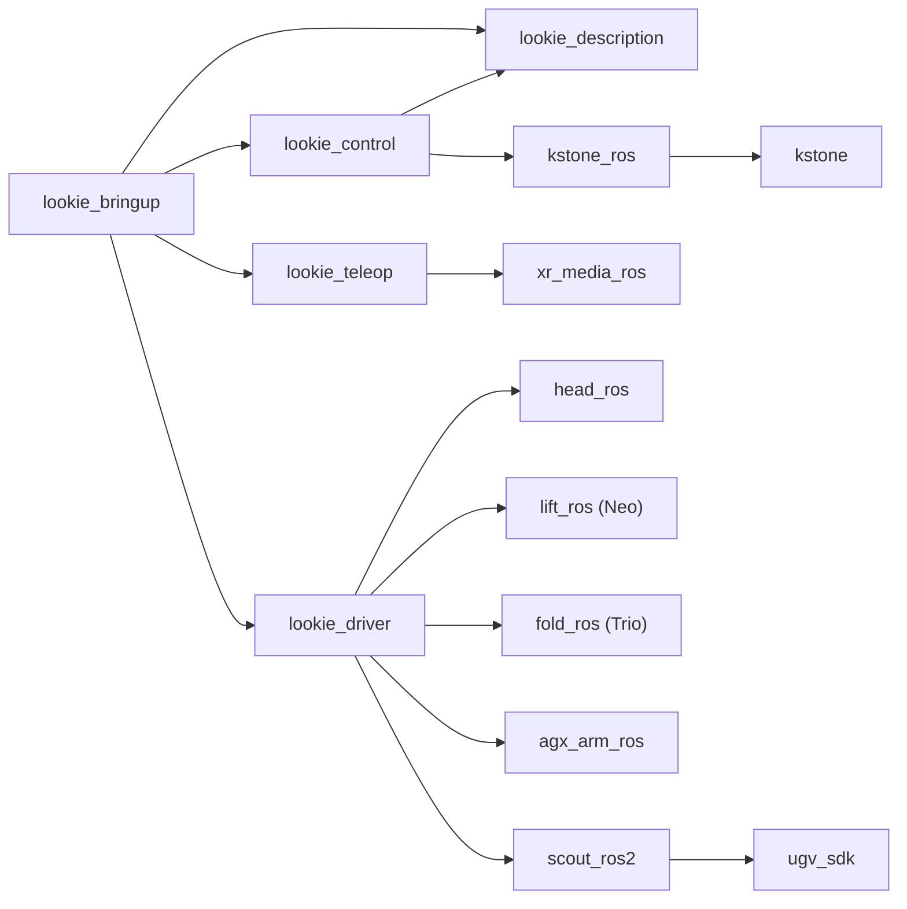
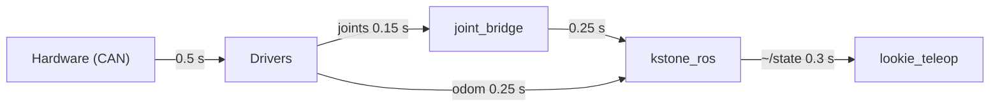

# lookie_ros Architecture

[中文](architecture.zh-CN.md)

How the lookie_ros packages, dependency repositories, launch flow and data flow fit together. Examples use the `trio` namespace; for Neo replace `/trio` with `/neo`.

## 1. Layered architecture

## 2. Launch flow

Before starting any node, each launch file reads `bringup.yaml`, resolves its `package://` and relative paths, and checks the driver config against the URDF:

## 3. Runtime data flow (ROS topics)

## 4. Control loop

## 5. Packages and dependency repositories

## 6. Feedback freshness and timeout chain

kstone sends commands to the drivers only while their feedback is fresh. Each layer judges freshness on its own; a timeout disables only the affected module or part, and the rest keeps running.

| Layer | Basis | On timeout |
|---|---|---|
| Drivers | Whether hardware data is still updating | Stop publishing that module's feedback |
| joint_bridge | Receipt time of each module's feedback | Leave the module out of the merged feedback |
| kstone | Stamp of each feedback group | Detach the group; re-attach automatically after it stays fresh for a while |
| lookie_teleop | Receipt time of `~/state` and the group states | Hold only the affected part; a `~/state` timeout disables teleop (see [teleop design §12](../lookie_teleop/docs/vr_teleop_dev_design.md)) |

- **Latency:** until a dropout is detected, the system runs on the last received data, for up to about 1 s.
- **Constraints:** the joint bridge timeout must not exceed kstone's (checked at startup, see [Regression checks](regression.md)); every timeout should be well above the matching publish period.
- **Observe:** `groups` and `fault` in `/trio/kstone/state`, `/trio/lookie_teleop/status`, and `feedback lost / recovered` in the driver logs.
- Simulation has no chassis odometry, so the `base` group is never fresh; this is expected.
