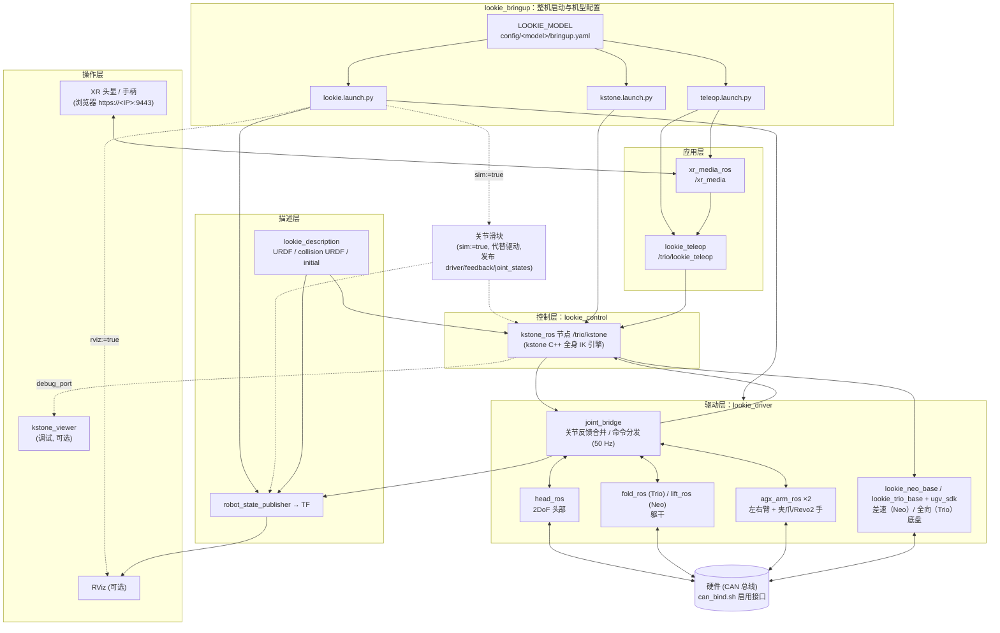
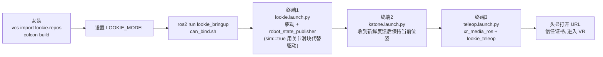
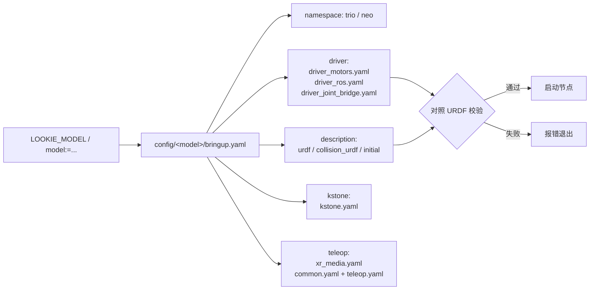
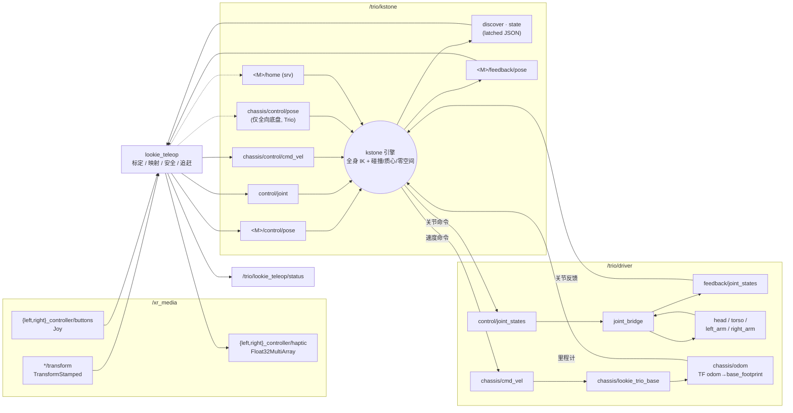
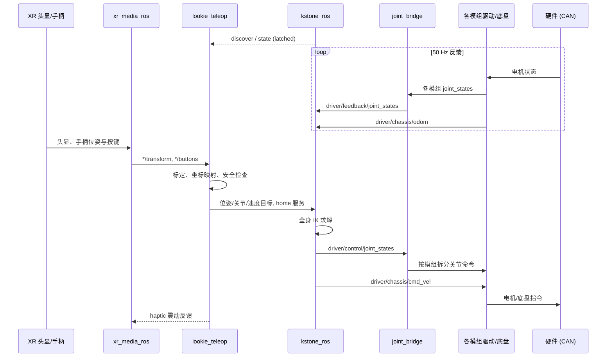
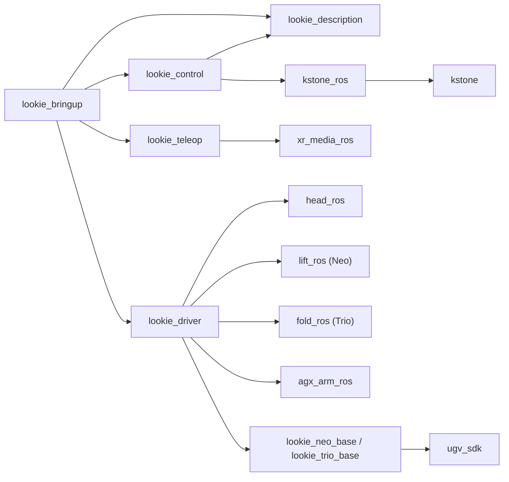
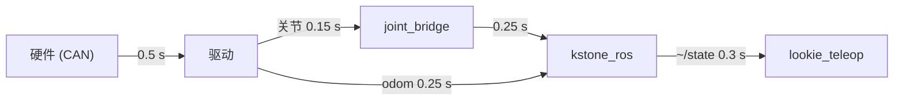

# lookie_ros 整体流程框架

[English](architecture.md)

本文以 `trio` 命名空间为例（Neo 机型将 `/trio` 换成 `/neo`），描述 lookie_ros 各功能包、依赖仓库、启动流程与数据流的关系。

## 1. 分层架构

## 2. 启动流程

每个 launch 启动前都会读取 `bringup.yaml`，解析其中的 `package://`/相对路径，并对照 URDF 校验驱动配置：

## 3. 运行时数据流（ROS 话题）

## 4. 控制闭环

## 5. 功能包与依赖仓库

## 6. 反馈新鲜度与超时链

kstone 只在反馈新鲜时才向驱动输出命令。新鲜度逐层判断，每层超时后只停用对应的模组或部位，其他部分照常运行。

| 层 | 判断依据 | 超时后 |
|---|---|---|
| 驱动 | 硬件数据是否仍在更新 | 停发该模组的反馈 |
| joint_bridge | 各模组反馈的接收时刻 | 合并反馈中去掉该模组 |
| kstone | 各反馈组的时间戳 | 该组脱离控制；重新新鲜一段时间后自动接入 |
| lookie_teleop | `~/state` 的接收时刻及各组状态 | 只停受影响的部位；`~/state` 超时则整体失能（见[遥操作设计 §12](../lookie_teleop/docs/vr_teleop_dev_design.zh-CN.md)） |

- **延迟：** 判定为掉线之前，系统按最后收到的数据运行，最长约 1 s。
- **约束：** 关节桥超时不大于 kstone 的超时（启动时检查，见[回归测试](regression.zh-CN.md)）；各级超时应明显大于对应的发布周期。
- **观察：** `/trio/kstone/state` 的 `groups`、`fault`，`/trio/lookie_teleop/status`，以及驱动日志中的 `feedback lost / recovered`。
- 仿真没有底盘里程计，`base` 组始终不新鲜，属预期。
