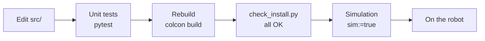

# Developer guide

[中文](development.zh-CN.md)

For developers changing lookie_ros code or configs: what to read first, where to change things and how to verify a change. To just run the robot, see the [README](../README.md).

## Reading order

| Order | Document | You should then know |
| --- | --- | --- |
| 1 | [README](../README.md) | What each of the three terminals starts, and the limits of simulation |
| 2 | [Architecture](architecture.md) | How the layers and topics connect and how the loop closes |
| 3 | [lookie_bringup](../lookie_bringup/README.md) | Model directories, `bringup.yaml`, namespaces and TF |
| 4 | [lookie_driver](../lookie_driver/README.md) | Module drivers and the joint bridge |
| 5 | [kstone_ros README](https://github.com/AgilexOpensource/kstone_ros) and its `docs/interfaces.md` | kstone modules, topics, feedback groups and homing |
| 6 | [VR teleop design](../lookie_teleop/docs/vr_teleop_dev_design.md) (start with the summary) | State machine and disable conditions; only needed to change teleop |

## Where to change things

The code has no list of models; every model-specific value lives in `lookie_bringup/config/<model>/`.

| Task | Where |
| --- | --- |
| Tune motors, CAN or driver parameters | `config/<model>/driver_motors.yaml`, `driver_ros.yaml` |
| Add or remove joints, change joint name mapping | `config/<model>/driver_joint_bridge.yaml`, checked against the `lookie_description` URDF |
| Tune whole-body control (limits, velocities, modules, collisions) | `config/<model>/kstone.yaml`, format in kstone_ros |
| Tune teleop feel | `config/lookie_teleop/common.yaml` (shared) or `config/<model>/teleop.yaml` (per model) |
| Add a model | Add the URDF to `lookie_description`, copy the closest `config/<model>/`, edit it and rebuild |
| Change the launch flow | `lookie_bringup/launch/`; shared logic in `lookie_bringup/lookie_bringup/` |
| Change teleop logic | `lookie_teleop/lookie_teleop/`: the pure-logic modules do not use rclpy; `node.py` only does I/O and scheduling |

## Workflow



1. **Unit tests**: run in `src/lookie_ros`. The tests import the source directly, so no build is needed first:

   ```bash
   python3 -m pytest lookie_bringup/test lookie_driver/test lookie_teleop/test
   ```

   The config tests check URDF coverage, topics and timeout rules for every model; run them after config changes too.

2. **Build and confirm the deployment**:

   ```bash
   cd <workspace> && python3 -m colcon build && source install/setup.bash
   python3 src/lookie_ros/scripts/check_install.py
   ```

   > **Important:** Without a rebuild, the robot runs the old code. When dependency repositories (kstone, kstone_ros, ...) change, pull and build them together; mixed versions can fail to start.

3. **Simulation**: `sim:=true` checks startup, config parsing and whether kstone attaches to feedback. It has no chassis odometry and kstone's commands do not reach the sliders, see the [README](../README.md#without-a-robot).

4. **On the robot**: follow the [regression checklist](regression.md#change-checklist).

> **Warning:** The drivers enable the motors as soon as they start, see the [README quick start](../README.md#quick-start).

## Debugging tools

Examples use `trio`; on Neo use `/neo`.

| To find out | Command |
| --- | --- |
| Whether kstone attached to feedback, and any fault | `ros2 topic echo /trio/kstone/state --qos-durability transient_local`; look at `joints_attached`, `groups`, `fault` |
| Which modules and interfaces kstone offers | `ros2 topic echo /trio/kstone/discover --qos-durability transient_local` |
| Whether joint feedback arrives | `ros2 topic hz /trio/driver/feedback/joint_states` |
| Teleop state and why it disabled | `ros2 topic echo /trio/lookie_teleop/status` |
| kstone targets, commands and solve quality | [kstone_viewer](../README.md#viewer) (`kstone.launch.py debug_port:=7311`) |
| Whether the install matches the source | `python3 src/lookie_ros/scripts/check_install.py` |

## Conventions

- Docs come in pairs (`*.md` and `*.zh-CN.md`); update both together.
- Each package's `.repos` file must copy entries of [lookie.repos](../lookie.repos); `test_repos.py` checks this.
- Python SDK versions: [requirements.txt](../requirements.txt) for development, [requirements.lock.txt](../requirements.lock.txt) for release, generated by `scripts/lock_python.py`; do not edit it by hand.
