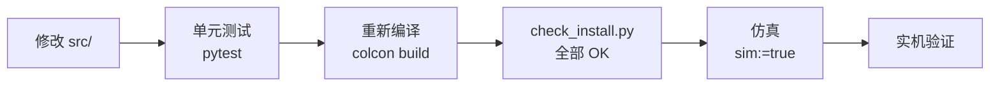

# 开发者入门

[English](development.md)

面向要修改 lookie_ros 代码或配置的开发者，说明按什么顺序阅读、改哪里、怎么验证。只使用机器人请看 [README](../README.zh-CN.md)。

## 阅读顺序

| 顺序 | 文档 | 读完应知道 |
| --- | --- | --- |
| 1 | [README](../README.zh-CN.md) | 三个终端分别启动什么，仿真的限制 |
| 2 | [架构](architecture.zh-CN.md) | 各层和话题怎样连接，数据怎样闭环 |
| 3 | [lookie_bringup](../lookie_bringup/README.zh-CN.md) | 机型目录、`bringup.yaml`、命名空间与 TF |
| 4 | [lookie_driver](../lookie_driver/README.zh-CN.md) | 各模组驱动与关节桥 |
| 5 | [kstone_ros README](https://github.com/AgilexOpensource/kstone_ros) 与其 `docs/interfaces.md` | kstone 的模块、话题、反馈组与 home |
| 6 | [VR 遥操作设计](../lookie_teleop/docs/vr_teleop_dev_design.zh-CN.md)（先读开头摘要） | 状态机与失能条件，只在改遥操作时需要 |

## 改哪里

代码中没有机型列表，机型相关的值都在 `lookie_bringup/config/<model>/` 中。

| 要做的事 | 修改位置 |
| --- | --- |
| 调电机、CAN、驱动参数 | `config/<model>/driver_motors.yaml`、`driver_ros.yaml` |
| 增减关节或改关节名映射 | `config/<model>/driver_joint_bridge.yaml`，并核对 `lookie_description` 的 URDF |
| 调全身控制（限位、速度、模块、碰撞） | `config/<model>/kstone.yaml`，格式见 kstone_ros |
| 调遥操作手感 | `config/lookie_teleop/common.yaml`（共用）或 `config/<model>/teleop.yaml`（机型相关） |
| 新增机型 | 把 URDF 加入 `lookie_description`，复制最接近的 `config/<model>/` 并修改，重新编译 |
| 改启动流程 | `lookie_bringup/launch/`，通用逻辑在 `lookie_bringup/lookie_bringup/` |
| 改遥操作逻辑 | `lookie_teleop/lookie_teleop/`：纯逻辑模块不依赖 rclpy，`node.py` 只负责收发和调度 |

## 开发流程



1. **单元测试**：在 `src/lookie_ros` 下运行，测试直接导入源码，不需要先编译：

   ```bash
   python3 -m pytest lookie_bringup/test lookie_driver/test lookie_teleop/test
   ```

   配置测试会对每个机型检查 URDF 覆盖、话题和超时约束；改了配置也要跑。

2. **编译并确认部署**：

   ```bash
   cd <工作空间> && python3 -m colcon build && source install/setup.bash
   python3 src/lookie_ros/scripts/check_install.py
   ```

   > **重要：** 不重新编译，机器人运行的就是旧代码。依赖仓库（kstone、kstone_ros 等）有更新时要一起拉取并编译，否则新旧版本混用可能直接启动失败。

3. **仿真**：`sim:=true` 可以验证启动、配置解析和 kstone 能否接入反馈，但没有底盘里程计，kstone 的命令也不会回到滑块，见 [README](../README.zh-CN.md#没有真机时)。

4. **实机**：按[回归检查](regression.zh-CN.md#改动验收清单)的清单验证。

> **警告：** 驱动启动即使能电机，见 [README 快速开始](../README.zh-CN.md#快速开始)。

## 调试工具

以 `trio` 为例，Neo 为 `/neo`。

| 想知道 | 命令 |
| --- | --- |
| kstone 是否接入反馈、有无故障 | `ros2 topic echo /trio/kstone/state --qos-durability transient_local`，看 `joints_attached`、`groups`、`fault` |
| kstone 有哪些模块和接口 | `ros2 topic echo /trio/kstone/discover --qos-durability transient_local` |
| 关节反馈是否到达 | `ros2 topic hz /trio/driver/feedback/joint_states` |
| 遥操作当前状态和失能原因 | `ros2 topic echo /trio/lookie_teleop/status` |
| kstone 的目标、命令与求解质量 | [kstone_viewer](../README.zh-CN.md#可视化工具)（`kstone.launch.py debug_port:=7311`） |
| install 是否与源码一致 | `python3 src/lookie_ros/scripts/check_install.py` |

某个部位不动或突然停住时，按[反馈新鲜度与超时链](architecture.zh-CN.md#6-反馈新鲜度与超时链)逐层排查。

## 约定

- 文档中英文成对维护（`*.md` 与 `*.zh-CN.md`），改一份时同步另一份。
- 各功能包的 `.repos` 文件必须与 [lookie.repos](../lookie.repos) 的条目一致，`test_repos.py` 会检查。
- Python SDK 的版本：开发用 [requirements.txt](../requirements.txt)，发布用 [requirements.lock.txt](../requirements.lock.txt)，由 `scripts/lock_python.py` 生成，不要手改。
