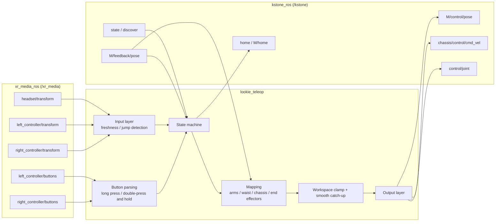
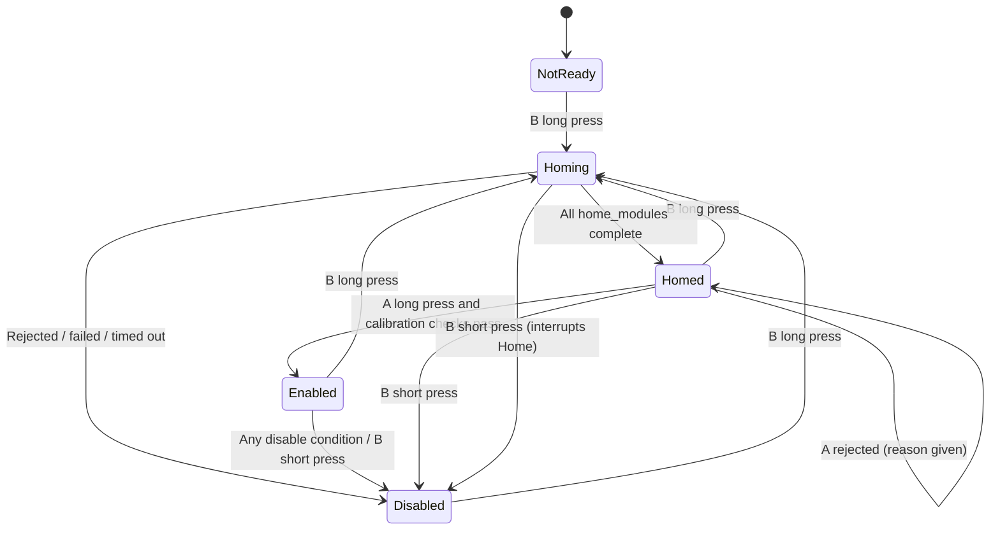
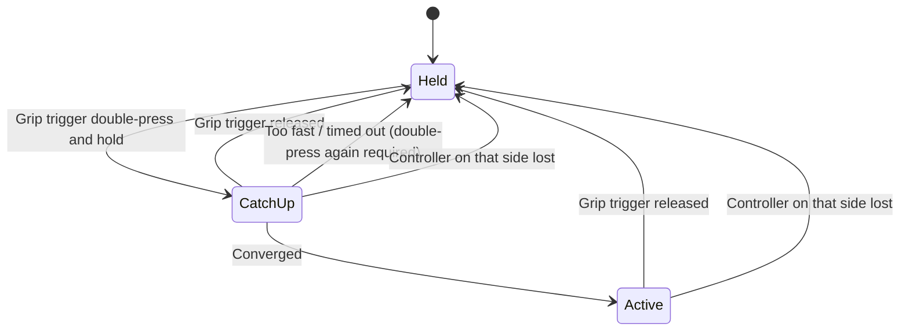
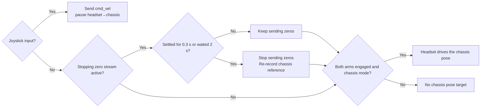
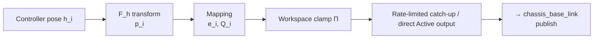
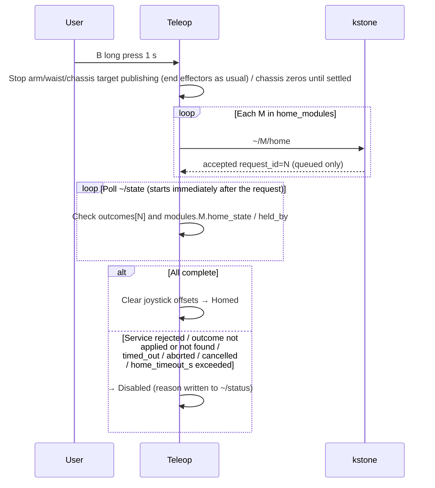

# VR whole-body teleoperation developer design

[中文](vr_teleop_dev_design.zh-CN.md)

> For developers: describes the interfaces, state machine, coordinate mapping, calibration checks, boundary constraints and safety policy of `lookie_teleop`.
> For operating steps, headset settings and troubleshooting see the [VR teleoperation quick start](vr_teleop_quickstart.md). All thresholds in this document are parameter defaults (`PARAMS` in `lookie_teleop/node.py`); the full list is in [§13](#13-parameters).

## Summary

- **What it does**: turns `xr_media_ros` headset and controller poses and buttons into `kstone_ros` pose targets for the arms, waist and chassis, and joint targets for the end effectors. It does no IK, no homing interpolation and no head control.
- **State machine** (§4): `NotReady →(long B) Homing → Homed →(long A, calibration) Enabled`. Inside Enabled each arm moves independently through `Held → CatchUp → Active`: a double-tap and hold on the side trigger takes over, releasing it stops the arm.
- **Safety principles** (§12):
  - Disabling only stops publishing: no power cut and no enable service call, so kstone holds the last target.
  - A headset jump, a kstone fault or a kstone timeout disables everything; a lost controller or a single module dropping out stops only that part.
  - A jump frame is never sent.
- **Read before changing code**: §2 interfaces, §4 state machine, §12 disable conditions; parameter defaults are in §13 and the code layout in §15.
- **Verify**: the pure-logic modules do not need rclpy, so run `python3 -m pytest lookie_teleop/test`; changes to the state machine or safety also need the on-robot checks in §16.

## 1. Scope and principles

| Item | Convention |
| --- | --- |
| Package | `lookie_teleop` |
| Motion control | Interfaces directly with `kstone_ros`; teleop only sends targets, calls services and reads state |
| VR | `xr_media_ros`; headset mounted on the chest (third person), left and right controllers |
| launch | Starts only the teleop node itself; does not bring up kstone / xr_media / simulation |
| Responsibility boundary | Head control, return-Home interpolation, end effector Home open/close positions and IK / whole-body solving are all **outside** teleop |

## 2. Architecture and interfaces



### 2.1 Subscriptions

The diagram shows the node's default direct interfaces. With `twist_mux` in the whole-robot launch, velocity goes to `lookie_teleop/cmd_vel` and reaches kstone through the mux; pose and joint targets remain direct. For namespaces and actual topics, see [lookie_bringup](../../lookie_bringup/README.md#vr-teleop).

| Topic | Type | Purpose |
| --- | --- | --- |
| `/xr_media/headset/transform` | `TransformStamped` (parent `world`) | Headset pose $H_t$ |
| `/xr_media/{left,right}_controller/transform` | `TransformStamped` | Controller pose $h_i$ |
| `/xr_media/{left,right}_controller/buttons` | `Joy` | axes `[stick_x, stick_y, trigger, grip]`; buttons `[trigger, grip, stick_click, X/A, Y/B]` |
| `/kstone/state` | `String` JSON, latched, 30 Hz | See the field table below |
| `/kstone/discover` | `String` JSON, latched | Modules, port topics and frames, `chassis_kinematics`, Home poses, end effector joint names and limits |
| `/kstone/{left_arm_pose,right_arm_pose,torso_pose,chassis}/feedback/pose` | `PoseStamped` | Current FK / chassis estimate (**not the target**) |

> xr_media_ros publishes transforms only while a device is tracked and has no separate tracking-valid field; teleop detects loss by a **timeout** on the local receive time (§12).

Fields used from `/kstone/state`:

| Field | Purpose |
| --- | --- |
| `fault` (non-empty means fault, latched), `fresh` | Motion control health check (§7.2, §12) |
| `outcomes[]` `{request_id, applied, error}` | Service request results; only `applied=true` counts as accepted (§11) |
| `modules.M.enabled` / `held_by` | Required modules are enabled; `held_by=null` means the module itself holds control |
| `modules.M.home_state` | `idle` / `waiting` / `executing` / `succeeded` / `timed_out` / `aborted` / `cancelled` (§11) |

> The `/kstone/state` timeout is evaluated on this node's receive time (`kstone_timeout_s`).

### 2.2 Publications

| Topic | Type | Content |
| --- | --- | --- |
| `/kstone/left_arm_pose/control/pose` | `PoseStamped`, frame `chassis_base_link` | Left arm end target (gripper `l_gripper_tip`, Revo2 hand `l_palm`) |
| `/kstone/right_arm_pose/control/pose` | Same as above | Right arm end target (`r_gripper_tip` / `r_palm`) |
| `/kstone/torso_pose/control/pose` | `PoseStamped`, frame `chassis_base_link` | Waist `chest_link` target |
| `/kstone/chassis/control/pose` | `PoseStamped`, frame `world_frame` | Headset-driven planar chassis pose target (omni x/y/yaw, differential forward/back/yaw) |
| `/kstone/chassis/control/cmd_vel` (default) | `Twist` | Joystick chassis velocity (omni x/y/yaw, differential x/yaw); `chassis_cmd_topic` can select a mux input instead |
| `/kstone/control/joint` | `JointState`, empty frame_id | End effector joint targets, plus waist joint targets when `torso_joints` is configured (§11) |
| `/xr_media/{left,right}_controller/haptic` | `Float32MultiArray` `[intensity, duration ms]` | Controller haptic confirmation (§5) |
| `~/status` | `String` JSON | Teleop state, rejection / disable reason, per-arm sub-states (UI / logging) |

Publishing rules:

- All commands with a header are stamped with **this node's `now()`**; XR timestamps are not reused. kstone_ros checks stamp continuity per command topic: regression or a difference greater than `command_timeout_s` between stamp progression and elapsed receipt time is rejected, not the stamp's absolute age against the node clock. See [kstone_ros interfaces](https://github.com/AgilexOpensource/kstone_ros/blob/main/docs/interfaces.md#node-parameters).
- Chassis `cmd_vel`: published with the main loop while a joystick commands it; after release, zeros continue until the measured pose settles for 0.3 s, or the 2 s wait expires, then publishing **stops**. Idle silence prevents continuous zeros from blocking another mux velocity source, but the stopping zero stream still owns that source while it lasts. Headset pose targets may be published alongside stopping zeros; inside kstone a fresh velocity command (including zero) outranks a pose target. Once the stream ends and its lease expires, continuously rewritten pose targets resume. The mux arbitrates velocity sources, not pose targets.

### 2.3 Service calls

| Service | Purpose |
| --- | --- |
| `/kstone/M/home` (`Trigger`) | Return Home individually for each module in `home_modules` (arm pose modules; configured joint modules for the Neo waist, §11; no end effectors) |
| `/kstone/home_cancel` (`Trigger`) | B short press during Homing: cancel every running Home in one call; each module stops smoothly where it is and holds there |
| ~~`/kstone/home`~~ | **Not used**: it homes the modules that "currently hold control"; the holder may be `*_arm_joint` / `torso_joint`, which would run the joint Home |
| ~~`/kstone/M/enable`~~ | **Not used**: disabling teleop only stops publishing commands and does not change the module enable state, so no extra action is needed on recovery |

The response `accepted request_id=N` **only means the request is queued**; completion is determined from `~/state`. Arms use pose-module Home, while the Neo waist uses its configured joint modules; subsequent targets go to the same controlling modules rather than being delayed by another module holding control.

## 3. Model profile

No model name is written in the node. The parameter `body_axes` (default: `chassis` / `waist_x` / `waist_z` / `waist_pitch` / `waist_yaw`) lists the axes the headset may drive, which is then intersected with discover: without a chassis `pose_target` port (`control/pose`) the `chassis` axis is removed automatically; when the `chassis_kinematics` is not omni (`omni`), joystick vy is set to 0 and the headset drives the chassis without sideways motion (§8.3); the joystick velocity is further clipped to the upper and lower limits of the chassis `velocity` port in discover. The `body_axes` of each model is given in the bringup configuration (`lookie_bringup/config/<model>/teleop.yaml`); the table below shows the resulting behaviour for the two models.

| Capability | trio (omni `omni`) | neo (differential `differential`) |
| --- | --- | --- |
| Headset → chassis | Yes: planar x/y/yaw (pose target) | Forward and yaw, no sideways (pose target), chassis mode |
| Headset → waist x (forward/backward) | Yes | No |
| Headset → waist Z | Yes | Yes (lean-compensated height; the arms cover the slow lift and the rest below its lower end) |
| Headset → waist pitch | Yes | Yes |
| Headset → waist yaw | Yes (waist mode) | No |
| Y long press switch | Yes | Yes (waist ↔ chassis forward/back/yaw; default waist) |
| Left joystick | x forward/backward, y left/right translation | Forward/backward only (`linear.y` is ignored by kstone; teleop also sets it to 0) |
| Right joystick x | Chassis turning | Chassis turning |
| Right joystick y (X switches Z/pitch) | Yes | Yes (both Z offset and pitch offset adjustable) |

Internally this is represented as an "enabled axis set": trio = `{chassis, waist_x, waist_z, waist_pitch, waist_yaw}`, neo = `{chassis, waist_z, waist_pitch}`. The mapping code only checks whether an axis is enabled and has no model-specific branches.

## 4. State machine

`~/status` reports these names: `state` is `NotReady`, `Homing`, `Homed`, `Enabled` or `Disabled`; `arms.<side>` is `Held`, `CatchUp` or `Active`. Hint texts such as `reason` and `warnings` are in English.

### 4.1 Main states



| State | Publishes targets | Accepted inputs | Description |
| --- | --- | --- | --- |
| NotReady | End effectors only | B long press, index trigger | Startup state; the robot's position is unknown, so it must return Home first |
| Homing | End effectors; chassis `cmd_vel` (joysticks, quiet once the base has settled) | B short press, index trigger, joysticks (chassis only) | Arm / waist target publishing is stopped first, then waits for kstone homing to complete; the chassis is not homed, so the joysticks drive its translation and turning as usual (modules held by the kstone Home are not a disable reason); other inputs have no effect |
| Homed | End effectors; chassis `cmd_vel` (joysticks, quiet once the base has settled) | A, B, Y, X, index trigger, joysticks (chassis only) | No arm / waist targets are sent, and the Home pose is held for A calibration; the joysticks only control chassis translation and turning, and right joystick y (waist offset) has no effect |
| Enabled | Yes | All (A ignored) | Contains the per-arm sub-states |
| Disabled | End effectors only (arms / waist / chassis keep their current targets) | B long press, index trigger | Only stops publishing commands (the enable service is not called); the chassis gets zeros until it has settled, then publishing stops; joysticks / grip triggers have no effect, preventing accidental input |

- The end effectors follow the index trigger in all states (including NotReady, Homing and Disabled), and the end effectors never return Home. The end effector joints are not in `home_modules`, so publishing their joint targets during homing does not conflict with kstone homing.

### 4.2 Per-arm sub-states (inside Enabled only)



- **Held**: holds the arm's last target in $F_t$ (taken from feedback on the first frame after enabling) and keeps publishing it; when waist Z changes the arm rises and lowers with the waist, and when waist pitch changes it stays fixed in the chassis frame.
- **CatchUp**: interpolates from the current end pose towards the mapped target, see §9.
- **Active**: publishes the workspace-clamped mapped target directly; teleop does not rate-limit it, and kstone applies the velocity limits (§9.3).
- **Controller lost** (transform / joy timeout on that side, jump, too far from the headset): only that arm is stopped (target held), without disabling; after the controller recovers, the grip trigger must be double-pressed and held again to take over, and button presses during the loss are discarded. On a headset data timeout both arms are Held (likewise a new double-press is required, without disabling); a headset jump / timestamp regression causes a full disable (§12).
- **Headset drive condition**: both arms are `Active` (CatchUp excluded). The instant of the transition from "not both arms engaged" to "both arms engaged" is called the **both-arms-engaged instant**.

## 5. Button parsing

| Input | Detection | Valid states | Action |
| --- | --- | --- | --- |
| B (right `buttons[4]`) | Long press ≥ `long_press_s`=1.0 s, triggered only once while held | All except Homing | Return Home; clear the joystick waist offsets |
| B short press | Released < 1 s after being pressed (triggered on the release edge; a press that already triggered a long press does not count as a short press) | Homing, Homed, Enabled | Full disable (reason: stopped by user): stops teleoperation and prevents accidental joystick input. During Homing it interrupts the Home: kstone `~/home_cancel` is called once, and every homing module stops smoothly on its current ramp point and holds there (the modules stay enabled) |
| A (right `buttons[3]`) | Long press 1 s, timed only while Homed (if already held during Homing, the 1 s is counted from Home completion, without releasing and pressing again) | Homed | Calibration (§7); → Enabled if it passes |
| Y (left `buttons[4]`) | Long press 1 s | Homed, Enabled (with `chassis`) | Headset drive target chassis ↔ waist; default from parameter `default_body_mode` |
| X (left `buttons[3]`) | Long press 1 s | Homed, Enabled | Right joystick y adjusts waist Z ↔ waist pitch (default Z); **no emergency stop** |
| Grip trigger `axes[3]` | Press threshold 0.6 / release 0.4 (hysteresis); interval between two presses ≤ `double_tap_s`=0.4 s and the second press kept held | Enabled | That arm Held → CatchUp; release → Held |
| Index trigger `axes[2]` | Continuous value 0~1 | All states | Proportional end effector open/close (§10) |
| Left joystick | Deadzone 0.15 | Homing, Homed, Enabled | Chassis translation velocity |
| Right joystick x | Deadzone 0.15 | Homing, Homed, Enabled | Chassis turning velocity |
| Right joystick y | Deadzone 0.15 | Enabled | Waist Z or pitch **offset** integration (kept until the next return Home) |

- A long press triggers **1 s after the press edge**, without waiting for release, so that the user does not have to guess when it counts.
- A short press during the A/X/Y long-press timing has no side effect; the B short press is evaluated only on release, so a long press of B does not trigger a disable first.

**Controller haptic confirmation** (published to `/xr_media/{side}_controller/haptic` and forwarded to the headset by xr_media_ros):

- When a long press is accepted (B / A / Y / X in the table above performs its action), the controller carrying the button vibrates twice according to `haptic_long_press`=`[1.0, 100, 2, 250]`. The vibration for A only indicates that the long press was recognised; whether calibration passed is shown separately by the status hint.
- When a grip trigger double-press is accepted (that arm goes from Held to taking over), the controller on that side vibrates once according to `haptic_grip_engage`=`[1.0, 100]`.
- The parameter format is `[intensity 0–1, single duration ms, count, interval ms]`; count and interval may be omitted (one pulse), and a duration of 0 turns it off. The second and later pulses are sent from `_tick`, and a new vibration replaces any vibration not yet fully sent on that controller.
- There is no effect when the headset browser does not support haptics or hand tracking is in use; operation is not affected.

### 5.1 Chassis arbitration between joysticks and headset



## 6. Frames and mount correction

The diagram covers Enabled cycles with healthy feedback. kstone suppresses concurrent headset pose targets while the zero stream is fresh; when no zero stream is active and headset-drive conditions are not met, neither chassis target is published. For stale chassis feedback, see §12.

### 6.1 Frames

| Symbol | Meaning |
| --- | --- |
| $W$ | XR `world` (z up) |
| $H_t$ | Headset pose (in $W$) |
| $h_i$ | Controller pose (in $W$), $i\in\{L,R\}$, already multiplied by the controller TCP offset |
| $B_t$ | Body frame: the headset pose with the mount pitch/roll removed |
| $F_h(t)$ | Body heading frame: same position as $B_t$, orientation keeps only the yaw of $B_t$ (gravity aligned) |
| $T$ | Robot `chassis_base_link` |
| $F_t(t)$ | Robot torso heading frame: origin at the `chest_link` target position, orientation keeps only the yaw of the torso target |

### 6.2 Mount correction (solved once at the A instant)

The headset is mounted on the chest and has a fixed pitch/roll mount angle of its own. At the A instant $H_0$ is decomposed as
$$H_0 = R_z(\psi_0)\,R_{mount},\qquad R_{mount}=R_y(\theta_m)R_x(\phi_m)$$
(the forward axis is given by the parameter `headset_forward_axis`), and afterwards
$$B_t = H_t\,R_{mount}^{-1},\qquad F_h(t)=\big(\mathrm{pos}(B_t),\;R_z(\mathrm{yaw}(B_t))\big)$$

- $|\theta_m|$ or $|\phi_m|$ > `mount_max_deg`=35° → **calibration rejected** (mounted crooked; yaw extraction would be distorted).
- Angle between the headset yaw and the normal of the line joining the two hands > 15° → **warning only** (the headset heading does not match the chest, which causes a fixed chassis / waist yaw deviation).
- The body forward lean angle $\theta_t=\mathrm{pitch}(B_t)$ is used for the waist pitch mapping.

> Why not all 6 degrees of freedom of headset↔controller are included in the calibration: the controller position relative to the headset is exactly the signal to be captured, so only quantities that "do not change with motion" can be calibrated, namely the mount pitch/roll. Yaw cannot be distinguished from the body heading and is only warned about.

## 7. A calibration

### 7.1 Recorded references

| Quantity | Definition |
| --- | --- |
| $R_{mount}$ | §6.2 |
| $p_i^0$ | $F_h(0)^{-1} h_i$, the poses of the two controllers in the body heading frame |
| $M_0$ | Position part of $\tfrac12(p_L^0+p_R^0)$, the midpoint of the two hands |
| $m_0$ | Midpoint of the two arm end feedbacks in $F_t(0)$ |
| $z^h_0,\ \theta_0$ | Headset height, body forward lean angle |
| $z^r_0,\ \varphi_0$ | Torso target height, pitch (taken from `torso_pose/feedback/pose`) |
| Chassis and waist yaw references | See §8.4 |

### 7.2 Check table (in $F_h(0)$, x forward, y left, z up; unit m)

| Check | Condition | If not met |
| --- | --- | --- |
| Devices | Headset and both controllers online, each with a transform within the last `xr_timeout_s` | Reject |
| Motion control | `~/state` not timed out, no `fault`, `fresh=true` (`require_fresh`, may be turned off for pure simulation without drivers; the groups in `ee_feedback_groups` and `ignored_feedback_groups` are excepted), required modules `enabled` | Reject |
| Mount angle | $\lvert\theta_m\rvert,\lvert\phi_m\rvert \le 35°$ | Reject |
| Forward/backward | $0.15 \le x_i \le 0.70$ (controllers in front of the chest, not behind the body / against the body) | Reject |
| Not crossed | $y_L - y_R \ge 0.10$ | Reject |
| Not one-sided | $\lvert (y_L+y_R)/2\rvert \le 0.20$ | Reject |
| Height | $-0.60 \le z_i \le 0.30$ | Reject |
| Spacing | $\big\lvert\,\lVert p_L-p_R\rVert - \lVert e_L-e_R\rVert\,\big\rvert < 0.10$ | Warning only (hard to align by eye; after engaging, catch-up converges to the controller spacing) |
| Headset yaw | §6.2 deviation ≤ 15° | Warning only |

On rejection the state stays Homed and `~/status` outputs the first failure reason, corresponding to [quick start §8](vr_teleop_quickstart.md#8-troubleshooting).

## 8. Mapping

### 8.1 Arms

Let $p_i(t)=F_h(t)^{-1}h_i(t)$ (position $\mathbf p_i$, orientation $Q^p_i$), and let $R$ be the fixed axis-alignment rotation from the body heading frame to the robot torso heading frame (normally the identity):
$$\mathbf e_i = \mathbf m_0 + R\,(\mathbf p_i - \mathbf M_0),\qquad Q_i = R\,Q^p_i\,C_i$$
$$X_i^{T} = F_t(t)\cdot(\mathbf e_i, Q_i)$$

- **Aligned at the midpoint**: the relative vector of the two hands $\mathbf p_L-\mathbf p_R$ is mapped 1:1, so the spacing and relative position of the two ends match those of the two controllers. A spacing mismatch at A is not rejected: when each arm is engaged by double-press, the §9.3 catch-up moves it smoothly from the measured end pose to the mapped target.
- Orientation is **mapped absolutely**: $C_i = R^{-1}\,Q^{ee}_i(0)$, with $Q^{ee}_i(0)$ the end orientation in the torso heading frame at A (right after Home, so the Home orientation). The controller TCP (`controller_tcp`, including its rotation) level and facing the body heading maps to the Home orientation, and any other orientation to the same rotation of it, whatever grip is held at A. A mapped orientation that differs from the end at engage is reached smoothly by the catch-up (§9.3).
- The arm references are **recorded only at A**; afterwards every release / re-press of the grip trigger goes through catch-up without recalibration.
- **Why the heading frame (yaw only) is used instead of the full $B_t$**:
  - when the person leans forward, the hands move forward relative to the heading frame → the arms reach forward;
  - when the waist follows pitch at the same time, the origin of $F_t$ moves forward with `chest_link`, and the two are consistent;
  - when the waist does not follow pitch (single arm engaged), leaning forward still makes the arm reach forward, so there is no case of "the body moved but the arm did not react".
- `lean_pivot_m` $L$ (default 0) moves the origin of the mapping frame from the chest to the point fixed relative to the hip: $\mathbf o = \mathbf c - L\,R_h\,(\sin\theta - \sin\theta_0,\ 0,\ \cos\theta - \cos\theta_0)$, with chest position $\mathbf c$, lean $\theta$ and $\theta_0$ at A. Walking still does not move the arms, while leaning swings the hands about the hip, in the same direction as the robot's waist pitch.
- $L$ is the operator's hip → chest-worn headset distance, taken from the matching robot geometry: the last waist pitch axis → `chest_link` distance (URDF), so the hip maps to the waist pitch axis and the chest to `chest_link`; the same value is the robot waist's pitch pivot when it has a waist x axis (§8.2). Too small: leaning still pushes the arms a little; too large: they pull back.
- The mapping frame moves and turns with the headset, so with the controllers still relative to the headset, walking or turning as a whole (including the chassis turning with the operator) leaves the arms in place on the robot; turning only the head with the hands still turns them the other way.
- Lookie neo uses $L$ = 0.27 m (torso_joint2 axis, URDF 0.269): its waist has no x / yaw, so the body's translation and turn do not drive the waist, and leaning reaches with the arms.
- Lookie trio uses $L$ = 0.27 m (torso_joint3 axis, URDF 0.2705): in chassis mode the hip point drives the base, so leaning does not push the base.
- The target is converted to `chassis_base_link` before publishing. $F_t(t)$ uses the **torso target** (the value maintained by teleop itself) instead of feedback, to avoid forming a loop with the WBC tracking error.

### 8.2 Waist (both arms engaged; waist mode follows all waist axes, chassis mode follows only Z and pitch; neo has Z and pitch only)

$$x^r_t = x^r_{ref} + k_x\,\big[F_h(ref)^{-1}F_h(t)\big]_x$$
$$z^r_t = z^r_0 + k_z\,(z^h_t - z^h_0) + \Delta z_{joy}$$
$$\varphi_t = \varphi_0 + k_\theta\,(\theta_t - \theta_0) + \Delta\varphi_{joy}$$
$$\psi^r_t = \psi^r_{ref} + (\psi^h_t - \psi^h_{ref})$$

- Z and pitch are **absolute quantities relative to A**: whenever the body returns to its posture at A, the waist returns to its height / pitch at A (if they differ at the both-arms-engaged instant, the waist catch-up smooths the transition).
- Yaw is a **relative quantity**: the reference is re-recorded at the instants in §8.4, to avoid a sudden waist turn when switching modes or engaging again. $\psi^h_t - \psi^h_{ref}$ is unwrapped frame by frame (not wrapped to ±180°), so the waist target does not jump to the other side when the person turns past 180°.
- x (forward/backward) is also a **relative quantity**: it takes the forward displacement of the lean-compensated hip point (§8.1, `lean_pivot_m`) in the reference heading frame, and the reference is re-recorded at the instants in §8.4, so engaging both arms again after walking does not make the waist lunge forward; x is not limited. y is not mapped. Leaning alone gives no x displacement. $z^h$ is likewise the hip point height.
- With a waist x axis and `lean_pivot_m` $L$ > 0, the x and z above are those of the pitch axis ($L$ along the torso target frame's $-z$), and the torso target sent is $\mathbf p = \mathbf p_{axis} + R\,(0,0,L)$ with $R$ the torso target orientation: bending swings the chest forward and down about that axis, like the operator's chest-worn headset, instead of pitching about the chest and lifting the axis. The $F_t$ the arm targets are in leaves that swing (relative to A) out, so bending does not carry the arms with the chest, while squatting still lowers them with the axis.
- Roll is not mapped: the torso has no roll degree of freedom, so the headset roll does not need to be aligned.
- Limits: only the two axes that the joystick can also adjust are limited, and the limit applies to the **sum** of headset + joystick (the headset part is truncated "when the sum reaches the limit", so regardless of the joystick offset the headset and the joystick reach the same limit; the headset mapping is recomputed from the absolute quantity every frame and does not accumulate). Z follows `waist_z_range` (relative to the torso at A, i.e. the Home height on the real robot; A is accepted only after Home); pitch follows `waist_pitch_limits_deg` (absolute in the chassis frame, default 30° backward, 90° forward). Yaw is only truncated by `waist_yaw_limits_deg` (absolute in the chassis frame, default ±89°, inside the ±90° of torso_joint4), to prevent both arms from swinging round to the side of the body with $F_t$ once the target turns beyond the joint range. x is not limited. Rate limiting is applied last. The waist target is not compared with feedback: when the real waist reaches a joint / reachability limit first (the limit varies with the other axes), the target keeps moving, and the arms attached to $F_t$ move with it.
- The joystick offsets $\Delta z_{joy}$, $\Delta\varphi_{joy}$ are integrated from right joystick y (X selects the axis), are effective in **any** Enabled sub-state (including one side engaged), and are **cleared only on return Home**. The offsets do not wind up: once the output has reached the limit, pushing the joystick further does not accumulate, and pushing the other way takes effect immediately. Purpose: compensate the fixed deviation left because the headset and waist poses cannot be aligned at A.
  - **Z: waist and arms rise and lower together**. The origin of $F_t$ includes the torso target z, and both arm targets (Active or Held) are expressed in $F_t$, so the relative height of waist and arms does not change.
  - **pitch: adjusts the waist only**. $F_t$ contains only yaw, so the pitch offset does not change the arm targets in the chassis frame. Purpose: the pitch of the headset on the wearer's chest cannot be fixed absolutely, so the offset is used to calibrate the pitch alignment error between the human torso and the robot torso.
- When not both arms are engaged, the waist target keeps its last value (with the joystick offset still applied).
- Chassis mode: the headset horizontal displacement and yaw (trio; neo without the sideways part) drive the chassis (§8.3), and waist x and yaw are held; Z and pitch follow the headset as usual by the formulas above (same as waist mode, with no deadband), so the waist follows squatting or bending forward while walking. With a waist x axis (trio) and `lean_pivot_m` $L$ > 0, it is the x of the pitch axis that is held (as in waist mode), so the chest still pitches about that axis and the arms are not carried forward with it; the controllers alone place them relative to the base.

### 8.3 Chassis (both arms engaged, chassis mode, no joystick input)

$$C_t = C_{ref}\;\oplus\;\mathrm{planar}\big(F_h(ref)^{-1}F_h(t)\big)$$

- $\mathrm{planar}(\cdot)$ takes $(x, y, \mathrm{yaw})$, with the translation multiplied by `chassis_scale` (default 1). Yaw is unwrapped continuously relative to the reference (not wrapped to ±180°), and both the desired value and the target catch-up are computed on the unwrapped angle, so the turning direction does not suddenly reverse when the headset turns quickly past 180° or even a full turn.
- Smooth deadband (2 cm / 2°: beyond twice the deadband, output = displacement − deadband; inside, a quadratic transition, with both output and slope continuous, so the target does not start abruptly from rest when crossing the deadband edge) + target velocity limiting (along the body axes of the target heading: elliptical combination of `chassis_vx_max` / `chassis_vy_max`, and `chassis_w_max`). The target is no longer clamped near the chassis feedback; when the chassis cannot keep up, kstone catches up within its own velocity / acceleration limits.
- Yaw reversal prevention: the target yaw leads the chassis feedback by at most 150°. The yaw of the pose target is wrapped to ±180° and kstone turns in the shortest direction, so a lead of more than 180° would make the chassis turn the opposite way; this is not triggered during normal following.
- Divergence protection: disables when the error to the desired pose exceeds 0.2 m / 15° and the chassis feedback keeps moving **away** from the desired pose (receding speed > 0.05 m/s or 0.1 rad/s) for 1.5 s (when the operator sways quickly left and right, the reverse motion of the lagging chassis was measured to last up to about 0.7 s, which should not trigger). This is used to detect cases such as a reversed chassis axis. A chassis blocked by an obstacle and not moving does not count as diverging and does not cause a disable.
- $F_h$ here is the lean-compensated hip point (§8.1, `lean_pivot_m`), so leaning to reach does not walk the base.
- Differential (neo): only the operator's walk along their own heading moves the target, along the target heading, at most `chassis_vx_max`; sideways steps are dropped. Each cycle the part of the target beside the measured base is dropped too, so a base still turning never gets a goal it cannot drive to. kstone plans distance along the heading and yaw together (drives while it turns, never sideways); it drives a Ruckig profile on its own reference pose (no odometry delay model), latches at the goal when the profile ends inside the tolerance (neo 1 cm / 1°) until a new goal comes and corrects from rest only beyond it. Limits come from the selected model's `kstone.yaml`: both Neo builds share velocity 1.0 m/s / 2.0 rad/s, linear acceleration/deceleration 1.0 / 1.5 m/s², angular acceleration/deceleration both 1.5 rad/s².
- Published to `chassis/control/pose` (`world_frame`).

### 8.4 Reference recording instants

| Reference | A | Both-arms-engaged instant | Y switch instant (both arms already engaged) | Joystick released |
| --- | --- | --- | --- | --- |
| Arms $M_0, m_0, C_i$ | Yes | — | — | — |
| Waist Z / pitch ($z_0,\theta_0$…) | Yes | — | — | — |
| Waist x, yaw | Yes | Yes | Yes | — |
| Chassis $C_{ref}, F_h(ref)$ | Yes | Yes | Yes | After settling or wait timeout |

> The both-arms-engaged instant is defined as "the moment headset control changes from stopped to effective": that is, when the second grip trigger enters Active; if both sides are already Active when Y switches from waist to chassis, the Y switch instant is used.
> After the joystick is released, zero velocity is sent first, and the chassis reference is re-recorded and control handed back to the headset only once the chassis has settled (pose change < 5 mm / 0.5° within 0.3 s, waiting at most 2 s). The chassis has a response delay of about 0.2 s and coasts while decelerating; if the reference were recorded at the instant of release, headset pose control would pull back the distance the joystick had just covered.

### 8.5 Releasing midway and engaging both arms again after walking

| Quantity | Handling when both arms are engaged again | Reason |
| --- | --- | --- |
| Arms | The controllers are mapped in the headset heading frame $F_h(t)$, so the person walking / turning as a whole does not change the target; on engaging, the arm catches up smoothly from the held target to the mapped target. | The mapping itself is local to the body and needs no reset |
| Waist Z, pitch | Absolute quantities relative to A, aligned smoothly to the current body posture through rate limiting | Keeps the height / pitch calibration from A; alignment is possible only without a reset |
| Waist x, yaw | Reference re-recorded at the both-arms-engaged instant (§8.4), continuing from the current value | The person may have turned or walked a long way; aligning would twist the upper body relative to the chassis or cause a jump |
| Waist y, roll | Not mapped, held | No corresponding degree of freedom, or not needed |
| Chassis | Reference re-recorded at the both-arms-engaged instant | The displacement the person walked should not be reproduced by the chassis |

- While one side is engaged: the waist / chassis stop following the headset, and the joysticks can still adjust the waist offsets and drive the chassis; the arm on the engaged side follows as usual. Because the arm target is a quantity local to $F_h(t)$, **the person walking forward as a whole does not pull the arm forward**; only hand motion relative to the body (including leaning forward) does.
- Turning on the spot (e.g. 180°) after releasing and then engaging again: pitch does not reverse. The forward lean `lean` is taken from the ZYX pitch of the body frame with the mount offset removed, $B_t = H_t R_{mount}^{-1}$; the world yaw changes only the yaw component of ZYX and does not affect pitch, so leaning forward is positive whichever way the person faces; yaw has its reference re-recorded at the both-arms-engaged instant, so the robot heading is not affected by the turn.
- Risk: absolute Z alignment depends on a stable XR world frame height (for headset settings see [quick start §3](vr_teleop_quickstart.md#3-before-you-start)); when the operator changes stance height (e.g. sits down) and engages again, the waist moves smoothly to the corresponding height at a maximum speed of `waist_z_rate`, still protected by the limits.

## 9. Boundary constraints and smooth catch-up

### 9.1 Processing pipeline (per arm, per cycle)



### 9.2 Workspace (in the robot torso heading frame $F_t$)

The arms have a single position constraint: a cube shared by both arms, with left and right each limited separately, and **after each engagement the limit applies only until the mapped target first returns inside the cube**. Not crossing the midline, not being crossed, the controllers being in front of the headset, etc. are **checked only at A calibration** (§7.2) and are no longer limited during teleoperation, so the arms may cross the midline; collision avoidance between the arms and the body is handled by kstone self-collision (there is no detection between the two hands).

| Quantity | Definition |
| --- | --- |
| Reference point $\mathbf c$ | Midpoint of the two arm end feedbacks in $F_t(0)$ at A. A is accepted only after returning Home (Homed), so it is the midpoint of the line joining the Home points of the two arms |
| Half edge length $d$ | Distance between the two arm ends at A (length of the line joining the Home points) |
| Constraint | $\lvert \mathbf e_i - \mathbf c\rvert_k \le d$, $k \in \{x, y, z\}$: a cube of edge length $2d$. Laterally each arm reaches at most $d/2$ beyond the opposite Home point, and on its own side $d/2$ beyond its own Home point |

- **The reference point is fixed relative to the torso**: the cube is expressed in $F_t$ and follows the waist position and yaw (the origin of $F_t$ is the `chest_link` target), and does not change after A; every later release and re-engagement of the grip trigger uses the same cube, without taking the point again.
- **When it is lifted**: evaluated separately for each arm. Clamping starts once the grip trigger engages (double-press and hold); it is lifted the first time the mapped target falls inside the cube, after which that arm follows freely and is no longer clamped even if the controller reaches outside the cube again; engaging again after the grip trigger is released or the controller on that side is lost restarts the clamping. The purpose is that an unreasonable controller position at engagement (too far away) does not pull the arm out, not to limit the range of motion during teleoperation.
- Clamp $\Pi$: each axis is truncated to $[\mathbf c - d, \mathbf c + d]$. The cube is a convex set, and per-axis truncation is the nearest-point projection, which is continuous and idempotent. When the clamp is lifted the mapped target is inside the cube and equals the clamp result, so the published value does not jump.
- Catch-up moves from the previous published value towards the (clamped) target at a limited rate each frame, without another projection; Active publishes the mapped target directly.
- **Only position is constrained, not orientation** (orientation is handled by the WBC weights).
- Being constrained **does not trigger a disable**; it is only flagged as `clamped` in `~/status`.
- On the first engagement / re-engagement, if the mapped target is outside the cube, the catch-up target is the clamped point, and the arm stops on the boundary waiting for the user's hand to come back.

### 9.3 Smooth catch-up

- Start: the arm's current end feedback $X^{fb}_i$; end: the latest $\Pi(\text{mapped target})$ of each cycle.
- Position approaches at $v_{catch}$=0.15 m/s and orientation at $\omega_{catch}$=0.8 rad/s (slerp); published value = start advanced towards the end at the limited rate.
- Convergence: position error < 2 cm and orientation error < 5° (computed against the **clamped** target) → Active.
- Failure → **only that arm is stopped** (no disable): the arm stops at the current published value (no jump) and returns to `Held`, and the reason is written to `catch_aborts` in `~/status`; a grip trigger that is still held does not count and must be released and then double-pressed and held again to catch up again, with no B/A needed. The other arm, the waist and the chassis are not affected (both-arms-engaged ends as a consequence). Failure conditions:
  - during catch-up the **controller speed** > 0.8 m/s or 3 rad/s (reason: motion too fast); the speed is differenced over two frames at least 50 ms apart, because the XR timestamps are receive times and samples may arrive in batches (interval < 1 ms), so frame-by-frame differencing would amplify jitter into "too fast";
  - catch-up exceeds `catch_timeout_s`=5 s.
- After Active, the teleop layer applies no rate limit and the published value equals the (clamped) mapped target directly; the velocity limit is the responsibility of the kstone arm `trajectory`, and single-frame spikes are covered by the XR jump detection (`jump_pos`/`jump_ang_deg`, plus `jump_speed`/`jump_rate_deg` × time interval for the controllers).

## 10. End effectors

$$q_j = q_j^{open} + u\,(q_j^{close} - q_j^{open}),\qquad u=\mathrm{clip}\Big(\tfrac{a-a_0}{1-a_0},0,1\Big)$$

- $a$ is the index trigger `axes[2]`, and $a_0$=`trigger_deadzone`=0.05 is the deadzone.
- `q_open/q_close` are the joint configuration vectors of each end effector: 6 joints for the revo2 dexterous hand (`*_thumb_metacarpal_joint`, `*_thumb_proximal_joint`, `*_{index,middle,ring,pinky}_proximal_joint`), and 1 joint for the gripper.
- Published in all states (NotReady, Homing, Homed, any Enabled arm sub-state, Disabled); **independent of the grip trigger**.
- The end effectors are **not in `home_modules`**, so returning Home does not open the end effectors, which avoids releasing an object being held; the index trigger can also keep opening and closing them during homing.
- The `ee_modules`, `ee_open` (default all 0) and `ee_close` of different end effectors (e.g. revo2 dexterous hand, gripper) are written in the bringup model yaml (`lookie_bringup/config/<model>/teleop.yaml`); the joint limits are read from `discover` and the targets are clamped to them.
- Published only when the value changes by > 1% or on the 10 Hz heartbeat, to reduce bus load.

## 11. Return Home procedure



- `home_modules` default: `torso_pose, left_arm_pose, right_arm_pose`. Arms use pose-module Home, not the joint Home of `*_arm_joint`; the end effectors do not return Home (when needed, motion control can home them separately). With `torso_joints` set, the waist is driven in joint space (a generic interface, not model-specific): each entry is `role:joint` with role `x`, `z`, `pitch` or `yaw`, written `role:-joint` when the joint turns against the waist convention (x forward, z up, pitch > 0 leaning forward, yaw > 0 left). The waist is sent as joint targets on `control/joint` with feedback from `feedback/joint_states`; roles without a joint read 0 and their `waist_*` axes are not driven by the headset; each role is bounded by its joint range from discover (x and z as absolute ranges, pitch and yaw intersected with `waist_*_limits_deg`). Lookie neo sets `torso_joints: ["z:torso_joint1", "pitch:torso_joint2"]`: kstone has no `torso_pose` there but two joint targets `torso_lift_joint` / `torso_pitch_joint` (same QP level), which are homed instead; the headset height (lean-compensated with `lean_pivot_m`, §8.1, so leaning alone does not move the lift) plus the right stick in z mode drive the lift, the lean drives the pitch. The arm targets are absolute in `chassis_base_link` and move with the lift target (`waist_z_rate`), so the arms cover the slow physical lift. Below the lift's lower joint limit the active arm targets keep going down (`arm_dz`, same rate), down to `waist_z_range` (neo: the Home gripper tip down to 0.04 m below the floor); the upper limit is not compensated, and the stick moves only the lift.
- For each module, success requires all of the following:
  1. The corresponding `request_id` is found in `outcomes` with `applied=true`; polling starts as soon as possible after the request, and **not finding it within `outcome_timeout_s` is treated as failure** (outcomes is a ring buffer and the entry may be pushed out); when `applied=false`, `error` is written to the disable reason.
  2. Only the `home_state` value in a **snapshot that already contains that outcome** is accepted, and it subsequently reaches `succeeded`. `home_state` stays at the previous terminal state, so an old `succeeded` from before the request does not count; within one snapshot the outcome and the module state are consistent (it is already set to `waiting` on acceptance), so the result is determined correctly even when the robot is already at the Home point and `waiting/executing` is never seen at 30 Hz.
  3. `held_by` is `null` (the module itself holds control).
- `timed_out` (kstone times from the "last progress") and `aborted` (motion interrupted by another input / skipped) are both failures.
- Teleop does no interpolation; the motion is carried out by kstone.
- During Homing, index triggers control the end effectors (§10), joysticks may drive the chassis, and B short press cancels Home. A/X/Y, grip triggers, B long press and waist fine-tuning are ignored.

## 12. Disable conditions

> How the drivers, joint bridge and kstone judge feedback freshness, the timeouts at each layer and the worst-case latency: see [Feedback freshness and timeout chain](../../docs/architecture.md#6-feedback-freshness-and-timeout-chain).

| Category | Condition (default) |
| --- | --- |
| XR headset | Timestamp regression; single-frame displacement > `jump_pos`=0.10 m or rotation > `jump_ang_deg`=30° (the headset threshold is not relaxed with time, so a recenter is always detected) |
| User | B short press |
| Motion control | `~/state` timeout > `kstone_timeout_s`; `fault` non-empty; a feedback group not listed in `ee_` / `ignored_` / `arm_` / `torso_` / `chassis_feedback_groups` (e.g. `default`) is stale (`require_fresh`, see below); a required module is disabled; a module is pre-empted by another source (`held_by` non-empty); torso or arm pose feedback is missing; the chassis keeps moving away from the target; Home / service request failure |

Disable action: only stops publishing commands and **does not call the enable service**: arm / waist / chassis pose targets stop being published (kstone holds the last target), and the chassis gets zeros until it has settled, then publishing stops; the end effectors still follow the index trigger; only B long press is accepted.

**Stopping both arms (no disable)**: headset transform timeout > `xr_timeout_s`=0.5 s (evaluated on this node's receive time, without using the XR timestamp). Both arms are Held in the same way as a single arm below, and the waist and the headset-driven chassis hold as a consequence (not both arms engaged); the joysticks remain usable. When the headset recovers, the jump reference from before the loss is discarded, so no false jump is reported.

**Stopping a single arm only (no disable)**: on one side the controller transform / joy times out > `xr_timeout_s`, the timestamp regresses, the single-frame displacement > 10 cm + 6 m/s × Δt or the rotation > 30° + 1200°/s × Δt (Δt is the XR timestamp interval of that controller between two checks, counted as at most 0.1 s, so jumps are still detected after a stream interruption recovers; fast hand waving was measured at up to 7 m/s, and with cycle jitter a single frame can exceed 20 cm, so a fixed threshold alone would misjudge continuous fast motion as a jump), or the distance to the headset > `max_reach`=1.0 m; or during that arm's catch-up the controller is too fast or the catch-up times out (§9.3). That arm holds its target, and after recovery the grip trigger is double-pressed and held to take over again; the other arm, the waist and the chassis are not affected (a single arm Held means not both arms engaged, so the headset no longer drives the waist / chassis).

> Merely being clamped by the workspace does **not** count as a disable; releasing the grip trigger does **not** count as a disable either.
>
> An end effector going offline (e.g. a loose cable) does **not** disable: kstone puts each end effector in a separate feedback group (kstone.yaml `feedback_groups`), and when one goes offline only the joint commands of that end effector are stopped, with `fresh=false` for that group in `~/state.groups`; teleop ignores the groups in `ee_feedback_groups` (default `[left_hand, right_hand]`), the arms, waist and chassis are teleoperated as usual, and the end effector recovers automatically once reconnected.
>
> The other hardware modules also have their own groups (kstone.yaml: `torso`, `head`, `left_arm`, `right_arm`; the chassis is `base`), and kstone_ros forwards only the joints of attached groups, so a module going offline only stops itself. While Enabled, teleop handles them per part instead of disabling:
>
> - `arm_feedback_groups` (default `[left_arm, right_arm]`): that arm is stopped like a lost controller (double-press and hold the grip trigger after recovery). A group counts as recovered only once kstone reports it fresh **and** attached again. While held, the arm target follows kstone's own feedback pose every cycle (the open-loop hold while stale, the measured pose while the group settles), because kstone accepts targets while a group is unattached and rebases only once; so after recovery the arm stays where it is and an arm that moved while unpowered is not driven back without the operator.
> - `torso_feedback_groups` (default `[torso]`): both arms are stopped, because their targets live in the torso frame, and the waist stick is ignored. The waist target likewise follows the torso feedback pose (the stick offset is kept), so after recovery the torso stays where it is. The arms stay attached and keep their frozen targets in the torso frame (not re-seeded from measured feedback, which would let a powered arm creep under gravity); double-press the grip trigger after recovery.
> - `chassis_feedback_groups` (default `[base]`): only zero chassis velocity is sent; after recovery the base settles and the headset reference is recorded again.
> - `ignored_feedback_groups` (default `[head]`): not driven by teleop, ignored.
>
> Any other stale group (e.g. `default`), a fault or a `~/state` timeout still causes a full disable. Long press A (enable) still requires every group except end effectors and ignored ones to be fresh. `~/status` reports `group_holds` for the torso / chassis.

All checks are executed **first** in every Enabled cycle, regardless of whether the arms are Active; as soon as any disable condition is hit, teleop disables and returns, with no mapping and no publishing in that cycle, so a jump frame is never sent to motion control.

### 12.1 Headset recenter (Home button)

On Quest, a long press of the Home button to recenter resets the `local-floor` reference space: within the same frame, the headset and both controllers are translated / rotated together to the new origin in the XR world frame (the floor height is kept).

| Timing | Result |
| --- | --- |
| Recenter while Enabled | The offset usually far exceeds 10 cm / 30°, so the headset jump detection hits in the next cycle → full disable, and the jump frame is not sent |
| Recenter during a headset data timeout | The timeout has already put both arms in Held, and no jump comparison is made on recovery; afterwards the same as the row "after both grip triggers are released" |
| Recenter after Disabled | No arm or waist commands are sent, and the end effectors follow the index trigger as usual (§10); afterwards return Home and recalibrate, and all references are reset |
| After both grip triggers are released, offset below the threshold | The arms are quantities local to $F_h$ and are not affected; waist yaw and chassis re-record their references at the next both-arms-engaged instant; `local-floor` keeps the floor height, so waist Z is unchanged; pitch takes only the body frame pitch and is not affected by translation / yaw |
| While both arms are engaged, offset below the threshold | The waist yaw / chassis target changes by at most one threshold amount, and is rate limited by `waist_yaw_rate` and `chassis_vx_max/vy_max/w_max` |

For operator-facing recenter requirements, see quick start §3.

## 13. Parameters

Defaults are taken from `PARAMS` in `lookie_teleop/node.py`; `lookie_bringup/config/lookie_teleop/common.yaml` has the same values except for the velocity limits noted in the table. Model `teleop.yaml` files also override TCP, hip pivot, waist joints/Home, ranges and rates; node defaults are not the effective real-robot values. Angles with the `_deg` suffix are in degrees; all others are in m, rad and s.

Both Neo end-effector configs override `joy_z_rate=0.015`, `waist_z_range=[-0.97,0.4]`, `waist_pitch_limits_deg=[-45,90]` and use waist joint Home. Neo gripper also overrides joystick `max_vx=1.0` and `max_wz=2.0`; other models retain the shared joystick rates, further clipped to the chassis limits from discover.

| Group | Parameter | Default |
| --- | --- | --- |
| Topics | `xr_namespace` / `kstone_namespace` / `chassis_cmd_topic` | `/xr_media` (absolute name, shared by XR devices) / `kstone` (relative name, follows the node namespace) / empty (the kstone chassis velocity port; set it when twist_mux arbitrates that port) |
| Axes | `body_axes` (axes the headset may drive, intersected with discover) | `[chassis, waist_x, waist_z, waist_pitch, waist_yaw]` |
| Rate | `rate_hz` | 50 |
| Buttons | `long_press_s` / `double_tap_s` / `grip_on` / `grip_off` | 1.0 / 0.4 / 0.6 / 0.4 |
| Haptics | `haptic_long_press` / `haptic_grip_engage` | `[1.0, 100, 2, 250]` / `[1.0, 100]` |
| Joysticks | `deadzone` / `max_vx` / `max_vy` / `max_wz` | 0.15 / 0.5 / 0.5 / 1.0 (`common.yaml` sets the three speed limits to 0.8 / 0.8 / 1.5) |
| Joystick waist offset | `joy_z_rate` / `joy_pitch_rate` | 0.10 m/s / 0.3 rad/s |
| Mount | `headset_forward_axis` / `mount_max_deg` / `yaw_warn_deg` | `[1,0,0]` / 35 / 15 |
| Calibration | `calib_x` / `calib_z` / `min_cross` / `max_side` / `spacing_tol` (warning only) | `[0.15,0.70]` / `[-0.60,0.30]` / 0.10 / 0.20 / 0.10 |
| Mapping | `R_body_to_torso` (rpy) / `controller_tcp` (xyz + rpy) | `[0,0,0]` / all 0 (common.yaml); set per end effector in teleop.yaml. **Always given for the right controller** (+X pointing, +Y inward towards the palm, +Z up; xr_media converts the WebXR grip pose, whose origin is at the curled fingers); the left controller uses the mirror image (y, roll, yaw negated). xyz is given in the **rotated** frame: the frame is rotated by rpy and the point then lies xyz along the rotated axes ($T=R_{\mathrm{rpy}}\cdot\text{Translate}(xyz)$, *not* the robot-industry $T=[R\mid xyz]$, so the point moves when rpy changes); that TCP frame level and forward maps to the end-effector Home orientation. Gripper: `[0.055,0,0.03,0,0.5236,0]` (5.5 cm ahead along the button-face plane, 3 cm along the panel normal, pitched 30°) → `*_gripper_tip`; Revo2 hand: `[0,0.05,0,0,0.5236,0]` (5 cm inward, on the pitch axis, so the rotation does not move it, pitch 30°) → `*_palm` (URDF, +0.07 m on the hand axis). §8.1 |
| Mapping | `lean_pivot_m` | 0 (neo, trio: 0.27, §8.1, §8.2) |
| Waist | `k_x` / `k_z` / `k_pitch` | 1.0 / 1.0 / 1.0 |
| Waist joint mapping | `torso_joints` | Unset (uses `torso_pose`); Neo: `["z:torso_joint1", "pitch:torso_joint2"]`, see §11 |
| Waist Z range (relative to A) | `waist_z_range` | `[-0.8, 0.15]` |
| Waist rate limits | `waist_x_rate` / `waist_z_rate` / `waist_pitch_rate` / `waist_yaw_rate` | 0.2 m/s / 0.2 m/s / 0.8 rad/s / 1.0 rad/s |
| Waist pitch absolute limits | `waist_pitch_limits_deg` | `[-30, 90]` (backward, forward) |
| Waist yaw absolute limits | `waist_yaw_limits_deg` | `[-89, 89]` |
| Body mode | `default_body_mode` | `waist` (can be switched to `chassis` only when the `chassis` axis is present) |
| Chassis | `chassis_scale` / `chassis_deadband_pos` / `chassis_deadband_deg` / `chassis_vx_max` / `chassis_vy_max` / `chassis_w_max` | 1.0 / 0.02 m / 2° / 0.5 / 0.5 / 1.0 (the three velocity limits in `common.yaml` are 1.0 / 0.8 / 2.0) |
| Boundary | No parameters: the cube is derived from the Home points of the two arms at A (§9.2) | — |
| Catch-up | `v_catch` / `w_catch` / `catch_pos_tol` / `catch_ori_tol_deg` / `catch_timeout_s` / `catch_fast_v` / `catch_fast_w` | 0.15 / 0.8 / 0.02 / 5 / 5.0 / 0.8 / 3.0 |
| Safety | `xr_timeout_s` / `jump_pos` / `jump_ang_deg` / `jump_speed` / `jump_rate_deg` / `max_reach` / `kstone_timeout_s` / `require_fresh` / `ee_feedback_groups` / `arm_feedback_groups` / `torso_feedback_groups` / `chassis_feedback_groups` / `ignored_feedback_groups` | 0.5 / 0.10 / 30 / 6.0 / 1200 / 1.0 / 0.3 (state 30 Hz) / true / `[left_hand, right_hand]` / `[left_arm, right_arm]` / `[torso]` / `[base]` / `[head]` |
| End effectors | `ee_modules` / `trigger_deadzone` | `[left_hand_joint, right_hand_joint]` / 0.05 |
| End effector joints | `ee_open` / `ee_close` / `ee_lower` / `ee_upper` / `ee_joints_{left,right}` | All 0 / joint upper limit / discover limit / discover limit / discover joint names |
| Home | `home_modules` / `home_timeout_s` / `outcome_timeout_s` | `[torso_pose, left_arm_pose, right_arm_pose]` / 20 / 1.0 |

## 14. Interface constraints and risks

| Item | Constraint | Handling |
| --- | --- | --- |
| Residual Home state | `home_state` stays at the previous terminal state; homing another module changes ownership | Determined by §11; arm pose modules and the configured Neo waist joint modules |
| Simulation without drivers | `fresh=false` when no driver feedback is connected | `require_fresh` parameter, may be turned off for pure simulation debugging; must be on for the real robot |
| outcomes ring buffer | Old results are pushed out | Poll as soon as possible after the request; not found means failure and disable |
| XR tracking state | xr_media_ros publishes only while tracking, with no separate flag | Determined by receive timeout (§12) |
| Haptic feedback | Depends on headset browser support; no vibrator during hand tracking | Haptic confirmation on long press / grip trigger takeover (§5); failure does not affect operation; the state is still authoritative in `~/status` |
| Centre of mass / self-collision | kstone has the `com` and `self_collision` modules | Teleop does not intervene; left to motion control |
| Multiple teleop nodes | Two teleop nodes sending targets at the same time pre-empt each other | Run only one teleop node at a time |
| Headset settings | The safety boundary, wear-detection sleep and Home button recenter all interrupt teleoperation | Configure as in quick start §3; for recenter behaviour see §12.1 |
| Head | The motion control layer automatically gazes at the two arm ends | Teleop sends no head target |
| Chest-mount yaw deviation | Cannot be calibrated, only warned about | §6.2 |
| Control ownership | Arm/waist modules use the existing priority and target arbitration; chassis velocity outranks pose | Arms use pose targets; waist uses configured pose or joint targets; continuously rewritten chassis poses resume after stopping zeros expire |
| Chassis pose frame | The actual value of `world_frame` (e.g. `odom`) is determined by the kstone configuration | Read from `discover` at startup, not hard-coded |

## 15. Package structure

```text
lookie_teleop/
├── package.xml / setup.py / setup.cfg
├── launch/teleop.launch.py      # starts only this node; params_file passes the parameter yaml files (comma separated, overriding in order)
├── lookie_teleop/
│   ├── node.py          # ROS I/O, timer, parameters, main state machine + per-arm sub-state scheduling
│   ├── profile.py       # discover ∩ body_axes → enabled axis set
│   ├── buttons.py       # long press / double-press and hold / hysteresis / joystick deadzone
│   ├── transforms.py    # SE(3) / quaternion utilities
│   ├── frames.py        # mount correction, F_h / F_t
│   ├── calibration.py   # §7 checks and reference recording
│   ├── mapping.py       # arm / waist / chassis / end effector mapping
│   ├── workspace.py     # workspace clamp Π
│   ├── catchup.py       # catch-up and rate limiting
│   ├── safety.py        # disable detection
│   └── home.py          # return Home service calls and completion determination
└── test/                # pure-logic unit tests (test_logic.py, fixtures/discover_trio.json)
```

The pure-logic modules do not depend on rclpy, which makes unit testing easy; `node.py` is responsible only for I/O and scheduling.

This package stays generic and contains no model configuration. Model-specific yaml files and the combined launch are placed in `lookie_bringup`:

```text
lookie_bringup/
├── config/<model>/
│   ├── bringup.yaml                 # teleop.xr_media / teleop.lookie_teleop point to the files below
│   └── teleop.yaml                  # body_axes + end effectors (ee_modules / ee_open / ee_close)
├── config/xr_media_ros/xr_media.yaml   # xr_media_ros: XR card only, media not configured
├── config/lookie_teleop/common.yaml    # tuning shared by all models, overridden by teleop.yaml
├── config/twist_mux.yaml              # velocity sources, priorities and timeouts
└── launch/teleop.launch.py          # xr_media_ros + lookie_teleop + twist_mux, does not start kstone_ros
```

```bash
ros2 launch lookie_bringup teleop.launch.py
```

## 16. Test plan

| Level | Content |
| --- | --- |
| Unit | Long press / double-press-and-hold timing; mount decomposition round trip; arm mapping midpoint 1:1 (spacing mismatch is warning only); each calibration check rejection / warning; workspace clamp (midline may be crossed, each arm independent); catch-up convergence / too fast / timeout; chassis divergence protection (faults only when the base moves away from the target, not when it lags but approaches); return Home determination (outcome not accepted / timeout, old succeeded, fast completion, timed_out/aborted, held_by occupied); each disable trigger |
| State machine | All transition edges; index triggers, chassis joysticks and B short press work during Homing; only B long press and index triggers work when Disabled; reference re-recorded after joystick release and settling or wait timeout; references at the Y switch instant |
| Integration | kstone_ros + xr_media_ros (or replayed xr data): A → both arms Active → waist / chassis following → boundary → B return Home |
| Before real-robot tests | Under neo (`body_axes: [chassis, waist_z, waist_pitch]`) the headset drives lift and pitch, plus chassis forward and yaw after Y; Y switch under trio; disconnecting a controller / exiting XR only stops the arms without disabling |

Build and test, run from the workspace root (`python3 -m venv` is needed only the first time):

```bash
python3 -m venv --system-site-packages .venv
source .venv/bin/activate
source /opt/ros/humble/setup.bash
python3 -m colcon build --packages-select lookie_teleop
source install/setup.bash
python3 -m pytest -q "$(colcon list --packages-select lookie_teleop --paths-only)/test"
```
