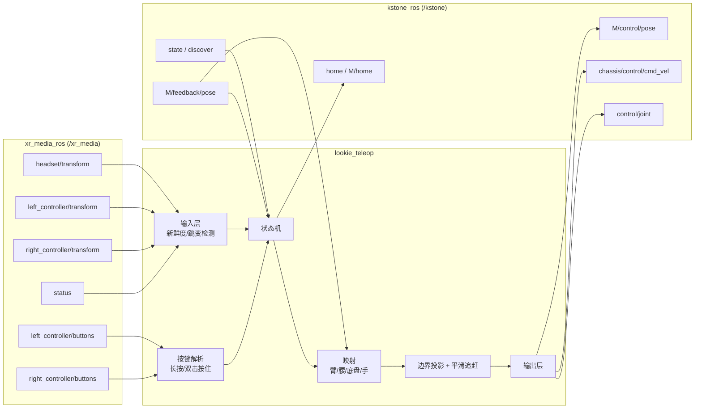
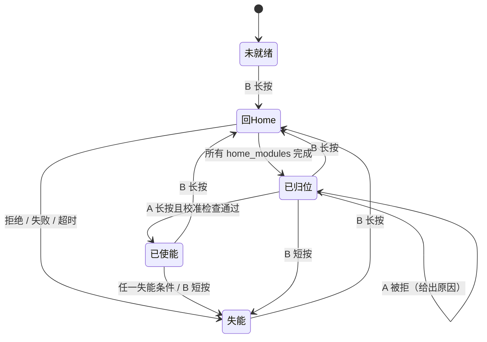
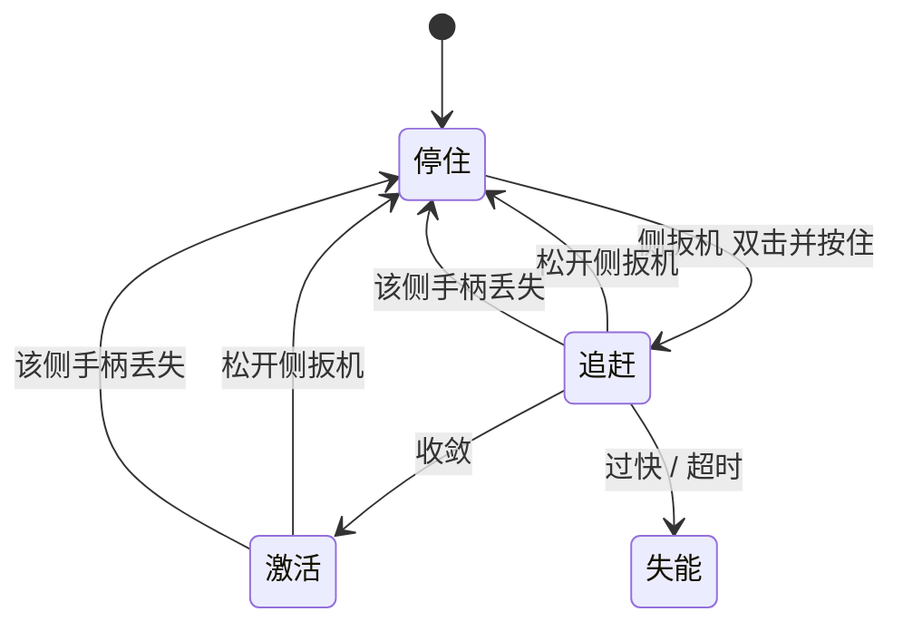
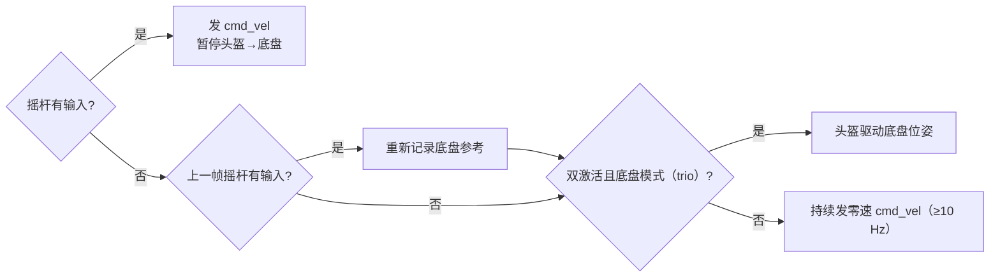
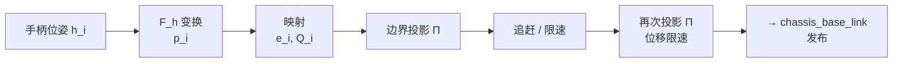
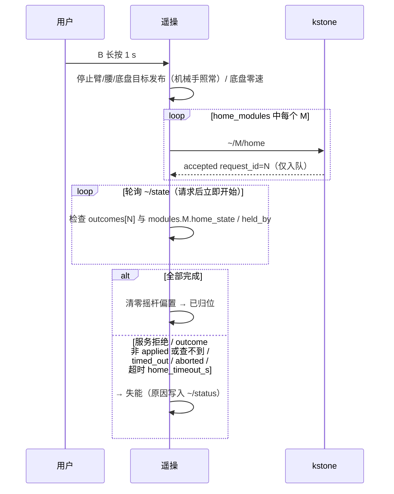

# VR 全身遥操作 —— 开发者实现设计

> 面向开发者：说明 `lookie_teleop` 的接口、状态机、坐标映射、校准检查、边界约束与安全策略。
> 操作步骤、头盔设置与常见问题见 [VR 遥操作快速上手](vr_teleop_quickstart.zh-CN.md)。文中阈值均为参数默认值（`lookie_teleop/node.py` 的 `PARAMS`，与 `lookie_bringup/config/lookie_teleop/common.yaml` 一致），完整列表见 §13。

---

## 1. 范围与原则

| 项 | 约定 |
|---|---|
| 包 | `lookie_teleop` |
| 运控 | 直接对接 `kstone_ros` 接口；遥操只发目标、调服务、读状态 |
| VR | `xr_media_ros`；头盔挂胸前（第三人称），左右手柄 |
| launch | 只启动遥操节点本身，不拉起 kstone / xr_media / 仿真 |
| 职责边界 | 头部控制、回 Home 插值、末端执行器 Home 开合位置、IK/全身求解均**不属于**遥操 |

---

## 2. 架构与接口



### 2.1 订阅

| 话题 | 类型 | 用途 |
|---|---|---|
| `/xr_media/headset/transform` | `TransformStamped`（parent `world`） | 头盔位姿 $H_t$ |
| `/xr_media/{left,right}_controller/transform` | `TransformStamped` | 手柄位姿 $h_i$ |
| `/xr_media/{left,right}_controller/buttons` | `Joy` | axes `[stick_x, stick_y, trigger, grip]`；buttons `[trigger, grip, stick_click, X/A, Y/B]` |
| `/kstone/state` | `String` JSON，锁存，30 Hz | 见下方字段表 |
| `/kstone/discover` | `String` JSON，锁存 | 模块、端口话题与坐标系、`chassis_kinematics`、Home 位姿、末端关节名与限位 |
| `/kstone/{left_arm_pose,right_arm_pose,torso_pose,chassis}/feedback/pose` | `PoseStamped` | 当前 FK / 底盘估计（**不是目标**） |

> xr_media_ros 只在设备被追踪时发布 transform，没有单独的追踪有效字段，遥操按本地接收时刻**超时**判断丢失（§12）。

`/kstone/state` 使用的字段：

| 字段 | 用途 |
|---|---|
| `fault`（非空即故障，锁存）、`fresh` | 运控健康检查（§7.2、§12） |
| `snapshot_stamp` | 区分新旧快照，跟踪误差每个快照只采样一次 |
| `outcomes[]` `{request_id, applied, error}` | 服务请求结果；`applied=true` 才算受理（§11） |
| `modules.M.enabled` / `held_by` | 所需模块已使能；`held_by=null` 表示模块自身持有控制权 |
| `modules.M.home_state` | `idle` / `waiting` / `executing` / `succeeded` / `timed_out` / `aborted`（§11） |
| `modules.{left,right}_arm_pose.outputs.position_error` / `orientation_error` | 跟踪误差，用于误差跳变检测（§12） |

> `/kstone/state` 的超时按本节点接收时刻判定（`kstone_timeout_s`）。

### 2.2 发布

| 话题 | 类型 | 内容 |
|---|---|---|
| `/kstone/left_arm_pose/control/pose` | `PoseStamped`，frame `chassis_base_link` | 左臂末端（`left_base_link`）目标 |
| `/kstone/right_arm_pose/control/pose` | 同上 | 右臂末端（`right_base_link`）目标 |
| `/kstone/torso_pose/control/pose` | `PoseStamped`，frame `chassis_base_link` | 腰部 `chest_link` 目标 |
| `/kstone/chassis/control/pose` | `PoseStamped`，frame `world_frame` | 底盘平面位姿目标（**仅全向**，头盔驱动时） |
| `/kstone/chassis/control/cmd_vel` | `Twist` | 摇杆底盘速度（全向 x/y/yaw，差速 x/yaw）；见下方发布规则 |
| `/kstone/control/joint` | `JointState`，frame_id 为空 | 机械手 6 指关节目标（按名路由到 `*_hand_joint`） |
| `~/status` | `String` JSON | 遥操状态、拒绝/失能原因、各臂子状态（UI/日志） |

发布规则：

- 所有带 header 的命令用**本节点 `now()`** 打时间戳，不沿用 XR 数据的时间戳（kstone 拒绝超过 0.5 s 或未来的时间戳）。
- 底盘 `cmd_vel`：已使能且头盔未驱动底盘时以 ≥ 10 Hz（随主循环）**持续**发布，摇杆归零时发 0；头盔驱动底盘位姿期间不发 `cmd_vel`（避免抢占位姿指令）。kstone 底盘速度端口超时为 0.25 s，停发后底盘会自行停止。

### 2.3 服务调用

| 服务 | 用途 |
|---|---|
| `/kstone/M/home`（`Trigger`） | 对 `home_modules` 中每个模块单独回 Home（只用 pose 模块；末端执行器不回 Home） |
| ~~`/kstone/home`~~ | **不使用**：它对"当前持有控制权"的模块回零，持有者可能是 `*_arm_joint` / `torso_joint`，会走关节 Home |
| ~~`/kstone/M/enable`~~ | **不使用**：遥操失能只停发命令，不改模块使能状态，恢复时无需额外操作 |

响应 `accepted request_id=N` **只代表入队**，完成以 `~/state` 为准。遥操只用 pose 模式，因此只用 pose 模块的 Home；pose 模块回 Home 后自身持有控制权，后续第一帧位姿目标不存在被关节模块占用而延迟的问题。

---

## 3. 机型 Profile

节点内不写机型名。参数 `body_axes`（默认全部：`chassis` / `waist_z` / `waist_pitch` / `waist_yaw`）列出头盔可驱动的轴，再与 discover 求交：`chassis` 模块的 `chassis_kinematics` 不是全向（`omni`）时自动去掉 `chassis` 轴，摇杆 vy 置 0；摇杆速度再按 discover 中底盘 `velocity` 端口的上下限裁剪。各机型的 `body_axes` 在 bringup 配置里给出（`lookie_bringup/config/<model>/teleop.yaml`），下表为两种机型的取值效果。

| 能力 | trio（全向 `omni`） | neo（差速 `differential`） |
|---|---|---|
| 头盔 → 底盘 | ✅ 平面 x/y/yaw（位姿目标） | ❌ |
| 头盔 → 腰 Z | ✅ | ❌ |
| 头盔 → 腰 pitch | ✅ | ✅ |
| 头盔 → 腰 yaw | ✅（腰部模式） | ❌ |
| Y 长按切换 | ✅ | ❌（忽略，`~/status` 提示） |
| 左摇杆 | x 前后、y 左右平移 | 仅前后（`linear.y` 被 kstone 忽略，遥操也置 0） |
| 右摇杆 x | 底盘转向 | 底盘转向 |
| 右摇杆 y（X 切换 Z/pitch） | ✅ | ✅（Z 偏置与 pitch 偏置均可调） |

内部用"轴使能集合"表示：trio = `{chassis, waist_z, waist_pitch, waist_yaw}`，neo = `{waist_pitch}`。映射代码只判断轴是否使能，不写机型分支。

---

## 4. 状态机

### 4.1 主状态



| 状态 | 发布目标 | 接受按键 | 说明 |
|---|---|---|---|
| 未就绪 | 仅机械手 | B 长按、主扳机 | 启动态；不知道机器人在哪，必须先回 Home |
| 回Home | 仅机械手（先停臂/腰/底盘目标发布） | 主扳机 | 等待 kstone 回零完成；其他按键无效 |
| 已归位 | 仅机械手 | A、B、Y、X、主扳机 | 臂/腰/底盘不发目标 |
| 已使能 | 是 | 全部（A 忽略） | 含每臂子状态 |
| 失能 | 仅机械手（臂/腰/底盘保持当前目标） | B 长按、主扳机 | 只停发命令（不调用 enable 服务）；底盘发一次零速后停发；摇杆/侧扳机无效，防误触 |

- 机械手在所有状态（含 未就绪、回Home、失能）都跟随主扳机，末端执行器始终不回 Home。机械手关节不在 `home_modules` 中，回 Home 期间发布手指目标不会与 kstone 回零冲突。

### 4.2 每臂子状态（仅在 已使能 内）



- **停住**：在 $F_t$ 下保持该臂最后目标（使能后首帧取反馈）并持续发布；腰 Z 变化时随腰一起升降，腰 pitch 变化时在底盘系下不动。
- **追赶**：从当前末端位姿向映射目标插值，见 §9。
- **激活**：直接发布（经边界投影与限速）的映射目标。
- **手柄丢失**（该侧 transform / joy 超时、跳变、离头盔过远）：只停该臂（保持目标），不失能；手柄恢复后需重新双击按住侧扳机才再接管，丢失期间的按键被吞掉。头盔丢失则整体失能（§12）。
- **头盔驱动条件**：两臂都处于 `激活`（不含追赶）。从"非双激活"变为"双激活"的瞬间记为 **双激活时刻**。

---

## 5. 按键解析

| 输入 | 判定 | 有效状态 | 动作 |
|---|---|---|---|
| B（右 `buttons[4]`） | 长按 ≥ `long_press_s`=1.0 s，按住期间只触发一次 | 除 回Home 外 | 回 Home；清零摇杆腰部偏置 |
| B 短按 | 按下后 < 1 s 松开（松开沿触发；已触发长按的不再算短按） | 已归位、已使能 | 整体失能（原因"用户停止"）：停遥操、防摇杆误触 |
| A（右 `buttons[3]`） | 长按 1 s | 已归位 | 校准（§7），通过则 → 已使能 |
| Y（左 `buttons[4]`） | 长按 1 s | 已归位、已使能（trio） | 头盔驱动目标 底盘 ↔ 腰部；默认参数 `default_body_mode` |
| X（左 `buttons[3]`） | 长按 1 s | 已归位、已使能 | 右摇杆 y 调节 腰Z ↔ 腰pitch（默认 Z）；**无急停** |
| 侧扳机 `axes[3]` | 按下阈值 0.6 / 释放 0.4（滞回）；两次按下间隔 ≤ `double_tap_s`=0.4 s 且第二次保持按住 | 已使能 | 该臂 停住 → 追赶；松开 → 停住 |
| 主扳机 `axes[2]` | 连续值 0~1 | 所有状态 | 机械手比例开合（§10） |
| 左摇杆 | 死区 0.15 | 已使能 | 底盘平移速度 |
| 右摇杆 x | 死区 0.15 | 已使能 | 底盘转向速度 |
| 右摇杆 y | 死区 0.15 | 已使能 | 腰 Z 或 pitch **偏置**积分（保留到下次回 Home） |

- 长按在**按下沿后满 1 s** 触发，不等松开，避免用户不知何时算数。
- A/X/Y 长按计时期间的短按无副作用；B 的短按在松开时才判定，因此长按 B 不会先触发失能。

### 5.1 摇杆与头盔的底盘仲裁



---

## 6. 坐标系与挂载修正

### 6.1 坐标系

| 符号 | 含义 |
|---|---|
| $W$ | XR `world`（z 向上） |
| $H_t$ | 头盔位姿（$W$ 下） |
| $h_i$ | 手柄位姿（$W$ 下），$i\in\{L,R\}$，已乘手柄 TCP 偏置 |
| $B_t$ | 身体系：头盔去掉挂载 pitch/roll 后的位姿 |
| $F_h(t)$ | 身体航向系：位置同 $B_t$，姿态只保留 $B_t$ 的 yaw（重力对齐） |
| $T$ | 机器人 `chassis_base_link` |
| $F_t(t)$ | 机器人躯干航向系：原点为 `chest_link` 目标位置，姿态只保留躯干目标的 yaw |

### 6.2 挂载修正（A 时刻求一次）

头盔挂在胸前，本身存在固定的 pitch/roll 挂载角。A 时刻将 $H_0$ 分解为
$$H_0 = R_z(\psi_0)\,R_{mount},\qquad R_{mount}=R_y(\theta_m)R_x(\phi_m)$$
（前向轴由参数 `headset_forward_axis` 给出），之后
$$B_t = H_t\,R_{mount}^{-1},\qquad F_h(t)=\big(\mathrm{pos}(B_t),\;R_z(\mathrm{yaw}(B_t))\big)$$

- $|\theta_m|$ 或 $|\phi_m|$ > `mount_max_deg`=35° → **拒绝校准**（挂歪了，yaw 提取会失真）。
- 头盔 yaw 与两手连线法向的夹角 > 15° → **仅警告**（头盔朝向与胸口不一致，会导致底盘/腰 yaw 有固定偏差）。
- 身体前倾角 $\theta_t=\mathrm{pitch}(B_t)$，用于腰 pitch 映射。

> 为什么不把头盔↔手柄全部 6 自由度纳入标定：手柄相对头盔的位置正是要采集的信号，只能标定"不随动作变化"的量，即挂载 pitch/roll。yaw 无法与身体朝向区分，只做警告。

---

## 7. A 校准

### 7.1 记录的参考量

| 量 | 定义 |
|---|---|
| $R_{mount}$ | §6.2 |
| $p_i^0$ | $F_h(0)^{-1} h_i$，两手柄在身体航向系下的位姿 |
| $M_0$ | $\tfrac12(p_L^0+p_R^0)$ 位置部分，两手中点 |
| $m_0$ | 两臂末端反馈在 $F_t(0)$ 下的中点 |
| $z^h_0,\ \theta_0$ | 头盔高度、身体前倾角 |
| $z^r_0,\ \varphi_0$ | 躯干目标高度、pitch（取 `torso_pose/feedback/pose`） |
| 底盘、腰 yaw 参考 | 见 §8.4 |

### 7.2 检查表（在 $F_h(0)$ 下，x 前 y 左 z 上；单位 m）

| 检查 | 通过条件 | 失败处理 |
|---|---|---|
| 设备 | 头盔和两手柄在线、近 `xr_timeout_s` 内均有 transform | 拒绝 |
| 运控 | `~/state` 未超时、无 `fault`、`fresh=true`（`require_fresh`，无驱动的纯仿真可关）、所需模块 `enabled` | 拒绝 |
| 挂载角 | $\lvert\theta_m\rvert,\lvert\phi_m\rvert \le 35°$ | 拒绝 |
| 前后 | $0.15 \le x_i \le 0.70$（手柄在胸前，不在身后/贴身） | 拒绝 |
| 不交叉 | $y_L - y_R \ge 0.10$ | 拒绝 |
| 不单侧 | $\lvert (y_L+y_R)/2\rvert \le 0.20$ | 拒绝 |
| 高度 | $-0.60 \le z_i \le 0.30$ | 拒绝 |
| 间距 | $\big\lvert\,\lVert p_L-p_R\rVert - \lVert e_L-e_R\rVert\,\big\rvert < 0.10$ | 拒绝 |
| 相对姿态 | 两手柄相对姿态 与 两末端相对姿态 夹角 > 45° | 仅警告 |
| 头盔 yaw | §6.2 偏差 > 15° | 仅警告 |

拒绝时状态保持 已归位，`~/status` 输出第一条失败原因，对应[快速上手 §8](vr_teleop_quickstart.zh-CN.md#8-常见问题)。

---

## 8. 映射

### 8.1 双臂

记 $p_i(t)=F_h(t)^{-1}h_i(t)$（位置 $\mathbf p_i$、姿态 $Q^p_i$），$R$ 为身体航向系到机器人躯干航向系的固定轴对齐旋转（通常为单位阵）：
$$\mathbf e_i = \mathbf m_0 + R\,(\mathbf p_i - \mathbf M_0),\qquad Q_i = R\,Q^p_i\,C_i$$
$$X_i^{T} = F_t(t)\cdot(\mathbf e_i, Q_i)$$

- **以中点对齐**：两手相对向量 $\mathbf p_L-\mathbf p_R$ 被 1:1 映射，所以两手间距、相对位置与两末端一致。
- $C_i$ 是**配置常量**（手柄握持系 → 末端工具系），不在 A 时求解；因此两手柄相对姿态也 1:1 传递。A 时若两末端与两手柄的相对位姿不一致，交给首次激活的平滑追赶。
- 臂参考**只在 A 时记录**，之后松开/再按侧扳机都走追赶，不重新标定。
- **为什么用航向系（只含 yaw）而不是完整 $B_t$**：
  - 人前倾时手相对航向系前移 → 机械臂前伸；
  - 腰部同时跟随 pitch 时，$F_t$ 原点随 `chest_link` 前移，两者一致；
  - 腰不跟随 pitch 时（trio 底盘模式、单臂激活），前倾仍能让臂前伸，不会"身体动了手臂没反应"。
- 发布前转换到 `chassis_base_link`。$F_t(t)$ 使用**躯干目标**（遥操自己维护的值）而非反馈，避免与 WBC 跟踪误差形成回路。

### 8.2 腰部（双激活 且 腰部模式；neo 只有 pitch）

$$z^r_t = z^r_0 + k_z\,(z^h_t - z^h_0) + \Delta z_{joy}$$
$$\varphi_t = \varphi_0 + k_\theta\,(\theta_t - \theta_0) + \Delta\varphi_{joy}$$
$$\psi^r_t = \psi^r_{ref} + (\psi^h_t - \psi^h_{ref})$$

- Z、pitch 是**相对 A 的绝对量**：任何时候身体回到 A 时的姿势，腰部就回到 A 时的高度/俯仰（若 双激活 瞬间不一致，由腰部追赶平滑过去）。
- yaw 是**相对量**：参考在 §8.4 时刻重记，避免切换模式或二次激活时腰部突转。
- roll 不映射：躯干没有 roll 自由度，头盔 roll 不需要对齐。
- 限幅：头盔部分和最终输出（头盔+摇杆）各限一次。Z 按 `waist_z_range`（相对 A）；pitch 取 `waist_pitch_range`（相对 A）与 `waist_pitch_limits_deg`（底盘系绝对，默认后仰 45°、前俯 90°）的交集；yaw 按 `waist_yaw_range`。跟随头盔与摇杆用同一套限幅，保证发给运控的躯干目标始终合理。最后做速度限制。
- 摇杆偏置 $\Delta z_{joy}$、$\Delta\varphi_{joy}$ 由右摇杆 y 积分（X 选择轴），在 **任何** 已使能 子状态下有效（含单侧激活），**只在回 Home 时清零**。偏置不积分饱和：输出已到限位时继续推摇杆不累加，反推立即生效。用途：补偿 A 时头盔与腰位姿无法对齐的固定偏差。
  - **Z：腰臂一起升降**。$F_t$ 原点含躯干目标 z，两臂目标（激活或停住）都在 $F_t$ 下表达，腰臂相对高度不变。
  - **pitch：只调腰**。$F_t$ 只含 yaw，pitch 偏置不改变两臂在底盘系下的目标（仅随肩点影响边界投影）。用途：头盔在佩戴者胸前的 pitch 无法绝对固定，用它校准真人躯干与机器人躯干之间的 pitch 对齐误差。
- 非双激活时，腰部目标保持最后值（仍叠加摇杆偏置）。

### 8.3 底盘（trio、双激活、底盘模式、摇杆无输入）

$$C_t = C_{ref}\;\oplus\;\mathrm{planar}\big(F_h(ref)^{-1}F_h(t)\big)$$

- $\mathrm{planar}(\cdot)$ 取 $(x, y, \mathrm{yaw})$，平移乘 `chassis_scale`（默认 1）。
- 死区（2 cm / 2°）+ 速度/加速度限幅（不超过 trio 的 0.5 m/s、1.0 rad/s）。
- 偏差钳位：目标始终钳在底盘反馈 ± `chassis_max_dev_pos`（0.2 m）/ `chassis_max_dev_deg`（15°）内，**不失能**。底盘跟不上时以上限持续追头盔目标，避免误差一下子拉大导致底盘难以受控、积分漂移加剧。
- 发布到 `chassis/control/pose`（`world_frame`）。

### 8.4 参考记录时刻

| 参考 | A | 双激活时刻 | Y 切换时刻（已双激活） | 摇杆松开 |
|---|---|---|---|---|
| 臂 $M_0, m_0$ | ✅ | — | — | — |
| 腰 Z / pitch（$z_0,\theta_0$…） | ✅ | — | — | — |
| 腰 yaw | ✅ | ✅ | ✅ | — |
| 底盘 $C_{ref}, F_h(ref)$ | ✅ | ✅ | ✅ | ✅ |

> 双激活时刻定义为"头盔控制从停止变为生效的那一刻"：即第二只侧扳机进入激活；若 Y 从腰部切到底盘时两侧已激活，则取 Y 切换那一刻。

### 8.5 中途松开、走动后再双激活

| 量 | 再次双激活时的处理 | 原因 |
|---|---|---|
| 臂 | 手柄在头盔航向系 $F_h(t)$ 下映射，人整体走动/转身不改变目标；激活时从保持目标平滑追赶到映射目标 | 映射本身就是身体局部的，无需重置 |
| 腰 Z、pitch | 相对 A 的绝对量，经速度限制平滑对齐到当前身体姿势 | 保持 A 时的高度/俯仰标定；不重置才能对齐 |
| 腰 yaw | 双激活时刻重记参考（§8.4），从当前值继续 | 人可能大幅转身，若对齐会导致上身相对底盘扭曲或跳变 |
| 腰 x/y、roll | 不映射，保持 | 无对应自由度或不需要 |
| 底盘 | 双激活时刻重记参考 | 人走动的位移不应被底盘复现 |

- 单侧激活期间：腰/底盘停止跟随头盔，摇杆仍可调腰偏置和驱动底盘；激活侧的臂照常跟随。由于臂目标是 $F_h(t)$ 局部量，**人整体往前走不会把臂往前拉**，只有手相对身体的运动（含前倾）才会。
- 松开后原地转身（如 180°）再激活：pitch 不会反向。前倾量 `lean` 取自去除佩戴偏差后的身体系 $B_t = H_t R_{mount}^{-1}$ 的 ZYX pitch，世界 yaw 只改变 ZYX 中的 yaw 分量，不影响 pitch，所以人在任何朝向前倾都是正值；yaw 则在双激活时刻重记参考，机器人朝向不受转身影响。
- 风险：Z 绝对对齐依赖 XR 世界系高度稳定（头盔设置见[快速上手 §3](vr_teleop_quickstart.zh-CN.md#3-操作前准备)）；操作者换了站姿高度（如坐下）再激活时腰会平滑移动到对应高度，最大速度 `waist_z_rate`，仍受限幅保护。

---

## 9. 边界约束与平滑追赶

### 9.1 处理管线（每臂、每周期）



### 9.2 工作空间（在机器人躯干航向系 $F_t$ 下）

| 约束 | 形式 |
|---|---|
| 臂展 | $r_{min} \le \lVert \mathbf e_i - \mathbf s_i\rVert \le r_{max}$，$\mathbf s_i$ 为肩点（参数 `shoulder_offsets`，躯干系下左右肩 xyz，随腰 pitch 旋转到 $F_t$） |
| 不贴身 | $x_i \ge x_{min}$ |
| 高度 | $z_{min} \le z_i \le z_{max}$ |
| 不过中线 | 左臂 $y_L \ge -\delta$，右臂 $y_R \le \delta$ |
| 不交叉 | $y_L - y_R \ge d_{min}$=0.10 |

- 投影 $\Pi$：按 球壳 → 半空间 → 不交叉 的顺序依次投影，重复至所有约束误差 ≤ `tol`=1e-6 m（最多 `iterations`=50 轮）。手柄回到范围内约束自然解除，**无需滞回**。
- 凸性：外球 $\lVert \mathbf d\rVert \le r_{max}$（$\mathbf d = \mathbf e_i - \mathbf s_i$）和各半空间是凸集；内球排除 $\lVert \mathbf d\rVert \ge r_{min}$ 不是凸集，球内的径向方向 $\mathbf d/\lVert \mathbf d\rVert$ 在肩点附近不连续（相距 2e-8 m 的两个输入，投影结果可相距 0.4 m）。
- 内球连续性：每臂保存上一帧映射目标的投影结果 $\mathbf e^{prev}_i$（激活 / 再激活时清空）。$\lVert \mathbf d\rVert < r_{min}$ 时沿 $\mathbf v = \mathbf d + (r_{min} - \lVert \mathbf d\rVert)\,\mathbf u^{prev}$ 推到内球面，$\mathbf u^{prev}$ 为 $\mathbf e^{prev}_i - \mathbf s_i$ 的单位向量：在肩点处等于上一帧方向，在内球面上等于 $\mathbf d/\lVert \mathbf d\rVert$，所以肩点附近和出入内球面时结果都连续。无上一帧或 $\mathbf v = 0$ 时退回径向方向（$\mathbf d = 0$ 时取 +x）。剩下一处跳变：手沿 $-\mathbf u^{prev}$ 穿过肩点并到达 $\lVert \mathbf d\rVert = r_{min}/2$ 时 $\mathbf v = 0$，方向翻转；球不能连续映射到球面上并保持球面不动，只依赖当前输入和上一帧的投影无法消除它，发布值的连续由后面的追赶 / 限速保证。
- 再次投影的输入是限速后的发布值，用径向方向，不带上一帧状态。投影后的位移再按本帧速度上限（追赶时 $v_{catch}$，激活后 $v_{max}$）从上一帧发布值限一次，所以发布值每帧最多移动 $v\,dt$。追赶起点在内球里时，发布值会在几帧内平滑推出内球，期间短暂位于内球里。
- 不交叉约束涉及两臂：
  - 一臂停住时，另一臂以停住臂的**保持目标**为界单侧推开；
  - 两臂都激活时，对称各推开一半。
- **只约束位置，不约束姿态**（姿态由 WBC 权重处理）。
- 被约束**不触发失能**，只在 `~/status` 中标记 `clamped`。
- 首次激活 / 再激活时若映射目标在边界外，追赶目标就是投影后的点，臂停在边界上等用户手回来。

### 9.3 平滑追赶

- 起点：该臂当前末端反馈 $X^{fb}_i$；终点：每周期最新的 $\Pi(\text{映射目标})$。
- 位置以 $v_{catch}$=0.15 m/s、姿态以 $\omega_{catch}$=0.8 rad/s 逼近（slerp），发布值 = 起点向终点按限速推进。
- 收敛：位置误差 < 2 cm 且姿态误差 < 5°（对**投影后**目标计算）→ 激活。
- 失败 → 失能：
  - 追赶期间**手柄原始速度** > 0.8 m/s 或 3 rad/s（"动作过快"）；
  - 追赶超过 `catch_timeout_s`=5 s。
- 激活后仍限速（`v_max`=1.0 m/s，`ω_max`=3 rad/s），防止单帧尖峰。

---

## 10. 机械手

$$q_j = q_j^{open} + u\,(q_j^{close} - q_j^{open}),\qquad u=\mathrm{clip}\Big(\tfrac{a-a_0}{1-a_0},0,1\Big)$$

- $a$ 为主扳机 `axes[2]`，$a_0$=`trigger_deadzone`=0.05 死区。
- `q_open/q_close` 为每只手 6 个关节的配置向量（`*_thumb_metacarpal_joint`、`*_thumb_proximal_joint`、`*_{index,middle,ring,pinky}_proximal_joint`）。
- 所有状态（未就绪、回Home、已归位、已使能任意臂子状态、失能）都发布；**不依赖侧扳机**。
- 末端执行器**不在 `home_modules` 中**，回 Home 不会张开手指，避免松掉正抓着的物体；回 Home 过程中也可用主扳机继续开合。
- 不同末端执行器（如灵巧手 revo2、夹爪）的 `ee_modules`、`ee_open`（默认全 0）、`ee_close` 写在 bringup 的机型 yaml（`lookie_bringup/config/<model>/teleop.yaml`）；关节限位从 `discover` 读取并夹紧。
- 仅在值变化 > 1% 或 10 Hz 心跳时发布，降低总线负载。

---

## 11. 回 Home 流程



- `home_modules` 默认：`torso_pose, left_arm_pose, right_arm_pose`。只用 pose 模块 Home，不用 `*_arm_joint` / `torso_joint` 的关节 Home；末端执行器不回 Home（需要时可由运控单独对其回 Home）。
- 每个模块判定成功需同时满足：
  1. `outcomes` 中找到对应 `request_id` 且 `applied=true`；请求后尽快轮询，在 `outcome_timeout_s` 内**查不到即视为失败**（outcomes 是环形缓冲，可能被挤出）；`applied=false` 时把 `error` 写入失能原因。
  2. `home_state` 只认**已包含该 outcome 的快照**中的值，此后到达 `succeeded`。`home_state` 会停留在上一次的终态，请求前的 `succeeded` 旧值不算数；同一快照里 outcome 与模块状态一致（受理时已置为 `waiting`），因此已在 Home 点、30 Hz 下看不到 `waiting/executing` 也能正确判定。
  3. `held_by` 为 `null`（模块自身持有控制权）。
- `timed_out`（kstone 以"最后一次进展"计时）、`aborted`（运动被其他输入打断 / 跳过）均为失败。
- 遥操不做插值，运动由 kstone 完成。
- 回Home 期间只有主扳机有效：机械手照常跟随（§10），其余按键（含 B 长按）被忽略。

---

## 12. 失能条件

| 类别 | 条件（默认值） |
|---|---|
| XR 头盔 | 头盔 transform 超时 > `xr_timeout_s`（按本节点接收时刻判定，不使用 XR 时间戳）；时间戳回退；单帧位移 > `jump_pos`=0.10 m 或旋转 > `jump_ang_deg`=30° |
| 用户 | B 短按 |
| 追赶 | 过快 / 超时（§9.3） |
| 跟踪 | 双激活期间**不**对持续误差判失能；仅对误差**跳变**判失能：$\lvert d(\text{position\_error})/dt\rvert >$ `track_err_rate_pos` 或 $\lvert d(\text{orientation\_error})/dt\rvert >$ `track_err_rate_ang`，连续 `track_err_rate_n` 个状态样本（30 Hz 求导噪声大，先一阶低通） |
| 运控 | `~/state` 超时 > `kstone_timeout_s`；`fault` 非空；`fresh=false`（`require_fresh`）；所需模块被禁用；模块被其他来源抢占（`held_by` 非空）；Home / 服务请求失败 |

失能动作：只停发命令，**不调用 enable 服务**——停发臂/腰/底盘位姿目标（kstone 保持最后目标），底盘发一次零速后停发；机械手仍跟随主扳机；只接受 B 长按。

**只停单臂（不失能）**：某侧手柄 transform / joy 超时、时间戳回退、单帧位移 > 10 cm 或旋转 > 30°、与头盔距离 > `max_reach`=1.0 m。该臂保持目标，恢复后双击按住侧扳机重新接管；另一臂、腰、底盘不受影响（单臂停住即非双激活，头盔不再驱动腰/底盘）。

> 只是被边界投影 **不** 算失能；松开侧扳机也 **不** 算失能；底盘目标被偏差钳位（§8.3）也 **不** 算失能。

所有检查都在每个 已使能 周期**最先**执行，不论臂是否激活；任一失能条件命中即失能并 return，本周期不做映射、不发布，所以跳变帧永远不会发给运控。

### 12.1 头盔重新居中（Home 键）

Quest 长按 Home 键重新居中会重置 `local-floor` 参考空间：同一帧内头盔与两手柄在 XR 世界系中一起平移/旋转到新原点（地面高度保持）。

| 时机 | 结果 |
|---|---|
| 已使能中居中 | 偏移通常远超 10 cm / 30°，头盔跳变检测在下一周期命中 → 整体失能，跳变帧不下发 |
| 失能后居中 | 不发臂和腰的命令，机械手照常跟随主扳机（§10）；之后回 Home 并重新校准，全部参考重置 |
| 松开双侧扳机后、小于阈值的偏移 | 臂是 $F_h$ 局部量不受影响；腰 yaw、底盘在下次双激活时重记参考；`local-floor` 保留地面高度，腰 Z 不变；pitch 只取身体系 pitch，不受平移/yaw 影响 |
| 双激活中、小于阈值的偏移 | 腰 yaw / 底盘目标最多改变一个阈值量，并受 `waist_yaw_rate`、`chassis_v_max/w_max` 限速与底盘偏差钳位保护 |

任何时机居中都不会把跳变下发给运控。面向操作者的要求见[快速上手 §3](vr_teleop_quickstart.zh-CN.md#3-操作前准备)。

---

## 13. 参数

默认值取自 `lookie_teleop/node.py` 的 `PARAMS`；`lookie_bringup/config/lookie_teleop/common.yaml` 给出相同的取值，机型 `teleop.yaml` 只覆盖 `body_axes` 与末端执行器。角度带 `_deg` 后缀的单位为度，其余为 m、rad、s。

| 分组 | 参数 | 默认 |
|---|---|---|
| 话题 | `xr_namespace` / `kstone_namespace` | `/xr_media`（绝对名，XR 设备共用） / `kstone`（相对名，跟随节点命名空间） |
| 轴 | `body_axes`（头盔可驱动的轴，与 discover 求交） | `[chassis, waist_z, waist_pitch, waist_yaw]` |
| 频率 | `rate_hz` | 50 |
| 按键 | `long_press_s` / `double_tap_s` / `grip_on` / `grip_off` | 1.0 / 0.4 / 0.6 / 0.4 |
| 摇杆 | `deadzone` / `max_vx` / `max_vy` / `max_wz` | 0.15 / 0.5 / 0.5 / 1.0 |
| 摇杆腰偏置 | `joy_z_rate` / `joy_pitch_rate` | 0.10 m/s / 0.3 rad/s |
| 挂载 | `headset_forward_axis` / `mount_max_deg` / `yaw_warn_deg` | `[1,0,0]` / 35 / 15 |
| 校准 | `calib_x` / `calib_z` / `min_cross` / `max_side` / `spacing_tol` / `rel_ori_warn_deg` | `[0.15,0.70]` / `[-0.60,0.30]` / 0.10 / 0.20 / 0.10 / 45 |
| 映射 | `R_body_to_torso`（rpy） / `controller_tcp`（xyz + rpy） / `C_left` / `C_right`（四元数 w,x,y,z） | `[0,0,0]` / 全 0 / 未设置时取 discover 中该臂的 Home 姿态 |
| 腰 | `k_z` / `k_pitch` | 1.0 / 1.0 |
| 腰范围（相对 A） | `waist_z_range` / `waist_pitch_range` / `waist_yaw_range` | `[-0.3, 0.1]` / `[-0.2, 0.6]` / `[-0.8, 0.8]` |
| 腰限速 | `waist_z_rate` / `waist_pitch_rate` / `waist_yaw_rate` | 0.2 m/s / 0.8 rad/s / 1.0 rad/s |
| 腰 pitch 绝对限位 | `waist_pitch_limits_deg` | `[-45, 90]`（后仰, 前俯） |
| 身体模式 | `default_body_mode` | `waist`（仅有 `chassis` 轴时可切到 `chassis`） |
| 底盘 | `chassis_scale` / `chassis_deadband_pos` / `chassis_deadband_deg` / `chassis_v_max` / `chassis_w_max` / `chassis_max_dev_pos` / `chassis_max_dev_deg` | 1.0 / 0.02 m / 2° / 0.5 / 1.0 / 0.2 m / 15° |
| 边界 | `shoulder_offsets`（左肩 xyz + 右肩 xyz，躯干系） / `r_min` / `r_max` / `x_min` / `ws_z_range` / `midline_delta` / `min_hand_gap` | `[0, 0.2005, 0.05, 0, -0.2005, 0.05]` / 0.20 / 0.75 / 0.10 / `[-0.6, 0.3]` / 0.05 / 0.10 |
| 追赶 | `v_catch` / `w_catch` / `catch_pos_tol` / `catch_ori_tol_deg` / `catch_timeout_s` / `catch_fast_v` / `catch_fast_w` | 0.15 / 0.8 / 0.02 / 5 / 5.0 / 0.8 / 3.0 |
| 限速 | `v_max` / `w_max`（同步后目标速度上限） | 1.0 / 3.0 |
| 安全 | `xr_timeout_s` / `jump_pos` / `jump_ang_deg` / `max_reach` / `kstone_timeout_s` / `require_fresh` | 0.2 / 0.10 / 30 / 1.0 / 0.3（state 30 Hz） / true |
| 跟踪跳变 | `track_err_rate_pos` / `track_err_rate_ang` / `track_err_rate_n` / `track_err_lpf_hz` | 1.0 m/s / 6 rad/s / 3 / 10 Hz |
| 底盘发布 | `cmd_vel_min_hz` | 10 |
| 末端执行器 | `ee_modules` / `trigger_deadzone` | `[left_hand_joint, right_hand_joint]` / 0.05 |
| 末端关节 | `ee_open` / `ee_close` / `ee_lower` / `ee_upper` / `ee_joints_{left,right}` | 全 0 / 关节上限 / discover 限位 / discover 限位 / discover 关节名 |
| Home | `home_modules` / `home_timeout_s` / `outcome_timeout_s` | `[torso_pose, left_arm_pose, right_arm_pose]` / 20 / 1.0 |

---

## 14. 接口约束与风险

| 项 | 约束 | 处理 |
|---|---|---|
| Home 状态残留 | `home_state` 停留在上次终态；关节 Home 结束后关节模块继续持有控制权（pose 模块 `held_by` 为关节模块） | 按 §11 规则判定；只用 pose 模块 Home |
| 无驱动仿真 | 未接驱动反馈时 `fresh=false` | `require_fresh` 参数，纯仿真调试时可关；实机必须开 |
| outcomes 环形缓冲 | 旧结果会被挤出 | 请求后尽快轮询，查不到即失败并失能 |
| XR 追踪状态 | xr_media_ros 只在追踪时发布，无单独标志 | 按接收超时判断（§12） |
| 震动反馈 | WebXR 无法可靠驱动手柄震动 | 不做；提示只通过 `~/status` |
| 重心 / 自碰撞 | kstone 有 `com`、`self_collision` 模块 | 遥操不干预，交由运控处理 |
| 多遥操节点 | 两个遥操节点同时发目标会互相抢占 | 同一时刻只运行一个遥操节点 |
| 头盔设置 | 安全边界、佩戴检测休眠、Home 键居中都会打断遥操 | 操作者按[快速上手 §3](vr_teleop_quickstart.zh-CN.md#3-操作前准备)设置；居中行为见 §12.1 |
| 头部 | 运控层自动注视双臂末端 | 遥操不发头部目标 |
| 胸挂 yaw 偏差 | 无法标定，只能警告 | §6.2 |
| 控制权 | kstone 以"最后收到目标"判定持有者 | 遥操只用 pose 模块控制臂/腰，不混发臂关节目标 |
| 底盘位姿坐标系 | `world_frame` 的具体值（如 `odom`）由 kstone 配置决定 | 启动时从 `discover` 读取，不硬编码 |

---

## 15. 包结构

```text
lookie_teleop/
├── package.xml / setup.py / setup.cfg
├── launch/teleop.launch.py      # 只启动本节点；params_file 传入参数 yaml（逗号分隔，按序覆盖）
├── lookie_teleop/
│   ├── node.py          # ROS I/O、定时器、参数、主状态机 + 每臂子状态调度
│   ├── profile.py       # discover ∩ body_axes → 轴使能集合
│   ├── buttons.py       # 长按 / 双击按住 / 滞回 / 摇杆死区
│   ├── transforms.py    # SE(3) / 四元数工具
│   ├── frames.py        # 挂载修正、F_h / F_t
│   ├── calibration.py   # §7 检查与参考记录
│   ├── mapping.py       # 臂 / 腰 / 底盘 / 手映射
│   ├── workspace.py     # 边界投影 Π
│   ├── catchup.py       # 追赶与限速
│   ├── safety.py        # 失能检测
│   └── home.py          # 回 Home 服务调用与完成判定
└── test/                # 纯逻辑单元测试（test_logic.py，fixtures/discover_trio.json）
```

纯逻辑模块不依赖 rclpy，便于单测；`node.py` 只负责收发与调度。

本包保持通用，不含机型配置。机型相关的 yaml 与组合启动放在 `lookie_bringup`：

```text
lookie_bringup/
├── config/<model>/
│   ├── bringup.yaml                 # teleop.xr_media / teleop.lookie_teleop 指向下面的文件
│   └── teleop.yaml                  # body_axes + 末端执行器（ee_modules / ee_open / ee_close）
├── config/xr_media_ros/xr_media.yaml   # xr_media_ros：只有 XR 卡片，不配置 media
├── config/lookie_teleop/common.yaml    # 各机型共用的调参，被 teleop.yaml 覆盖
└── launch/teleop.launch.py          # xr_media_ros + lookie_teleop，不启动 kstone_ros
```

```bash
ros2 launch lookie_bringup teleop.launch.py
```

---

## 16. 测试计划

| 层级 | 内容 |
|---|---|
| 单元 | 长按/双击按住时序；挂载分解往返；臂映射中点 1:1；校准检查各条拒绝/警告；投影 $\Pi$ 连续性与幂等性；追赶收敛/过快/超时；误差跳变（导数）检测与持续误差不触发；回 Home 判定（outcome 未受理/超时、旧 succeeded、快速完成、timed_out/aborted、held_by 被占）；失能各触发项 |
| 状态机 | 全部迁移边；回Home 期间只有主扳机有效；失能仅 B 长按与主扳机有效；摇杆松开重记参考；Y 切换时刻参考 |
| 集成 | kstone_ros + xr_media_ros（或回放的 xr 数据）：A → 双臂激活 → 腰/底盘跟随 → 边界 → B 回 Home |
| 实机前 | neo（`body_axes: [waist_pitch]`）下头盔只驱动 pitch；trio 下 Y 切换；断开手柄 / 退出 XR 触发失能 |

构建与测试，在工作空间根目录执行（`python3 -m venv` 只需首次）：

```bash
python3 -m venv --system-site-packages .venv
source .venv/bin/activate
source /opt/ros/humble/setup.bash
python3 -m colcon build --packages-select lookie_teleop
source install/setup.bash
python3 -m pytest -q "$(colcon list --packages-select lookie_teleop --paths-only)/test"
```
