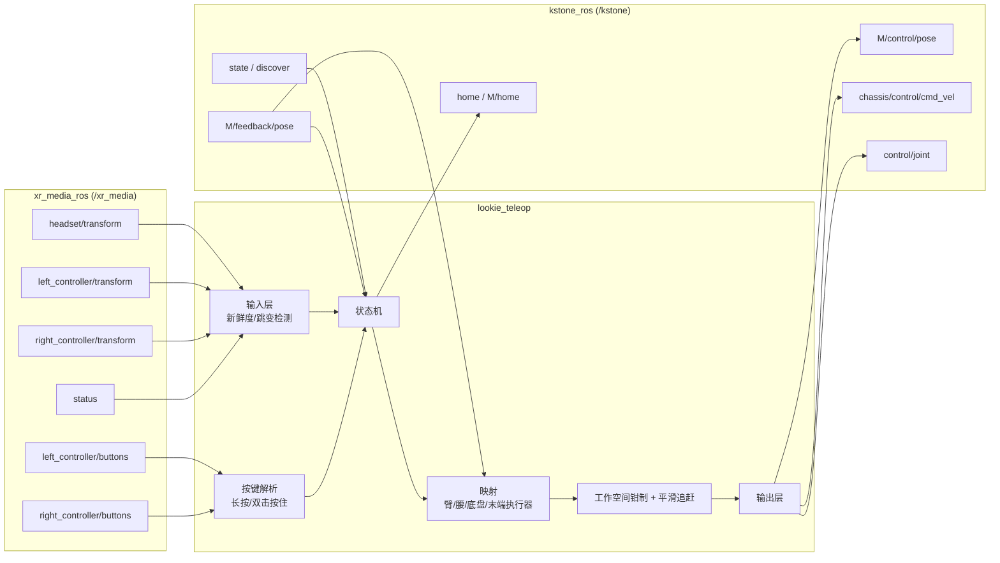
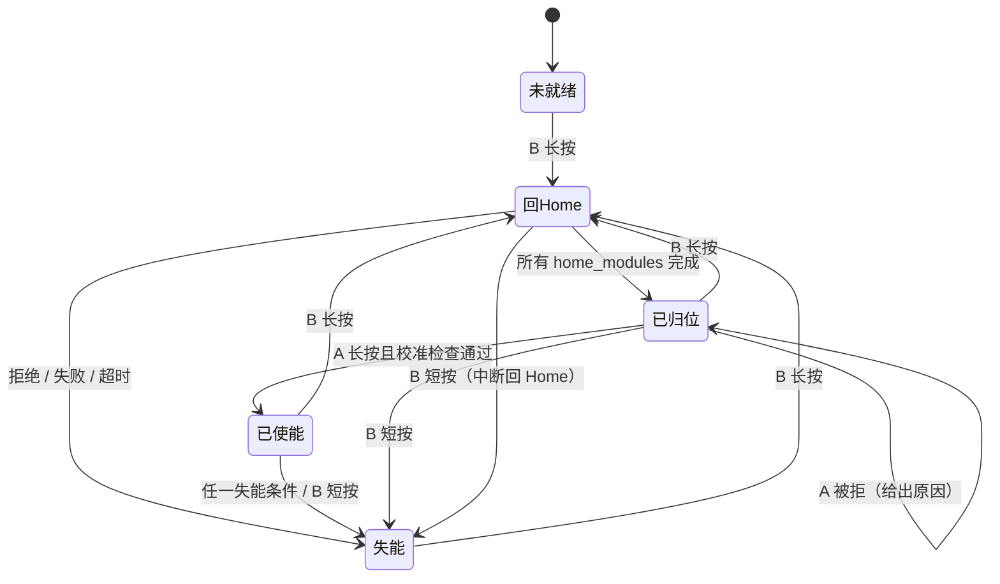
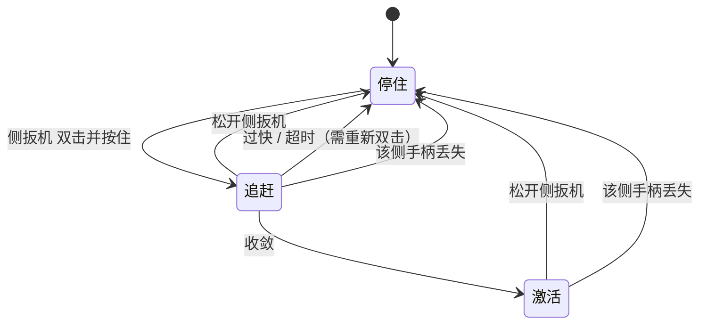
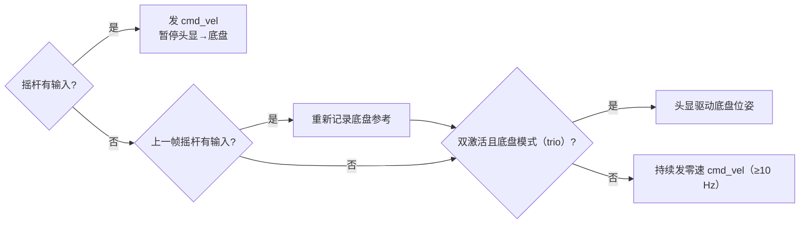
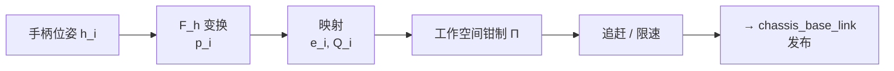
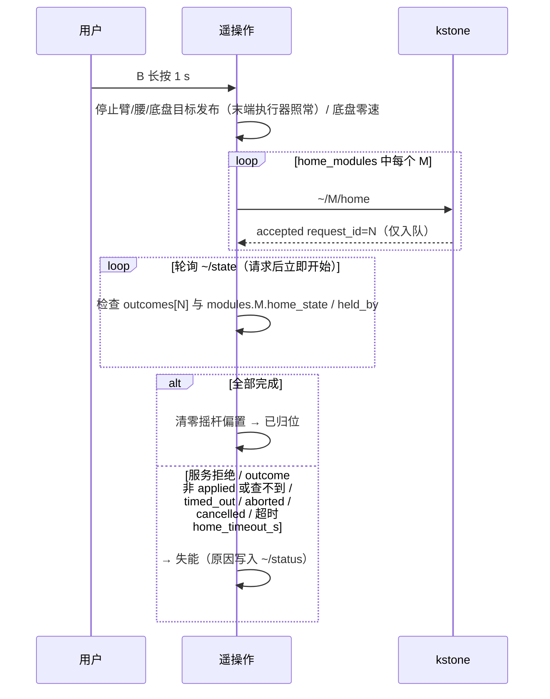

# VR 全身遥操作开发者设计

[English](vr_teleop_dev_design.md)

> 面向开发者：说明 `lookie_teleop` 的接口、状态机、坐标映射、校准检查、边界约束与安全策略。
> 操作步骤、头显设置与常见问题见 [VR 遥操作快速上手](vr_teleop_quickstart.zh-CN.md)。文中阈值均为参数默认值（`lookie_teleop/node.py` 的 `PARAMS`），完整列表见 [§13](#13-参数)。

## 摘要

- **做什么**：把 `xr_media_ros` 的头显、手柄位姿和按键转换成 `kstone_ros` 的臂、腰、底盘位姿目标和末端执行器关节目标；不做 IK、不插值回 Home、不控制头部。
- **状态机**（§4）：`未就绪 →(B 长按) 回Home → 已归位 →(A 长按校准) 已使能`；每臂在已使能内独立地 `停住 → 追赶 → 激活`，由侧扳机双击按住接管、松开即停。
- **安全原则**（§12）：
  - 失能只停发命令，不断电、不调用 enable 服务，kstone 保持最后目标。
  - 头显跳变、kstone 故障或超时会整体失能；手柄丢失、单个模组掉线只停对应部位。
  - 跳变帧永远不会下发。
- **改代码前先读**：§2 接口、§4 状态机、§12 失能条件；参数默认值见 §13，代码结构见 §15。
- **验证**：纯逻辑模块不依赖 rclpy，`python3 -m pytest lookie_teleop/test`；涉及状态机或安全的改动还需按 §16 做实机检查。

## 1. 范围与原则

| 项 | 约定 |
| --- | --- |
| 包 | `lookie_teleop` |
| 运控 | 直接对接 `kstone_ros` 接口；遥操作只发目标、调服务、读状态 |
| VR | `xr_media_ros`；头显挂胸前（第三人称），左右手柄 |
| launch | 只启动遥操作节点本身，不拉起 kstone / xr_media / 仿真 |
| 职责边界 | 头部控制、回 Home 插值、末端执行器 Home 开合位置、IK/全身求解均**不属于**遥操作 |

## 2. 架构与接口



### 2.1 订阅

| 话题 | 类型 | 用途 |
| --- | --- | --- |
| `/xr_media/headset/transform` | `TransformStamped`（parent `world`） | 头显位姿 $H_t$ |
| `/xr_media/{left,right}_controller/transform` | `TransformStamped` | 手柄位姿 $h_i$ |
| `/xr_media/{left,right}_controller/buttons` | `Joy` | axes `[stick_x, stick_y, trigger, grip]`；buttons `[trigger, grip, stick_click, X/A, Y/B]` |
| `/kstone/state` | `String` JSON，锁存，30 Hz | 见下方字段表 |
| `/kstone/discover` | `String` JSON，锁存 | 模块、端口话题与坐标系、`chassis_kinematics`、Home 位姿、末端关节名与限位 |
| `/kstone/{left_arm_pose,right_arm_pose,torso_pose,chassis}/feedback/pose` | `PoseStamped` | 当前 FK / 底盘估计（**不是目标**） |

> xr_media_ros 只在设备被追踪时发布 transform，没有单独的追踪有效字段，遥操作按本地接收时刻**超时**判断丢失（§12）。

`/kstone/state` 使用的字段：

| 字段 | 用途 |
| --- | --- |
| `fault`（非空即故障，锁存）、`fresh` | 运控健康检查（§7.2、§12） |
| `outcomes[]` `{request_id, applied, error}` | 服务请求结果；`applied=true` 才算受理（§11） |
| `modules.M.enabled` / `held_by` | 所需模块已使能；`held_by=null` 表示模块自身持有控制权 |
| `modules.M.home_state` | `idle` / `waiting` / `executing` / `succeeded` / `timed_out` / `aborted` / `cancelled`（§11） |

> `/kstone/state` 的超时按本节点接收时刻判定（`kstone_timeout_s`）。

### 2.2 发布

| 话题 | 类型 | 内容 |
| --- | --- | --- |
| `/kstone/left_arm_pose/control/pose` | `PoseStamped`，frame `chassis_base_link` | 左臂末端目标（夹爪 `l_gripper_tip`，Revo2 灵巧手 `l_palm`） |
| `/kstone/right_arm_pose/control/pose` | 同上 | 右臂末端目标（`r_gripper_tip` / `r_palm`） |
| `/kstone/torso_pose/control/pose` | `PoseStamped`，frame `chassis_base_link` | 腰部 `chest_link` 目标 |
| `/kstone/chassis/control/pose` | `PoseStamped`，frame `world_frame` | 底盘平面位姿目标（**仅全向**，头显驱动时） |
| `/kstone/chassis/control/cmd_vel` | `Twist` | 摇杆底盘速度（全向 x/y/yaw，差速 x/yaw）；见下方发布规则 |
| `/kstone/control/joint` | `JointState`，frame_id 为空 | 末端执行器关节目标（按名路由到 `ee_modules` 中的模块，如 `*_hand_joint`、`*_gripper_joint`） |
| `/xr_media/{left,right}_controller/haptic` | `Float32MultiArray` `[强度, 时长 ms]` | 手柄震动确认（§5） |
| `~/status` | `String` JSON | 遥操作状态、拒绝/失能原因、各臂子状态（UI/日志） |

发布规则：

- 所有带 header 的命令用**本节点 `now()`** 打时间戳，不沿用 XR 数据的时间戳（kstone 拒绝超过 0.5 s 或未来的时间戳）。
- 底盘 `cmd_vel`：回Home、已归位，或已使能且头显未驱动底盘时以 ≥ 10 Hz（随主循环）**持续**发布，摇杆归零时发 0；头显驱动底盘位姿期间不发 `cmd_vel`（避免抢占位姿指令）。kstone 底盘速度端口超时为 0.25 s，停发后底盘会自行停止。

### 2.3 服务调用

| 服务 | 用途 |
| --- | --- |
| `/kstone/M/home`（`Trigger`） | 对 `home_modules` 中每个模块单独回 Home（只用 pose 模块；末端执行器不回 Home） |
| `/kstone/home_cancel`（`Trigger`） | 回Home 中短按 B：一次调用取消所有正在进行的回 Home，各模块平滑停在当前位置并保持 |
| ~~`/kstone/home`~~ | **不使用**：它对"当前持有控制权"的模块回零，持有者可能是 `*_arm_joint` / `torso_joint`，会走关节 Home |
| ~~`/kstone/M/enable`~~ | **不使用**：遥操作失能只停发命令，不改模块使能状态，恢复时无需额外操作 |

响应 `accepted request_id=N` **只代表入队**，完成以 `~/state` 为准。遥操作只用 pose 模式，因此只用 pose 模块的 Home；pose 模块回 Home 后自身持有控制权，后续第一帧位姿目标不存在被关节模块占用而延迟的问题。

## 3. 机型 Profile

节点内不写机型名。参数 `body_axes`（默认：`chassis` / `waist_x` / `waist_z` / `waist_pitch` / `waist_yaw`）列出头显可驱动的轴，再与 discover 求交：底盘没有 `pose_target` 端口（`control/pose`）时自动去掉 `chassis` 轴；`chassis_kinematics` 不是全向（`omni`）时摇杆 vy 置 0，头显驱动底盘也不横移（§8.3）；摇杆速度再按 discover 中底盘 `velocity` 端口的上下限裁剪。各机型的 `body_axes` 在 bringup 配置里给出（`lookie_bringup/config/<model>/teleop.yaml`），下表为两种机型的取值效果。

| 能力 | trio（全向 `omni`） | neo（差速 `differential`） |
| --- | --- | --- |
| 头显 → 底盘 | 是：平面 x/y/yaw（位姿目标） | 前进和 yaw，不横移（位姿目标），底盘模式 |
| 头显 → 腰 x（前后） | 是 | 否 |
| 头显 → 腰 Z | 是 | 是（俯身补偿后的高度；臂补升降柱的滞后和下限以下的余量） |
| 头显 → 腰 pitch | 是 | 是 |
| 头显 → 腰 yaw | 是（腰部模式） | 否 |
| Y 长按切换 | 是 | 是（腰 ↔ 底盘 yaw，默认腰） |
| 左摇杆 | x 前后、y 左右平移 | 仅前后（`linear.y` 被 kstone 忽略，遥操作也置 0） |
| 右摇杆 x | 底盘转向 | 底盘转向 |
| 右摇杆 y（X 切换 Z/pitch） | 是 | 是（Z 偏置与 pitch 偏置均可调） |

内部用"轴使能集合"表示：trio = `{chassis, waist_x, waist_z, waist_pitch, waist_yaw}`，neo = `{waist_pitch}`。映射代码只判断轴是否使能，不写机型分支。

## 4. 状态机

`~/status` 中的状态值使用英文名：`state` 为 `NotReady`（未就绪）、`Homing`（回Home）、`Homed`（已归位）、`Enabled`（已使能）、`Disabled`（失能）；`arms.<side>` 为 `Held`（停住）、`CatchUp`（追赶）、`Active`（激活）。`reason`、`warnings` 等提示文本均为英文。

### 4.1 主状态



| 状态 | 发布目标 | 接受按键 | 说明 |
| --- | --- | --- |---|
| 未就绪 | 仅末端执行器 | B 长按、主扳机 | 启动态；不知道机器人在哪，必须先回 Home |
| 回Home | 末端执行器；底盘 `cmd_vel`（摇杆，无输入发零速） | B 短按、主扳机、摇杆（仅底盘） | 先停臂/腰目标发布，等待 kstone 回零完成；底盘不回 Home，摇杆照常控底盘平移和转向（kstone 回 Home 占住的模块不算失能原因）；其他按键无效 |
| 已归位 | 末端执行器；底盘 `cmd_vel`（摇杆，无输入发零速） | A、B、Y、X、主扳机、摇杆（仅底盘） | 臂/腰不发目标，保持 Home 姿态供 A 校准；摇杆只控底盘平移和转向，右摇杆 y（腰偏置）无效 |
| 已使能 | 是 | 全部（A 忽略） | 含每臂子状态 |
| 失能 | 仅末端执行器（臂/腰/底盘保持当前目标） | B 长按、主扳机 | 只停发命令（不调用 enable 服务）；底盘发一次零速后停发；摇杆/侧扳机无效，防误触 |

- 末端执行器在所有状态（含 未就绪、回Home、失能）都跟随主扳机，末端执行器始终不回 Home。末端执行器关节不在 `home_modules` 中，回 Home 期间发布其关节目标不会与 kstone 回零冲突。

### 4.2 每臂子状态（仅在 已使能 内）



- **停住**：在 $F_t$ 下保持该臂最后目标（使能后首帧取反馈）并持续发布；腰 Z 变化时随腰一起升降，腰 pitch 变化时在底盘系下不动。
- **追赶**：从当前末端位姿向映射目标插值，见 §9。
- **激活**：直接发布（经工作空间钳制与限速）的映射目标。
- **手柄丢失**（该侧 transform / joy 超时、跳变、离头显过远）：只停该臂（保持目标），不失能；手柄恢复后需重新双击按住侧扳机才再接管，丢失期间的按键被吞掉。头显数据超时则两臂都停住（同样需重新双击，不失能）；头显跳变 / 时间戳回退则整体失能（§12）。
- **头显驱动条件**：两臂都处于 `激活`（不含追赶）。从"非双激活"变为"双激活"的瞬间记为 **双激活时刻**。

## 5. 按键解析

| 输入 | 判定 | 有效状态 | 动作 |
| --- | --- | --- |---|
| B（右 `buttons[4]`） | 长按 ≥ `long_press_s`=1.0 s，按住期间只触发一次 | 除 回Home 外 | 回 Home；清零摇杆腰部偏置 |
| B 短按 | 按下后 < 1 s 松开（松开沿触发；已触发长按的不再算短按） | 回Home、已归位、已使能 | 整体失能（原因"用户停止"）：停遥操作、防摇杆误触。回Home 中按下则中断回 Home：调一次 kstone `~/home_cancel`，所有回 Home 中的模块平滑停在当前插值点并保持（不失能模块） |
| A（右 `buttons[3]`） | 长按 1 s，只在 已归位 时计时（回Home 中就按住的，Home 完成起再计 1 s，不需要松开重按） | 已归位 | 校准（§7），通过则 → 已使能 |
| Y（左 `buttons[4]`） | 长按 1 s | 已归位、已使能（有 `chassis`） | 头显驱动目标 底盘 ↔ 腰部；默认参数 `default_body_mode` |
| X（左 `buttons[3]`） | 长按 1 s | 已归位、已使能 | 右摇杆 y 调节 腰Z ↔ 腰pitch（默认 Z）；**无急停** |
| 侧扳机 `axes[3]` | 按下阈值 0.6 / 释放 0.4（滞回）；两次按下间隔 ≤ `double_tap_s`=0.4 s 且第二次保持按住 | 已使能 | 该臂 停住 → 追赶；松开 → 停住 |
| 主扳机 `axes[2]` | 连续值 0~1 | 所有状态 | 末端执行器比例开合（§10） |
| 左摇杆 | 死区 0.15 | 回Home、已归位、已使能 | 底盘平移速度 |
| 右摇杆 x | 死区 0.15 | 回Home、已归位、已使能 | 底盘转向速度 |
| 右摇杆 y | 死区 0.15 | 已使能 | 腰 Z 或 pitch **偏置**积分（保留到下次回 Home） |

- 长按在**按下沿后满 1 s** 触发，不等松开，避免用户不知何时算数。
- A/X/Y 长按计时期间的短按无副作用；B 的短按在松开时才判定，因此长按 B 不会先触发失能。

**手柄震动确认**（发布到 `/xr_media/{side}_controller/haptic`，由 xr_media_ros 转给头显）：

- 长按被受理（上表 B / A / Y / X 执行动作）时，按键所在手柄按 `haptic_long_press`=`[1.0, 100, 2, 250]` 震两下。A 的震动只表示长按已识别，校准是否通过另看状态提示。
- 侧扳机双击被受理（该臂由停住转为接管）时，该侧手柄按 `haptic_grip_engage`=`[1.0, 100]` 震一下。
- 参数格式为 `[强度 0–1, 单次时长 ms, 次数, 间隔 ms]`；次数与间隔可省略（震一下），时长 0 关闭。第二下起由 `_tick` 发出，新的震动会取代该手柄尚未发完的震动。
- 头显浏览器不支持震动或处于手势追踪时无效果，不影响操作。

### 5.1 摇杆与头显的底盘仲裁



## 6. 坐标系与挂载修正

### 6.1 坐标系

| 符号 | 含义 |
| --- | --- |
| $W$ | XR `world`（z 向上） |
| $H_t$ | 头显位姿（$W$ 下） |
| $h_i$ | 手柄位姿（$W$ 下），$i\in\{L,R\}$，已乘手柄 TCP 偏置 |
| $B_t$ | 身体系：头显去掉挂载 pitch/roll 后的位姿 |
| $F_h(t)$ | 身体航向系：位置同 $B_t$，姿态只保留 $B_t$ 的 yaw（重力对齐） |
| $T$ | 机器人 `chassis_base_link` |
| $F_t(t)$ | 机器人躯干航向系：原点为 `chest_link` 目标位置，姿态只保留躯干目标的 yaw |

### 6.2 挂载修正（A 时刻求一次）

头显挂在胸前，本身存在固定的 pitch/roll 挂载角。A 时刻将 $H_0$ 分解为
$$H_0 = R_z(\psi_0)\,R_{mount},\qquad R_{mount}=R_y(\theta_m)R_x(\phi_m)$$
（前向轴由参数 `headset_forward_axis` 给出），之后
$$B_t = H_t\,R_{mount}^{-1},\qquad F_h(t)=\big(\mathrm{pos}(B_t),\;R_z(\mathrm{yaw}(B_t))\big)$$

- $|\theta_m|$ 或 $|\phi_m|$ > `mount_max_deg`=35° → **拒绝校准**（挂歪了，yaw 提取会失真）。
- 头显 yaw 与两手连线法向的夹角 > 15° → **仅警告**（头显朝向与胸口不一致，会导致底盘/腰 yaw 有固定偏差）。
- 身体前倾角 $\theta_t=\mathrm{pitch}(B_t)$，用于腰 pitch 映射。

> 为什么不把头显↔手柄全部 6 自由度纳入标定：手柄相对头显的位置正是要采集的信号，只能标定"不随动作变化"的量，即挂载 pitch/roll。yaw 无法与身体朝向区分，只做警告。

## 7. A 校准

### 7.1 记录的参考量

| 量 | 定义 |
| --- | --- |
| $R_{mount}$ | §6.2 |
| $p_i^0$ | $F_h(0)^{-1} h_i$，两手柄在身体航向系下的位姿 |
| $M_0$ | $\tfrac12(p_L^0+p_R^0)$ 位置部分，两手中点 |
| $m_0$ | 两臂末端反馈在 $F_t(0)$ 下的中点 |
| $z^h_0,\ \theta_0$ | 头显高度、身体前倾角 |
| $z^r_0,\ \varphi_0$ | 躯干目标高度、pitch（取 `torso_pose/feedback/pose`） |
| 底盘、腰 yaw 参考 | 见 §8.4 |

### 7.2 检查表（在 $F_h(0)$ 下，x 前 y 左 z 上；单位 m）

| 检查 | 条件 | 不满足时 |
| --- | --- | --- |
| 设备 | 头显和两手柄在线、近 `xr_timeout_s` 内均有 transform | 拒绝 |
| 运控 | `~/state` 未超时、无 `fault`、`fresh=true`（`require_fresh`，无驱动的纯仿真可关；`ee_feedback_groups` 和 `ignored_feedback_groups` 中的组除外）、所需模块 `enabled` | 拒绝 |
| 挂载角 | $\lvert\theta_m\rvert,\lvert\phi_m\rvert \le 35°$ | 拒绝 |
| 前后 | $0.15 \le x_i \le 0.70$（手柄在胸前，不在身后/贴身） | 拒绝 |
| 不交叉 | $y_L - y_R \ge 0.10$ | 拒绝 |
| 不单侧 | $\lvert (y_L+y_R)/2\rvert \le 0.20$ | 拒绝 |
| 高度 | $-0.60 \le z_i \le 0.30$ | 拒绝 |
| 间距 | $\big\lvert\,\lVert p_L-p_R\rVert - \lVert e_L-e_R\rVert\,\big\rvert < 0.10$ | 仅警告（目测难以对准；激活后由追赶收敛到手柄间距） |
| 头显 yaw | §6.2 偏差 ≤ 15° | 仅警告 |

拒绝时状态保持 已归位，`~/status` 输出第一条失败原因，对应[快速上手 §8](vr_teleop_quickstart.zh-CN.md#8-常见问题)。

## 8. 映射

### 8.1 双臂

记 $p_i(t)=F_h(t)^{-1}h_i(t)$（位置 $\mathbf p_i$、姿态 $Q^p_i$），$R$ 为身体航向系到机器人躯干航向系的固定轴对齐旋转（通常为单位阵）：
$$\mathbf e_i = \mathbf m_0 + R\,(\mathbf p_i - \mathbf M_0),\qquad Q_i = R\,Q^p_i\,C_i$$
$$X_i^{T} = F_t(t)\cdot(\mathbf e_i, Q_i)$$

- **以中点对齐**：两手相对向量 $\mathbf p_L-\mathbf p_R$ 被 1:1 映射，所以两末端的间距、相对位置与两手柄一致。A 时间距不一致不拒绝：各臂双击激活时由 §9.3 追赶从实测末端平滑移到映射目标。
- 姿态为**绝对映射**：$C_i = R^{-1}\,Q^{ee}_i(0)$，$Q^{ee}_i(0)$ 为 A 时（紧接 Home，即 Home 姿态）末端在躯干航向系下的姿态。手柄 TCP（`controller_tcp`，含其旋转）水平且朝向身体航向时对应 Home 姿态，其他朝向对应 Home 姿态的同样转动；与 A 时手柄怎么握无关。激活时映射姿态与末端不一致，由 §9.3 追赶平滑转过去。
- 臂参考**只在 A 时记录**，之后松开/再按侧扳机都走追赶，不重新标定。
- **为什么用航向系（只含 yaw）而不是完整 $B_t$**：
  - 人前倾时手相对航向系前移 → 机械臂前伸；
  - 腰部同时跟随 pitch 时，$F_t$ 原点随 `chest_link` 前移，两者一致；
  - 腰不跟随 pitch 时（单臂激活），前倾仍能让臂前伸，不会"身体动了手臂没反应"。
- `lean_pivot_m` $L$（默认 0）把映射系原点从胸部移到相对髋部固定的点：$\mathbf o = \mathbf c - L\,R_h\,(\sin\theta - \sin\theta_0,\ 0,\ \cos\theta - \cos\theta_0)$，$\mathbf c$ 为胸部位置，$\theta$ 为前倾，$\theta_0$ 为 A 时前倾。走动仍不带动臂，前倾则让双手绕髋摆动，方向与机器人腰 pitch 一致。
- $L$ 是人髋 → 胸前头显的距离，取机器人对应的几何：腰最后一个 pitch 轴 → `chest_link` 的距离（URDF），使人的髋 ↔ 机器人腰 pitch 轴、人的胸 ↔ `chest_link` 一一对应；同一个值也是底盘模式下机器人腰的俯仰支点（§8.2）。偏小：前倾时臂仍被推出一点；偏大：臂会往回收。
- 映射系随头显平移和转向，所以手柄相对头显不动时，整体走动、转身（含底盘随人转）双臂相对机器人不动；只转头而手不动时臂反向转。
- Lookie neo 的 $L$ = 0.27 m（torso_joint2 轴，URDF 0.269）：腰没有 x / yaw，身体平移和转向不驱动腰，前倾由臂前伸。
- Lookie trio 的 $L$ = 0.27 m（torso_joint3 轴，URDF 0.2705）：底盘模式下由髋点驱动底盘，前倾不推动底盘。
- 发布前转换到 `chassis_base_link`。$F_t(t)$ 使用**躯干目标**（遥操作自己维护的值）而非反馈，避免与 WBC 跟踪误差形成回路。

### 8.2 腰部（双激活；腰部模式跟随全部腰轴，底盘模式只跟随 Z 和 pitch；neo 只有 Z 和 pitch）

$$x^r_t = x^r_{ref} + k_x\,\big[F_h(ref)^{-1}F_h(t)\big]_x$$
$$z^r_t = z^r_0 + k_z\,(z^h_t - z^h_0) + \Delta z_{joy}$$
$$\varphi_t = \varphi_0 + k_\theta\,(\theta_t - \theta_0) + \Delta\varphi_{joy}$$
$$\psi^r_t = \psi^r_{ref} + (\psi^h_t - \psi^h_{ref})$$

- Z、pitch 是**相对 A 的绝对量**：任何时候身体回到 A 时的姿势，腰部就回到 A 时的高度/俯仰（若 双激活 瞬间不一致，由腰部追赶平滑过去）。
- yaw 是**相对量**：参考在 §8.4 时刻重记，避免切换模式或二次激活时腰部突转。$\psi^h_t - \psi^h_{ref}$ 逐帧展开（不折回 ±180°），人转过 180° 时腰目标不会跳到另一侧。
- x（前后）也是**相对量**：取头显在参考航向系下的前向位移，参考在 §8.4 时刻重记，人走动后再双激活不会让腰前冲；x 不限幅。y 不映射。头显前倾时 pitch 与 x 同时增大，必要时调小 `k_x` 或 `k_pitch`。
- roll 不映射：躯干没有 roll 自由度，头显 roll 不需要对齐。
- 限幅：只限制摇杆也能调节的两个轴，限的是头显+摇杆的**总和**（头显部分按"总和到限"截断，所以无论摇杆偏置多少，头显和摇杆到达的是同一个极限；头显映射每帧按绝对量重算，不累积）。Z 按 `waist_z_range`（相对 A 时的躯干，即实机 Home 高度，A 只在 Home 后接受）；pitch 按 `waist_pitch_limits_deg`（底盘系绝对，默认后仰 30°、前俯 90°）。yaw 只按 `waist_yaw_limits_deg` 截断（底盘系绝对，默认 ±89°，在 torso_joint4 ±90° 之内），避免目标转出关节范围后双臂随 $F_t$ 绕到身侧。x 不限幅。最后做速度限制。腰目标不与反馈比较：实机腰先到关节/可达极限时（极限随其他轴变化），目标会继续走，挂在 $F_t$ 上的双臂会随之移动。
- 摇杆偏置 $\Delta z_{joy}$、$\Delta\varphi_{joy}$ 由右摇杆 y 积分（X 选择轴），在 **任何** 已使能 子状态下有效（含单侧激活），**只在回 Home 时清零**。偏置不积分饱和：输出已到限位时继续推摇杆不累加，反推立即生效。用途：补偿 A 时头显与腰位姿无法对齐的固定偏差。
  - **Z：腰臂一起升降**。$F_t$ 原点含躯干目标 z，两臂目标（激活或停住）都在 $F_t$ 下表达，腰臂相对高度不变。
  - **pitch：只调腰**。$F_t$ 只含 yaw，pitch 偏置不改变两臂在底盘系下的目标。用途：头显在佩戴者胸前的 pitch 无法绝对固定，用它校准真人躯干与机器人躯干之间的 pitch 对齐误差。
- 非双激活时，腰部目标保持最后值（仍叠加摇杆偏置）。
- 底盘模式：头显水平位移和 yaw（trio；neo 去掉横向部分）驱动底盘（§8.3），腰 x、yaw 保持；Z、pitch 照常按上式跟随头显（与腰部模式相同，不加死区），边走边蹲、前俯都能带腰。有腰 x 轴（trio）且 `lean_pivot_m` $L$ > 0 时，腰 x 不再固定，而是固定 pitch 轴（腰目标系 $-z$ 方向 $L$ 处）的 x：$x = x_p + (R\,(0,0,L))_x$，$R$ 为腰目标姿态，所以前俯时胸绕该轴转，而不是绕胸部。臂目标所在的 $F_t$ 不含这部分 x（`arm_dx`，离开底盘模式后保留，不跳变），因此俯身时臂不随胸前移，相对底盘的位置只由手柄决定。

### 8.3 底盘（双激活、底盘模式、摇杆无输入）

$$C_t = C_{ref}\;\oplus\;\mathrm{planar}\big(F_h(ref)^{-1}F_h(t)\big)$$

- $\mathrm{planar}(\cdot)$ 取 $(x, y, \mathrm{yaw})$，平移乘 `chassis_scale`（默认 1）。yaw 相对参考连续展开（不折回 ±180°），期望和目标追赶都在展开后的角度上计算，头显快速转过 180° 甚至一整圈时，转向不会突然反号。
- 平滑死区（2 cm / 2°：超过 2 倍死区后输出 = 位移 − 死区；之内按平方过渡，输出和斜率都连续，越过死区边缘时目标不会从静止突然起步）+ 目标速度限幅（按目标朝向的车体轴：`chassis_vx_max` / `chassis_vy_max` 椭圆组合，`chassis_w_max`）。目标不再钳在底盘反馈附近，底盘跟不上时由 kstone 按自身速度/加速度上限追赶。
- 偏航防折返：目标偏航领先底盘反馈最多 150°。位姿目标的偏航是折回 ±180° 的，kstone 按最短方向转，领先超过 180° 会让底盘反向转；正常跟随时不会触发。
- 背离保护：与期望位姿的误差超过 0.2 m / 15°、且底盘反馈仍在**远离**期望位姿（远离速度 > 0.05 m/s 或 0.1 rad/s）持续 1.5 s 时失能（操作员快速左右晃动时，滞后的底盘反向运动实测最长约 0.7 s，不应触发）。用于发现底盘轴向反了等情况。底盘被障碍物挡住不动时不算背离，不会失能。
- 这里的 $F_h$ 是俯身补偿后的髋点（§8.1，`lean_pivot_m`），俯身够东西不会带动底盘。
- 差速（neo）：只有人沿自身朝向走的距离驱动目标，沿目标朝向移动，速度不超过 `chassis_vx_max`；横向迈步忽略。每个周期还去掉目标在实测底盘侧方的部分，底盘还在转向时也不会拿到它走不到的目标。kstone 把沿朝向的距离和 yaw 一起规划（边走边转，不横移）；运动中按自身参考位姿执行 Ruckig 轨迹（不依赖里程计延迟），轨迹结束在容差内（neo 1 cm / 1°）即锁存到位（直到来了新目标，遥控挪动后不会开回去），超出容差才在静止后补走；其加速度与底盘实测一致（neo 线加速 0.6、线减速 1.0 m/s²，角加速度 0.65 rad/s²）。
- 发布到 `chassis/control/pose`（`world_frame`）。

### 8.4 参考记录时刻

| 参考 | A | 双激活时刻 | Y 切换时刻（已双激活） | 摇杆松开 |
| --- | --- | --- | --- | --- |
| 臂 $M_0, m_0, C_i$ | 是 | — | — | — |
| 腰 Z / pitch（$z_0,\theta_0$…） | 是 | — | — | — |
| 腰 x、yaw | 是 | 是 | 是 | — |
| 底盘 $C_{ref}, F_h(ref)$ | 是 | 是 | 是 | 是 |

> 双激活时刻定义为"头显控制从停止变为生效的那一刻"：即第二只侧扳机进入激活；若 Y 从腰部切到底盘时两侧已激活，则取 Y 切换那一刻。
> 摇杆松开后先发零速，等底盘停稳（位姿 0.3 s 内变化 < 5 mm / 0.5°，最多等 2 s）再重记底盘参考、交回头显。底盘有约 0.2 s 响应延迟并会滑行减速，若在松开瞬间记参考，头显位姿控制会把摇杆刚走的那段拉回去。

### 8.5 中途松开、走动后再双激活

| 量 | 再次双激活时的处理 | 原因 |
| --- | --- | --- |
| 臂 | 手柄在头显航向系 $F_h(t)$ 下映射，人整体走动/转身不改变目标；激活时从保持目标平滑追赶到映射目标 | 映射本身就是身体局部的，无需重置 |
| 腰 Z、pitch | 相对 A 的绝对量，经速度限制平滑对齐到当前身体姿势 | 保持 A 时的高度/俯仰标定；不重置才能对齐 |
| 腰 x、yaw | 双激活时刻重记参考（§8.4），从当前值继续 | 人可能大幅转身或走动，若对齐会导致上身相对底盘扭曲或跳变 |
| 腰 y、roll | 不映射，保持 | 无对应自由度或不需要 |
| 底盘 | 双激活时刻重记参考 | 人走动的位移不应被底盘复现 |

- 单侧激活期间：腰/底盘停止跟随头显，摇杆仍可调腰偏置和驱动底盘；激活侧的臂照常跟随。由于臂目标是 $F_h(t)$ 局部量，**人整体往前走不会把臂往前拉**，只有手相对身体的运动（含前倾）才会。
- 松开后原地转身（如 180°）再激活：pitch 不会反向。前倾量 `lean` 取自去除佩戴偏差后的身体系 $B_t = H_t R_{mount}^{-1}$ 的 ZYX pitch，世界 yaw 只改变 ZYX 中的 yaw 分量，不影响 pitch，所以人在任何朝向前倾都是正值；yaw 则在双激活时刻重记参考，机器人朝向不受转身影响。
- 风险：Z 绝对对齐依赖 XR 世界系高度稳定（头显设置见[快速上手 §3](vr_teleop_quickstart.zh-CN.md#3-操作前准备)）；操作者换了站姿高度（如坐下）再激活时腰会平滑移动到对应高度，最大速度 `waist_z_rate`，仍受限幅保护。

## 9. 边界约束与平滑追赶

### 9.1 处理管线（每臂、每周期）



### 9.2 工作空间（在机器人躯干航向系 $F_t$ 下）

臂只有一条位置约束：两臂共用的正方体，左右各限各的，**每次激活后只限到映射目标第一次回到正方体里为止**。不过中线、不交叉、手柄在头显前方等**只在 A 校准时检查**（§7.2），遥操作过程中不再限制，双臂可以过中线；臂与身体之间的防撞由 kstone 自碰撞负责（两只手之间不检测）。

| 量 | 定义 |
| --- | --- |
| 参考点 $\mathbf c$ | A 时两臂末端反馈在 $F_t(0)$ 下的中点。A 只在回 Home 之后（已归位）接受，所以就是双臂 Home 点连线的中点 |
| 半边长 $d$ | A 时两臂末端的距离（Home 点连线长度） |
| 约束 | $\lvert \mathbf e_i - \mathbf c\rvert_k \le d$，$k \in \{x, y, z\}$：边长 $2d$ 的正方体。横向每臂最多到对侧 Home 点之外再 $d/2$，自己一侧到本侧 Home 点之外 $d/2$ |

- **参考点相对躯干固定**：正方体在 $F_t$ 下表达，跟随腰的位置和 yaw（$F_t$ 原点是 `chest_link` 目标），A 之后不再变化；之后松开、再激活侧扳机都用同一个正方体，不重新取点。
- **何时解除**：每臂各自判断。侧扳机激活（双击按住）后开始钳制；映射目标第一次落在正方体内即解除，此后该臂自由跟随，手柄再伸出正方体也不再钳制；松开侧扳机或该侧手柄丢失后再激活，重新开始钳制。用途是激活时手柄位置不合理（离得太远）不会把臂拉出去，而不是限制遥操作过程中的动作范围。
- 钳制 $\Pi$：每轴截断到 $[\mathbf c - d, \mathbf c + d]$。正方体是凸集，每轴截断就是最近点投影，连续、幂等。解除时映射目标就在正方体内，等于钳制结果，发布值不跳变。
- 追赶 / 限速每帧从上一帧发布值向（钳制后的）目标移动，不需要再次投影。
- **只约束位置，不约束姿态**（姿态由 WBC 权重处理）。
- 被约束**不触发失能**，只在 `~/status` 中标记 `clamped`。
- 首次激活 / 再激活时若映射目标在正方体外，追赶目标就是钳制后的点，臂停在边界上等用户手回来。

### 9.3 平滑追赶

- 起点：该臂当前末端反馈 $X^{fb}_i$；终点：每周期最新的 $\Pi(\text{映射目标})$。
- 位置以 $v_{catch}$=0.15 m/s、姿态以 $\omega_{catch}$=0.8 rad/s 逼近（slerp），发布值 = 起点向终点按限速推进。
- 收敛：位置误差 < 2 cm 且姿态误差 < 5°（对**钳制后**目标计算）→ 激活。
- 失败 → **只停该臂**（不失能）：臂停在当前发布值上（不跳变），回到 `停住`，原因写入 `~/status` 的 `catch_aborts`；仍按住的侧扳机不算数，需松开后重新双击并按住才再次追赶，不用 B/A。另一臂、腰和底盘不受影响（双激活随之结束）。失败条件：
  - 追赶期间**手柄速度** > 0.8 m/s 或 3 rad/s（"动作过快"）；速度按间隔 ≥ 50 ms 的两帧差分，XR 时间戳是接收时刻，样本可能成批到达（间隔 < 1 ms），逐帧差分会把抖动放大成"过快"；
  - 追赶超过 `catch_timeout_s`=5 s。
- 激活后遥操作层不限速，发布值直接等于（钳制后的）映射目标；速度上限由 kstone 臂的 `trajectory` 负责，单帧尖峰由 XR 跳变检测（`jump_pos`/`jump_ang_deg`，手柄另加 `jump_speed`/`jump_rate_deg` × 时间间隔）兜底。

## 10. 末端执行器

$$q_j = q_j^{open} + u\,(q_j^{close} - q_j^{open}),\qquad u=\mathrm{clip}\Big(\tfrac{a-a_0}{1-a_0},0,1\Big)$$

- $a$ 为主扳机 `axes[2]`，$a_0$=`trigger_deadzone`=0.05 死区。
- `q_open/q_close` 为每个末端执行器的关节配置向量：灵巧手 revo2 为 6 个关节（`*_thumb_metacarpal_joint`、`*_thumb_proximal_joint`、`*_{index,middle,ring,pinky}_proximal_joint`），夹爪为 1 个关节。
- 所有状态（未就绪、回Home、已归位、已使能任意臂子状态、失能）都发布；**不依赖侧扳机**。
- 末端执行器**不在 `home_modules` 中**，回 Home 不会张开末端执行器，避免松掉正抓着的物体；回 Home 过程中也可用主扳机继续开合。
- 不同末端执行器（如灵巧手 revo2、夹爪）的 `ee_modules`、`ee_open`（默认全 0）、`ee_close` 写在 bringup 的机型 yaml（`lookie_bringup/config/<model>/teleop.yaml`）；关节限位从 `discover` 读取并夹紧。
- 仅在值变化 > 1% 或 10 Hz 心跳时发布，降低总线负载。

## 11. 回 Home 流程



- `home_modules` 默认：`torso_pose, left_arm_pose, right_arm_pose`。只用 pose 模块 Home，不用 `*_arm_joint` 的关节 Home；末端执行器不回 Home（需要时可由运控单独对其回 Home）。`torso_joints` 给出时腰改为关节空间驱动（通用接口，不区分机型）：每项为 `角色:关节名`，角色取 `x`、`z`、`pitch`、`yaw`，关节方向与腰部约定（x 向前、z 向上、pitch > 0 前俯、yaw > 0 左转）相反时写 `角色:-关节名`。腰以关节目标发到 `control/joint`，反馈取自 `feedback/joint_states`，未给关节的角色反馈视为 0，对应的 `waist_*` 轴不再由头显驱动；各角色的范围取 discover 中的关节范围（x、z 直接作为绝对范围，pitch、yaw 与 `waist_*_limits_deg` 取交集）。Lookie neo 设置 `torso_joints: ["z:torso_joint1", "pitch:torso_joint2"]`：其 kstone 没有 `torso_pose`，而是两个关节目标 `torso_lift_joint` / `torso_pitch_joint`（同一 QP 层），改为对它们回 Home；头显高度（用 `lean_pivot_m` 做俯身补偿，§8.1，单纯俯身不动升降）加右摇杆 z 模式驱动升降，俯身驱动 pitch。臂目标在 `chassis_base_link` 下是绝对的，随升降目标（`waist_z_rate`）移动，所以由臂补偿升降柱实际的慢速。低于升降下限的部分，跟随中的臂目标继续下降（`arm_dz`，同样速度），最多到 `waist_z_range`（neo：Home 时的夹爪尖可降到地面以下 0.04 m）；上限不补偿，摇杆只动升降柱。
- 每个模块判定成功需同时满足：
  1. `outcomes` 中找到对应 `request_id` 且 `applied=true`；请求后尽快轮询，在 `outcome_timeout_s` 内**查不到即视为失败**（outcomes 是环形缓冲，可能被挤出）；`applied=false` 时把 `error` 写入失能原因。
  2. `home_state` 只认**已包含该 outcome 的快照**中的值，此后到达 `succeeded`。`home_state` 会停留在上一次的终态，请求前的 `succeeded` 旧值不算数；同一快照里 outcome 与模块状态一致（受理时已置为 `waiting`），因此已在 Home 点、30 Hz 下看不到 `waiting/executing` 也能正确判定。
  3. `held_by` 为 `null`（模块自身持有控制权）。
- `timed_out`（kstone 以"最后一次进展"计时）、`aborted`（运动被其他输入打断 / 跳过）均为失败。
- 遥操作不做插值，运动由 kstone 完成。
- 回Home 期间只有主扳机有效：末端执行器照常跟随（§10），其余按键（含 B 长按）被忽略。

## 12. 失能条件

> 驱动、关节桥和 kstone 如何判断反馈新鲜、各级超时和最坏延迟见[反馈新鲜度与超时链](../../docs/architecture.zh-CN.md#6-反馈新鲜度与超时链)。

| 类别 | 条件（默认值） |
| --- | --- |
| XR 头显 | 时间戳回退；单帧位移 > `jump_pos`=0.10 m 或旋转 > `jump_ang_deg`=30°（头显不随时间放宽，所以重新居中一定能检出） |
| 用户 | B 短按 |
| 运控 | `~/state` 超时 > `kstone_timeout_s`；`fault` 非空；未列在 `ee_` / `ignored_` / `arm_` / `torso_` / `chassis_feedback_groups` 中的反馈组（如 `default`）过期（`require_fresh`，见下）；所需模块被禁用；模块被其他来源抢占（`held_by` 非空）；缺少躯干或臂的位姿反馈；底盘持续背离目标运动；Home / 服务请求失败 |

失能动作：只停发命令，**不调用 enable 服务**——停发臂/腰/底盘位姿目标（kstone 保持最后目标），底盘发一次零速后停发；末端执行器仍跟随主扳机；只接受 B 长按。

**停两臂（不失能）**：头显 transform 超时 > `xr_timeout_s`=0.5 s（按本节点接收时刻判定，不使用 XR 时间戳）。两臂按下面单臂的方式停住，腰和头显驱动的底盘随之保持（非双激活）；摇杆仍可用。头显恢复时丢弃丢失前的跳变参考，不误报跳变。

**只停单臂（不失能）**：某侧手柄 transform / joy 超时 > `xr_timeout_s`、时间戳回退、单帧位移 > 10 cm + 6 m/s × Δt 或旋转 > 30° + 1200°/s × Δt（Δt 为两次检查之间该手柄的 XR 时间戳间隔，最多按 0.1 s 计，断流恢复后仍检测跳变；实测快速挥手可达 7 m/s，周期抖动时单帧可超过 20 cm，只用固定阈值会把连续的快速动作误判为跳变）、与头显距离 > `max_reach`=1.0 m；该臂追赶期间手柄过快或追赶超时（§9.3）。该臂保持目标，恢复后双击按住侧扳机重新接管；另一臂、腰、底盘不受影响（单臂停住即非双激活，头显不再驱动腰/底盘）。

> 只是被工作空间钳制 **不** 算失能；松开侧扳机也 **不** 算失能。
>
> 末端执行器掉线（如线缆松动）**不** 失能：kstone 把每个末端执行器放在单独的反馈组（kstone.yaml `feedback_groups`），掉线时只停该末端执行器的关节指令，`~/state.groups` 中该组 `fresh=false`；遥操作忽略 `ee_feedback_groups`（默认 `[left_hand, right_hand]`）中的组，臂、腰、底盘照常遥操作，末端执行器重新接上后自动恢复。
>
> 其他硬件模块也各自成组（kstone.yaml：`torso`、`head`、`left_arm`、`right_arm`；底盘为 `base`），kstone_ros 只转发已接入组的关节，某个模块掉线只停它自己。已使能时遥操作按部位处理，不失能：
>
> - `arm_feedback_groups`（默认 `[left_arm, right_arm]`）：该臂按手柄丢失的方式停住（恢复后双击按住侧扳机重新接管）。kstone 报告该组重新新鲜**且**已接入后才算恢复。保持期间该臂目标每周期跟随 kstone 自身的反馈位姿（过期时为开环保持值，接入稳定期为实测位姿），因为 kstone 在组未接入时也接受目标且只重定一次基准；因此恢复后该臂停在原处，断电期间移动过的臂不会在操作者不知情时被拉回。
> - `torso_feedback_groups`（默认 `[torso]`）：两臂停住（臂目标在躯干坐标系下），忽略腰部摇杆。腰部目标同样跟随躯干反馈位姿（保留摇杆偏移），恢复后躯干停在原处。两臂仍处于接入状态，保持躯干坐标系下冻结的目标（不按实测反馈重定，否则通电的臂会在重力下逐渐下垂）；恢复后双击侧扳机重新接管。
> - `chassis_feedback_groups`（默认 `[base]`）：底盘只发零速；恢复后等底盘停稳，重新记录头显参考。
> - `ignored_feedback_groups`（默认 `[head]`）：遥操作不驱动，忽略。
>
> 其他组（如 `default`）过期、故障或 `~/state` 超时仍整体失能。长按 A 使能时，除末端执行器和忽略的组外，所有组仍须新鲜。`~/status` 的 `group_holds` 报告躯干 / 底盘的保持状态。

所有检查都在每个 已使能 周期**最先**执行，不论臂是否激活；任一失能条件命中即失能并 return，本周期不做映射、不发布，所以跳变帧永远不会发给运控。

### 12.1 头显重新居中（Home 键）

Quest 长按 Home 键重新居中会重置 `local-floor` 参考空间：同一帧内头显与两手柄在 XR 世界系中一起平移/旋转到新原点（地面高度保持）。

| 时机 | 结果 |
| --- | --- |
| 已使能中居中 | 偏移通常远超 10 cm / 30°，头显跳变检测在下一周期命中 → 整体失能，跳变帧不下发 |
| 头显数据超时期间居中 | 超时已让两臂停住，恢复时不比较跳变；之后同"松开双侧扳机后"一行 |
| 失能后居中 | 不发臂和腰的命令，末端执行器照常跟随主扳机（§10）；之后回 Home 并重新校准，全部参考重置 |
| 松开双侧扳机后、小于阈值的偏移 | 臂是 $F_h$ 局部量不受影响；腰 yaw、底盘在下次双激活时重记参考；`local-floor` 保留地面高度，腰 Z 不变；pitch 只取身体系 pitch，不受平移/yaw 影响 |
| 双激活中、小于阈值的偏移 | 腰 yaw / 底盘目标最多改变一个阈值量，并受 `waist_yaw_rate`、`chassis_vx_max/vy_max/w_max` 限速 |

任何时机居中都不会把跳变下发给运控。面向操作者的要求见[快速上手 §3](vr_teleop_quickstart.zh-CN.md#3-操作前准备)。

## 13. 参数

默认值取自 `lookie_teleop/node.py` 的 `PARAMS`；`lookie_bringup/config/lookie_teleop/common.yaml` 除表中注明的速度上限外取值相同，机型 `teleop.yaml` 只覆盖 `body_axes` 与末端执行器。角度带 `_deg` 后缀的单位为度，其余为 m、rad、s。

| 分组 | 参数 | 默认 |
| --- | --- | --- |
| 话题 | `xr_namespace` / `kstone_namespace` | `/xr_media`（绝对名，XR 设备共用） / `kstone`（相对名，跟随节点命名空间） |
| 轴 | `body_axes`（头显可驱动的轴，与 discover 求交） | `[chassis, waist_x, waist_z, waist_pitch, waist_yaw]` |
| 频率 | `rate_hz` | 50 |
| 按键 | `long_press_s` / `double_tap_s` / `grip_on` / `grip_off` | 1.0 / 0.4 / 0.6 / 0.4 |
| 震动 | `haptic_long_press` / `haptic_grip_engage` | `[1.0, 100, 2, 250]` / `[1.0, 100]` |
| 摇杆 | `deadzone` / `max_vx` / `max_vy` / `max_wz` | 0.15 / 0.5 / 0.5 / 1.0（`common.yaml` 的三个速度上限为 0.8 / 0.8 / 1.5） |
| 摇杆腰偏置 | `joy_z_rate` / `joy_pitch_rate` | 0.10 m/s / 0.3 rad/s |
| 挂载 | `headset_forward_axis` / `mount_max_deg` / `yaw_warn_deg` | `[1,0,0]` / 35 / 15 |
| 校准 | `calib_x` / `calib_z` / `min_cross` / `max_side` / `spacing_tol`（仅警告） | `[0.15,0.70]` / `[-0.60,0.30]` / 0.10 / 0.20 / 0.10 |
| 映射 | `R_body_to_torso`（rpy） / `controller_tcp`（xyz + rpy） | `[0,0,0]` / 全 0（common.yaml），按末端在 teleop.yaml 中设置。**始终以右手柄为参考**给出（+X 指向前方，+Y 朝内即掌心方向，+Z 向上；由 xr_media 从 WebXR grip pose 转换，原点在弯曲手指的中心），左手柄取镜像（y、roll、yaw 取反）。先按 xyz 平移，再绕该点按 rpy 旋转；旋转后的 TCP 系水平朝前即对应末端 Home 姿态。夹爪：`[0.06,0,0,0,0.5236,0]`（前 6 cm，pitch 30°）→ `*_gripper_tip`；Revo2 灵巧手：`[0,0.05,0,0,0.5236,0]`（朝内 5 cm，pitch 30°）→ `*_palm`（URDF 中手轴线上 +0.07 m）。§8.1 |
| 映射 | `lean_pivot_m` | 0（neo、trio：0.27，§8.1、§8.2） |
| 腰 | `k_x` / `k_z` / `k_pitch` | 1.0 / 1.0 / 1.0 |
| 腰 Z 范围（相对 A） | `waist_z_range` | `[-0.8, 0.15]` |
| 腰限速 | `waist_x_rate` / `waist_z_rate` / `waist_pitch_rate` / `waist_yaw_rate` | 0.2 m/s / 0.2 m/s / 0.8 rad/s / 1.0 rad/s |
| 腰 pitch 绝对限位 | `waist_pitch_limits_deg` | `[-30, 90]`（后仰，前俯） |
| 腰 yaw 绝对限位 | `waist_yaw_limits_deg` | `[-89, 89]` |
| 身体模式 | `default_body_mode` | `waist`（仅有 `chassis` 轴时可切到 `chassis`） |
| 底盘 | `chassis_scale` / `chassis_deadband_pos` / `chassis_deadband_deg` / `chassis_vx_max` / `chassis_vy_max` / `chassis_w_max` | 1.0 / 0.02 m / 2° / 0.5 / 0.5 / 1.0（`common.yaml` 的三个速度上限为 1.0 / 0.8 / 2.0） |
| 边界 | 无参数：正方体由 A 时双臂 Home 点求出（§9.2） | — |
| 追赶 | `v_catch` / `w_catch` / `catch_pos_tol` / `catch_ori_tol_deg` / `catch_timeout_s` / `catch_fast_v` / `catch_fast_w` | 0.15 / 0.8 / 0.02 / 5 / 5.0 / 0.8 / 3.0 |
| 安全 | `xr_timeout_s` / `jump_pos` / `jump_ang_deg` / `jump_speed` / `jump_rate_deg` / `max_reach` / `kstone_timeout_s` / `require_fresh` / `ee_feedback_groups` / `arm_feedback_groups` / `torso_feedback_groups` / `chassis_feedback_groups` / `ignored_feedback_groups` | 0.5 / 0.10 / 30 / 6.0 / 1200 / 1.0 / 0.3（state 30 Hz） / true / `[left_hand, right_hand]` / `[left_arm, right_arm]` / `[torso]` / `[base]` / `[head]` |
| 末端执行器 | `ee_modules` / `trigger_deadzone` | `[left_hand_joint, right_hand_joint]` / 0.05 |
| 末端关节 | `ee_open` / `ee_close` / `ee_lower` / `ee_upper` / `ee_joints_{left,right}` | 全 0 / 关节上限 / discover 限位 / discover 限位 / discover 关节名 |
| Home | `home_modules` / `home_timeout_s` / `outcome_timeout_s` | `[torso_pose, left_arm_pose, right_arm_pose]` / 20 / 1.0 |

## 14. 接口约束与风险

| 项 | 约束 | 处理 |
| --- | --- | --- |
| Home 状态残留 | `home_state` 停留在上次终态；关节 Home 结束后关节模块继续持有控制权（pose 模块 `held_by` 为关节模块） | 按 §11 规则判定；只用 pose 模块 Home |
| 无驱动仿真 | 未接驱动反馈时 `fresh=false` | `require_fresh` 参数，纯仿真调试时可关；实机必须开 |
| outcomes 环形缓冲 | 旧结果会被挤出 | 请求后尽快轮询，查不到即失败并失能 |
| XR 追踪状态 | xr_media_ros 只在追踪时发布，无单独标志 | 按接收超时判断（§12） |
| 震动反馈 | 依赖头显浏览器支持；手势追踪时无震动器 | 长按 / 侧扳机接管时震动确认（§5），失败不影响操作；状态仍以 `~/status` 为准 |
| 重心 / 自碰撞 | kstone 有 `com`、`self_collision` 模块 | 遥操作不干预，交由运控处理 |
| 多遥操作节点 | 两个遥操作节点同时发目标会互相抢占 | 同一时刻只运行一个遥操作节点 |
| 头显设置 | 安全边界、佩戴检测休眠、Home 键居中都会打断遥操作 | 操作者按[快速上手 §3](vr_teleop_quickstart.zh-CN.md#3-操作前准备)设置；居中行为见 §12.1 |
| 头部 | 运控层自动注视双臂末端 | 遥操作不发头部目标 |
| 胸挂 yaw 偏差 | 无法标定，只能警告 | §6.2 |
| 控制权 | kstone 以"最后收到目标"判定持有者 | 遥操作只用 pose 模块控制臂/腰，不混发臂关节目标 |
| 底盘位姿坐标系 | `world_frame` 的具体值（如 `odom`）由 kstone 配置决定 | 启动时从 `discover` 读取，不硬编码 |

## 15. 包结构

```text
lookie_teleop/
├── package.xml / setup.py / setup.cfg
├── launch/teleop.launch.py      # 只启动本节点；params_file 传入参数 yaml（逗号分隔，按序覆盖）
├── lookie_teleop/
│   ├── node.py          # ROS I/O、定时器、参数、主状态机 + 每臂子状态调度
│   ├── profile.py       # discover ∩ body_axes → 轴使能集合
│   ├── buttons.py       # 长按 / 双击按住 / 滞回 / 摇杆死区
│   ├── transforms.py    # SE(3) / 四元数工具
│   ├── frames.py        # 挂载修正、F_h / F_t
│   ├── calibration.py   # §7 检查与参考记录
│   ├── mapping.py       # 臂 / 腰 / 底盘 / 末端执行器映射
│   ├── workspace.py     # 工作空间钳制 Π
│   ├── catchup.py       # 追赶与限速
│   ├── safety.py        # 失能检测
│   └── home.py          # 回 Home 服务调用与完成判定
└── test/                # 纯逻辑单元测试（test_logic.py，fixtures/discover_trio.json）
```

纯逻辑模块不依赖 rclpy，便于单测；`node.py` 只负责收发与调度。

本包保持通用，不含机型配置。机型相关的 yaml 与组合启动放在 `lookie_bringup`：

```text
lookie_bringup/
├── config/<model>/
│   ├── bringup.yaml                 # teleop.xr_media / teleop.lookie_teleop 指向下面的文件
│   └── teleop.yaml                  # body_axes + 末端执行器（ee_modules / ee_open / ee_close）
├── config/xr_media_ros/xr_media.yaml   # xr_media_ros：只有 XR 卡片，不配置 media
├── config/lookie_teleop/common.yaml    # 各机型共用的调参，被 teleop.yaml 覆盖
└── launch/teleop.launch.py          # xr_media_ros + lookie_teleop，不启动 kstone_ros
```

```bash
ros2 launch lookie_bringup teleop.launch.py
```

## 16. 测试计划

| 层级 | 内容 |
| --- | --- |
| 单元 | 长按/双击按住时序；挂载分解往返；臂映射中点 1:1（间距不一致仅警告）；校准检查各条拒绝/警告；工作空间钳制（可过中线、各臂独立）；追赶收敛/过快/超时；底盘背离保护（远离目标才触发，滞后但在靠近时不触发）；回 Home 判定（outcome 未受理/超时、旧 succeeded、快速完成、timed_out/aborted、held_by 被占）；失能各触发项 |
| 状态机 | 全部迁移边；回Home 期间只有主扳机有效；失能仅 B 长按与主扳机有效；摇杆松开、底盘停稳后重记参考；Y 切换时刻参考 |
| 集成 | kstone_ros + xr_media_ros（或回放的 xr 数据）：A → 双臂激活 → 腰/底盘跟随 → 边界 → B 回 Home |
| 实机前 | neo（`body_axes: [chassis, waist_z, waist_pitch]`）下头显驱动升降和 pitch，Y 切换后还驱动底盘前进和 yaw；trio 下 Y 切换；断开手柄 / 退出 XR 只停臂、不失能 |

构建与测试，在工作空间根目录执行（`python3 -m venv` 只需首次）：

```bash
python3 -m venv --system-site-packages .venv
source .venv/bin/activate
source /opt/ros/humble/setup.bash
python3 -m colcon build --packages-select lookie_teleop
source install/setup.bash
python3 -m pytest -q "$(colcon list --packages-select lookie_teleop --paths-only)/test"
```
