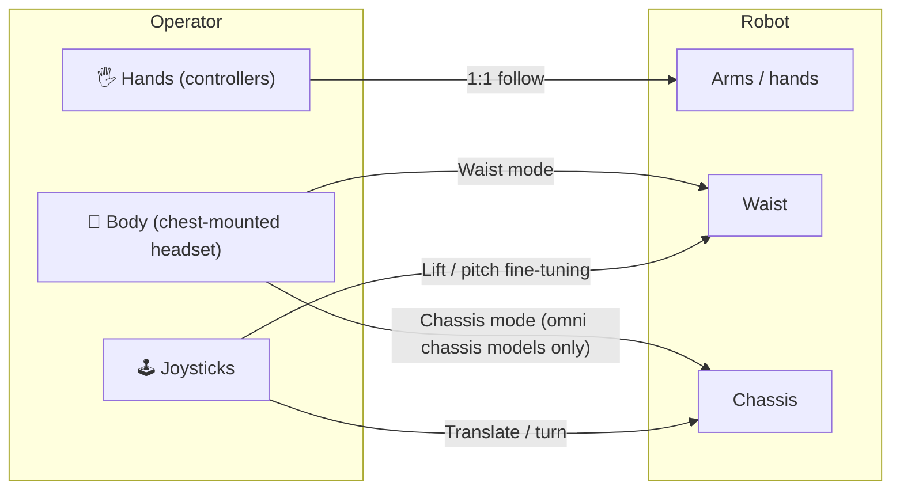
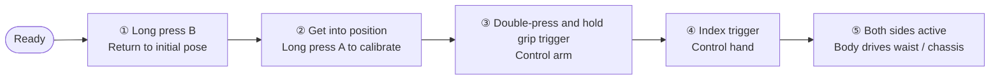
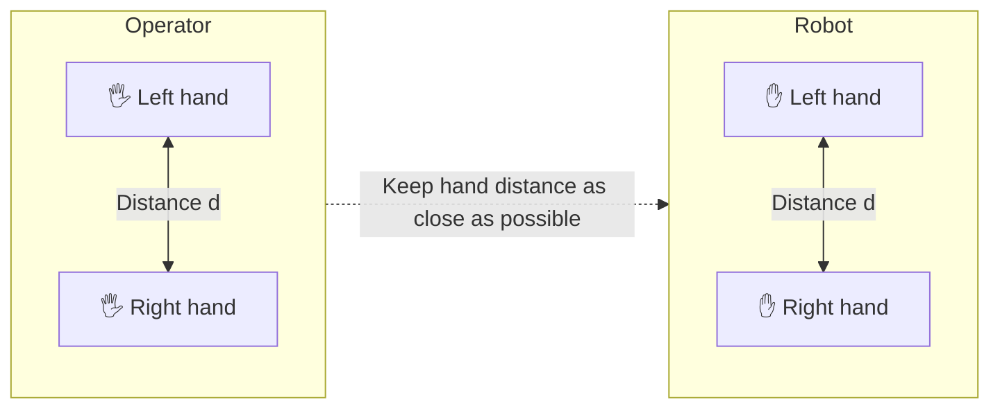
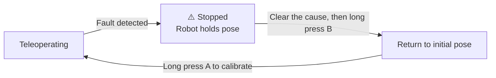

# Whole-body motion control: VR teleoperation quick start

[中文](vr_teleop_quickstart.zh-CN.md)

This chapter explains how to teleoperate the whole robot (both arms, both hands, waist, and chassis) with a VR headset and left and right controllers.

---

## 1. Control overview

The operator fixes the headset to their chest and holds one controller in each hand:

- **Hand motion** → the robot's arms and hands follow
- **Body motion** → drives the robot's waist or chassis
- **Joysticks** → directly drive the chassis and fine-tune the waist at any time

> 💡 The arms only follow your hand motion **relative to your body**. When you walk or turn, the robot's arm pose stays the same as long as your hands stay still relative to your body.

---

## 2. Controller layout

| Position | Left controller | Right controller |
|---|---|---|
| Upper button | **Y** | **B** |
| Lower button | **X** | **A** |
| Joystick | Left joystick | Right joystick |
| Index finger | Index trigger | Index trigger |
| Middle finger | Grip trigger | Grip trigger |

| Button | Action | Function |
|---|---|---|
| **B** | Long press | Robot returns to its initial pose (hands excluded) |
| **B** | Short press | Stop teleoperation; the robot holds in place, preventing accidental input |
| **A** | Long press | Calibrate and start teleoperation |
| **Y** | Long press | Switch body motion between driving the chassis and the waist (omni chassis models only) |
| **X** | Long press | Switch right joystick up/down between waist lift and pitch |
| **Grip trigger** (middle finger) | Double-press, then hold | Control the arm on the same side; release to stop it |
| **Index trigger** (index finger) | Press | Open and close the hand on the same side; the deeper you press, the tighter it grips |
| **Left joystick** | Push | Move the chassis forward/backward and left/right |
| **Right joystick** left/right | Push | Turn the chassis |
| **Right joystick** up/down | Push | Fine-tune waist lift or pitch |

> "Long press" means holding the button for about 1 s; "short press" means releasing it within 1 s.

---

## 3. Before you start

1. **Check the environment**: the robot is powered on and the motion control system is running; no people or obstacles are within the robot's or operator's range of movement, and the floor is flat.
2. **Headset settings** (in the headset's system settings):
   - **Turn off wear detection** (proximity sensor). Otherwise the headset goes to sleep when hanging on your chest and teleoperation is interrupted.
   - **Turn off the safety boundary**. Otherwise boundary warnings or passthrough view pop up when you walk or turn, and teleoperation is interrupted.
   - **Recenter** (long press the headset Home button) only after a short press of **B** has stopped teleoperation, or after both grip triggers are released. Recentering during teleoperation triggers safety protection and stops teleoperation automatically.
3. **Wear the headset**: fix the headset to the chest mount with the front cameras facing forward. Make sure it is secure and does not wobble.
4. **Connect**: open the teleoperation page, enter VR mode, and confirm that both controllers are connected and tracked.
5. **Position yourself**: stand **directly behind** the robot, facing the same direction, so that left/right and forward/backward match.
6. **Run only one teleoperation program at a time.** Do not run other teleoperation methods at the same time.

> ⚠️ With the safety boundary off, the headset no longer warns you about obstacles. Always operate in an open area with a dedicated spotter.

---

## 4. Start teleoperation

### ① Return to the initial pose

Long press **B**. The robot's torso, arms, and chassis return to the initial pose; wait until the robot is completely still. The hands are not part of the return; they stay under index trigger control during the return, so a held object is not dropped.

### ② Calibrate

1. Stand up straight, facing the robot's forward direction.
2. Hold both hands **directly in front of** your chest, **left hand on the left and right hand on the right, not crossed**.
3. Match the **distance between your hands and the orientation of your palms** to the robot's current arms as closely as possible.
4. Hold still and long press **A**. Teleoperation starts once calibration is complete.

> - Recalibrate every time after returning to the initial pose.
> - Calibration is rejected in the following cases; adjust and try again: you are not standing straight; your hands are not in front of your chest, are crossed, or are off to one side; the distance between your hands differs too much from the robot's.
> - A slightly tilted headset does not affect operation. If you are told the headset is tilted, straighten it and long press A again.

### ③ Control the arms

1. **Double-press** a grip trigger and **hold** it on the second press. The arm on that side starts following.
2. At first, **keep your hand still or move it slowly** and wait for the robot arm to catch up with your hand smoothly.
3. Once it has caught up, operate normally. The arm follows your hand's movement and rotation 1:1.
4. **Release the grip trigger and the arm stops immediately.**

> 💡 **Tip**: After releasing the grip trigger, you can reposition yourself or your hand, then reactivate. The arm smoothly catches up to the new position. Use this when you cannot reach or your posture is awkward.

> 💡 **Range limits**: If you reach too far, too close, too high, or too low, reach behind your body, or cross your hands, the robot arm stops at its range limit and stops following. Following resumes automatically once your hand moves back into range.

### ④ Control the hands

Press the **index trigger** and the hand on the same side closes according to how far you press; release to open it. This works without holding the grip trigger, and also after teleoperation stops and during the return to the initial pose.

### ⑤ Whole-body motion

Body motion drives the waist or chassis only while you **hold both grip triggers at the same time** (both arms following). See section 5.

---

## 5. Whole-body motion

### 5.1 Waist

On omni chassis models, long press **Y** first to switch to waist mode. Differential chassis models are always in waist mode.

| Your body motion | Omni chassis models (e.g. Trio) | Differential chassis models (e.g. Neo) |
|---|---|---|
| Lean forward / back | Waist pitches forward / back | Waist pitches forward / back |
| Squat / stand up | Waist lowers / rises | No response (use the right joystick) |
| Turn in place | Waist turns | No response |

### 5.2 Chassis

**Joystick control** (all models):

| Joystick | Omni chassis models | Differential chassis models |
|---|---|---|
| Left joystick forward/back | Move forward / backward | Move forward / backward |
| Left joystick left/right | Strafe left / right | No response |
| Right joystick left/right | Turn in place | Turn in place |

**Body drive** (omni chassis models only):

1. Long press **Y** to switch to chassis mode.
2. Hold both grip triggers at the same time.
3. Walk and turn. When you move forward, the robot moves forward; when you turn, the robot turns.

> - Joysticks take priority: pushing a joystick pauses body drive, which resumes automatically when you release it.
> - The chassis moves slightly slower than you. If it falls too far behind, the robot catches up at a limited speed and does not suddenly lunge.
> - While your body drives the chassis, the arms still follow only your hand motion relative to your body, so walking does not make them move unexpectedly.

### 5.3 Waist fine-tuning

If the robot's waist height or pitch differs from your body, compensate with the joystick:

- **Right joystick up/down**: fine-tunes waist **lift** by default. The arms rise and fall with the waist, keeping their height relative to the waist.
- Long press **X** to switch to fine-tuning waist **pitch**. This adjusts only the waist and does not affect the arm pose. Long press **X** again to switch back to lift.

> The angle of the chest-mounted headset varies with how it is worn. If the robot's torso always leans further forward or back than you, use pitch fine-tuning to align it.

Fine-tuning offsets are kept until the next return to the initial pose.

---

## 6. Pause and end teleoperation

**Temporary pause** (for example, to walk up to the robot or adjust the headset):

1. Release all triggers and confirm the robot is still.
2. Short press **B**. Teleoperation stops, and the joysticks and grip triggers no longer respond, preventing accidental input.
3. When you are done, long press **B** to return to the initial pose, then long press **A** to calibrate and continue teleoperation.

**End**:

1. Release all triggers and confirm the robot is still.
2. Long press **B**. The robot returns to the initial pose.
3. Exit VR mode and remove the headset from the mount.

---

## 7. Safety protection and recovery

The system **stops teleoperation automatically** when it detects any of the following during teleoperation:

| Category | Condition |
|---|---|
| Device | Headset tracking lost, VR exited, headset asleep, recentering during teleoperation |
| Motion | Moving too fast while an arm is catching up; sudden large jumps of the hands; controller too far from the body |
| Robot | Robot cannot keep up, motion limit reached, motion control reports a fault |

After an automatic stop, the robot holds its current pose and the chassis stops. **Only long press B and the index trigger (hands) work.**

**When a single controller is lost** (tracking lost, disconnected, or jumping data), only the arm on that side stops. The other arm and the joysticks still work, and body motion temporarily does not drive the waist or chassis. Once the controller recovers, double-press and hold the grip trigger on that side to regain control.

> ⚠️ In an emergency, press the **emergency stop button on the robot or the motion control system** immediately.

**Safety tips**

- Move slowly while an arm has just been activated and is catching up.
- Practice unfamiliar operations at low speed in an open area first.
- Have a dedicated spotter when the robot carries objects or is near people.

---

## 8. Troubleshooting

| Symptom | Possible cause | Solution |
|---|---|---|
| Long press A does nothing | Not in initial pose; controllers not tracked; not standing straight; hands not in front of chest, crossed, or off to one side; hand distance differs too much from the robot's | Long press B first; make sure the controllers are within tracking range; stand straight with hands in front of your chest and apart, adjust the distance, and try again |
| Headset reported as tilted during calibration | Headset mounted off-center, or hands not aligned front to back | Straighten the headset, align your hands front to back, then long press A again |
| Robot arm stops following when the hand reaches a certain point | Arm range limit reached | Move your hand back into range; following resumes automatically |
| Arm does not move while holding the grip trigger | Not double-pressed; not calibrated; arm is catching up | Double-press and hold; complete calibration; hold your hand still and wait |
| Robot does not respond when walking or squatting | Only one grip trigger held; wrong mode; joystick in use | Hold both grip triggers at the same time; long press Y to switch modes; release the joystick |
| Long press Y does nothing | Differential chassis models do not support body drive of the chassis | Use the joysticks to drive the chassis |
| Waist does not rise or lower when squatting | On differential chassis models, body motion only controls waist pitch | Use right joystick up/down to adjust lift |
| Waist is higher / lower or leans further forward / back than you | Offset during calibration | Fine-tune with right joystick up/down; long press X to switch to pitch fine-tuning |
| Teleoperation stops suddenly | Safety protection triggered | Clear the cause, then long press B and then A |
| One arm suddenly stops while the other works normally | That controller lost tracking or disconnected | Move the controller back into tracking range, then double-press and hold the grip trigger |
| Teleoperation stops after recentering | Home button pressed to recenter during teleoperation | Short press B before recentering; afterwards long press B and then A |
| Frequent interruptions with the headset on the chest | Wear detection / safety boundary not turned off; loose mount | Reconfigure the headset as described in section 3 and secure the mount |

---

## 9. Quick reference card

| I want to… | Action |
|---|---|
| Start teleoperation | Long press **B** → get into position → long press **A** |
| Control one arm | Double-press and hold the **grip trigger** on that side |
| Pause an arm | Release the **grip trigger** |
| Grasp / release | Press / release the **index trigger** |
| Drive the waist or chassis with my body | Hold both **grip triggers**, then move your body |
| Switch body drive between chassis and waist | Long press **Y** (omni chassis models only) |
| Move the chassis | **Left joystick** to move, **right joystick left/right** to turn |
| Fine-tune the waist | **Right joystick up/down**; long press **X** to switch between lift and pitch |
| Pause (prevent accidental input) | Short press **B** |
| End / recover | Long press **B** (long press **A** afterwards to recover) |
