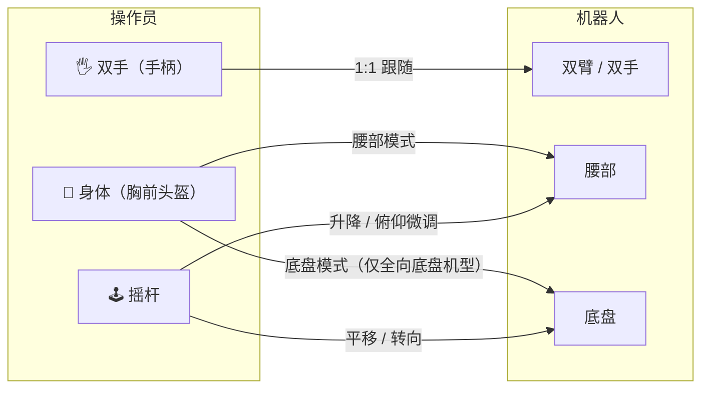
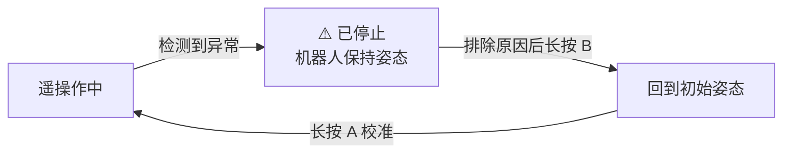

# 全身运动控制 —— VR 遥操作快速上手指南

[English](vr_teleop_quickstart.md)

本章介绍如何使用 VR 头盔与左右手柄遥操作机器人全身（双臂、双手、腰部、底盘）。

---

## 1. 控制方式概览

操作员将头盔固定在胸前，双手各持一个手柄：

- **双手动作** → 机器人双臂与双手跟随
- **身体动作** → 带动机器人腰部或底盘
- **摇杆** → 随时直接控制底盘移动、微调腰部

> 💡 双臂只跟随你双手**相对身体**的动作。当你走动或转身时，只要双手相对身体不变，机器人双臂姿态就保持不变。

---

## 2. 认识手柄

| 位置 | 左手柄 | 右手柄 |
|---|---|---|
| 上方按键 | **Y** | **B** |
| 下方按键 | **X** | **A** |
| 摇杆 | 左摇杆 | 右摇杆 |
| 食指 | 主扳机 | 主扳机 |
| 中指 | 侧扳机 | 侧扳机 |

| 按键 | 操作 | 功能 |
|---|---|---|
| **B** | 长按 | 机器人回到初始姿态（不含机械手） |
| **B** | 短按 | 停止遥操作，机器人原地保持，防止误触 |
| **A** | 长按 | 校准并开始遥操作 |
| **Y** | 长按 | 切换身体带动「底盘 / 腰部」（仅全向底盘机型） |
| **X** | 长按 | 切换右摇杆上下调节腰部「升降 / 俯仰」 |
| **侧扳机**（中指） | 双击后按住 | 控制同侧手臂；松开即停住 |
| **主扳机**（食指） | 按压 | 控制同侧机械手开合，按得越深握得越紧 |
| **左摇杆** | 推动 | 底盘前后 / 左右移动 |
| **右摇杆** 左右 | 推动 | 底盘转向 |
| **右摇杆** 上下 | 推动 | 微调腰部升降或俯仰 |

> “长按”指按住约 1 秒；“短按”指按下后 1 秒内松开。

---

## 3. 操作前准备

1. **环境检查**：机器人已上电、运控系统已启动；机器人与操作员活动范围内无人员和障碍物，地面平整。
2. **头盔设置**（在头盔系统设置中）：
   - **关闭佩戴检测**（距离传感器）—— 否则头盔挂在胸前会自动休眠，导致遥操作中断。
   - **关闭安全边界** —— 否则走动或转身时会弹出边界提示或切换透视画面，导致遥操作中断。
   - **重新居中**（长按头盔 Home 键）只能在短按 **B** 停止遥操作后，或松开两侧侧扳机后进行。遥操作中重新居中会触发安全保护并自动停止。
3. **佩戴头盔**：将头盔固定在胸前挂架上，前摄像头朝前，确保牢固不晃动。
4. **连接**：打开遥操作页面，进入 VR 模式，确认两个手柄均已连接且被正常追踪。
5. **站位**：站在机器人**正后方**，与机器人朝向一致，便于左右、前后对应。
6. **同一时间只运行一个遥操作程序**，不要同时开启其他遥操作方式。

> ⚠️ 关闭安全边界后头盔不再提醒障碍物，请务必在空旷区域操作，并安排专人看护。

---

## 4. 开始遥操作

### ① 回到初始姿态

长按 **B**，机器人躯干、双臂和底盘回到初始姿态，等待完全停稳。机械手不参与回初始姿态，回初始姿态过程中仍由主扳机控制，抓着的物体不会松开。

### ② 校准

1. 站直，身体正对机器人前方。
2. 双手放在胸前**正前方**，**左手在左、右手在右，不要交叉**。
3. 两手间距不必与机器人一致：机器人双臂会对齐到两手柄的相对位置，间距不同时只给出提示，激活后双臂平滑追赶到手柄间距。手掌朝向也不必对齐，长按 A 时的朝向即对应机器人当时的手部朝向。
4. 保持不动，长按 **A**，校准完成后即开始遥操作。

> - 每次回到初始姿态后都需要重新校准。
> - 以下情况校准会被拒绝，请调整后重试：没有站直；双手不在胸前、交叉或偏向一侧。
> - 头盔挂得略歪不影响操作；若提示头盔挂歪，请重新挂正后再长按 A。

### ③ 控制手臂

1. **双击**某侧侧扳机，第二下**按住不放**，该侧手臂开始跟随。
2. 刚开始请**保持手不动或缓慢移动**，等待机器人手臂平稳追上你的手。
3. 追上后即可正常操作，手臂 1:1 跟随你手的移动和转动。
4. **松开侧扳机，手臂立即停住。**

> 💡 **小技巧**：松开侧扳机后可调整站位或手的位置，再重新激活，手臂会平滑追赶到新位置。适用于够不到或姿势别扭时。

> 💡 **激活边界**：按住侧扳机激活时，如果手离双臂初始位置太远（超出以其为中心的一个方块），机器人手臂先停在方块边界上；手回到方块内一次后就自由跟随，之后再伸出也不受限。松开侧扳机再激活会重新从边界开始。双手可以过中线。

### ④ 控制机械手

按压**主扳机**，同侧机械手随按压程度闭合，松开则张开。无需按住侧扳机也可使用；遥操作停止后、回初始姿态过程中也都可以控制。

### ⑤ 全身运动

**同时按住两侧侧扳机**（双臂都在跟随）时，身体动作才会带动腰部或底盘，见第 5 节。

---

## 5. 全身运动

### 5.1 腰部

全向底盘机型需先长按 **Y** 切换到腰部模式；差速底盘机型固定为腰部模式。

| 你的身体动作 | 全向底盘机型（如 trio） | 差速底盘机型（如 neo） |
|---|---|---|
| 身体前倾 / 后仰 | 腰部前俯 / 后仰 | 腰部前俯 / 后仰 |
| 身体前移 / 后移 | 腰部前移 / 后移 | 不响应 |
| 下蹲 / 起身 | 腰部降低 / 升高 | 不响应（请用右摇杆调节） |
| 原地转身 | 腰部转向 | 不响应 |

### 5.2 底盘

**摇杆控制**（所有机型；回 Home 后、长按 A 之前也能用摇杆移动底盘，这时腰部微调不生效）：

| 摇杆 | 全向底盘机型 | 差速底盘机型 |
|---|---|---|
| 左摇杆 前后 | 前进 / 后退 | 前进 / 后退 |
| 左摇杆 左右 | 左右平移 | 不响应 |
| 右摇杆 左右 | 原地转向 | 原地转向 |

**身体带动**（仅全向底盘机型）：

1. 长按 **Y** 切换到底盘模式。
2. 同时按住两侧侧扳机。
3. 走动、转身 —— 你前进机器人就前进，你转身机器人就转向。下蹲 / 起身、前倾 / 后仰仍带动腰部升降和俯仰。

> - 摇杆优先：推动摇杆时身体带动暂停，松开后自动恢复。
> - 底盘的实际移动会比你稍慢；落后过多时机器人以有限的速度追赶，不会突然猛冲。
> - 身体带动底盘时，双臂仍只跟随你双手相对身体的动作，不会因走动而乱动。

### 5.3 腰部微调

若机器人腰部高度或俯仰与你的身体有偏差，可用摇杆补偿：

- **右摇杆上下**：默认微调腰部**升降**，双臂随腰一起升降，手臂相对腰的高度不变；
- 长按 **X** 切换为微调腰部**俯仰**，只调整腰部，双臂姿态不受影响，再次长按 **X** 切回升降。

> 头盔挂在胸前的角度因佩戴方式而异，若机器人躯干总比你前倾或后仰，用俯仰微调对齐即可。

微调量会一直保留，直到下次回到初始姿态。

---

## 6. 暂停与结束遥操作

**临时暂停**（如需走近机器人查看、调整头盔）：

1. 松开所有扳机，确认机器人已停稳。
2. 短按 **B**，遥操作停止，摇杆和侧扳机不再生效，避免误触。
3. 调整完成后，长按 **B** 回到初始姿态，再长按 **A** 校准，继续遥操作。

**结束**：

1. 松开所有扳机，确认机器人已停稳。
2. 长按 **B**，机器人回到初始姿态。
3. 退出 VR 模式，从挂架取下头盔。

---

## 7. 安全保护与恢复

遥操作中检测到以下情况时，系统会**自动停止遥操作**：

| 类别 | 情况 |
|---|---|
| 设备 | 遥操作中重新居中 |
| 动作 | 双手突然大幅跳动；手柄离身体过远 |
| 机器人 | 机器人无法跟上、到达运动极限、运控报告故障 |

自动停止后：机器人保持当前姿态，底盘停止，**仅长按 B 和主扳机（机械手）有效**。

**单个手柄丢失**（追踪丢失、断开或数据跳动）时，只停住该侧手臂，另一侧手臂和摇杆仍可使用，身体暂不带动腰部 / 底盘。手柄恢复后，双击该侧侧扳机并按住即可重新控制。

**头盔数据中断超过 0.5 s**（追踪丢失、退出 VR、头盔休眠、网络卡顿）时，两侧手臂都停住，不会自动停止遥操作；摇杆仍可用。头盔恢复后，分别双击并按住两侧侧扳机即可重新控制。

**手臂追赶期间动作过快或追赶超时**时，只停住该侧手臂（停在当前位置），其他部分照常。松开该侧侧扳机，再双击并按住即可重新追赶，不需要按 B / A。

> ⚠️ 遇到紧急情况，请立即按下**机器人本体或运控系统的急停按钮**。

**安全建议**

- 手臂刚激活、正在追赶时，动作务必放慢。
- 不熟悉的操作先在低速、空旷环境下练习。
- 机器人搬运物体或靠近人员时，需专人看护。

---

## 8. 常见问题

| 现象 | 可能原因 | 处理方法 |
|---|---|---|
| 长按 A 无反应 | 未回到初始姿态；手柄未被追踪；没有站直；双手不在胸前、交叉或偏向一侧 | 先长按 B；确认手柄在追踪范围内；站直，双手放在胸前正前方、左右分开后重试 |
| 校准时提示头盔挂歪 | 头盔挂偏，或两手前后没有对齐 | 重新挂正头盔，两手前后对齐后再长按 A |
| 激活后机器人手臂停在某处不跟随 | 激活时手在激活边界外 | 将手移回双臂初始位置附近，之后自由跟随 |
| 按住侧扳机手臂不动 | 未双击；未校准；手臂正在追赶 | 双击后按住；完成校准；保持手不动等待 |
| 走动或下蹲时机器人无反应 | 只按住一侧侧扳机；模式不对；摇杆正在使用 | 同时按住两侧侧扳机；长按 Y 切换模式；松开摇杆 |
| 长按 Y 无反应 | 差速底盘机型不支持身体带动底盘 | 使用摇杆控制底盘 |
| 下蹲时腰部不升降 | 差速底盘机型身体动作只控制腰部俯仰 | 用右摇杆上下调节升降 |
| 腰部比人高 / 低、前倾 / 后仰 | 校准时存在偏差 | 右摇杆上下微调；长按 X 切换微调俯仰 |
| 遥操作突然停止 | 触发了安全保护 | 排除原因后依次长按 B、A |
| 一侧手臂突然停住，另一侧正常 | 该侧手柄追踪丢失或断开 | 将手柄移回追踪范围，双击侧扳机并按住 |
| 重新居中后遥操作停止 | 遥操作中按了 Home 键重新居中 | 先短按 B 再重新居中；之后依次长按 B、A |
| 头盔挂胸前时经常中断 | 未关闭佩戴检测 / 安全边界；挂架松动 | 按第 3 节重新设置头盔并固定挂架 |

---

## 9. 速查卡

| 我想… | 操作 |
|---|---|
| 开始遥操作 | 长按 **B** → 摆好姿势 → 长按 **A** |
| 控制一侧手臂 | 双击该侧**侧扳机**并按住 |
| 暂停手臂 | 松开**侧扳机** |
| 抓取 / 松开 | 按压 / 松开**主扳机** |
| 用身体带动腰部或底盘 | 同时按住两侧**侧扳机**后移动身体 |
| 切换带动底盘 / 腰部 | 长按 **Y**（仅全向底盘机型） |
| 移动底盘 | **左摇杆**移动，**右摇杆左右**转向 |
| 微调腰部 | **右摇杆上下**；长按 **X** 切换升降 / 俯仰 |
| 暂停（防误触） | 短按 **B** |
| 结束 / 恢复 | 长按 **B**（恢复时再长按 **A**） |
